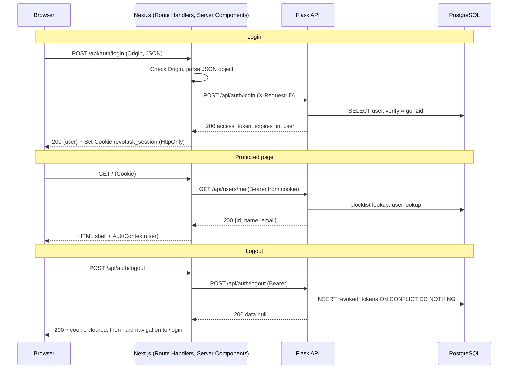

# Design · authentication (T03–T04)

**Status:** Implemented and verified locally. Where the build differed from this design, the design now says so (DD11, §4.4 email rule, §6.5 cookie, §6.6 redirect helpers, §6.1 `retry()`, and the "Added during implementation" note in §3). This design refines root `specs/design.md` D2, D5 and D6. The contract and ownership changes it depends on were applied to the shared documents in the spec round (§10).

**Requirements:** `requirements.md` in this folder (AUTH-R1 to AUTH-R12, decisions P1–P10, assumptions A1–A15).
**Guidelines applied:** BE01–BE08, DB04, FE-C1, FE-C2, FE-C3, FE-C4, FE-N1–N9, FE-S1–S3, FE-A1, FE-A2, FE-A4.

## 1. Overview



The browser talks only to the Next origin. Flask never sees a browser `Origin` and needs no CORS. The token exists in three places only: Flask's login response, the Next process memory while it forwards the request, and the HttpOnly cookie.

## 2. Key design decisions

| #    | Decision                                                                                                                                                                                                                                                                                           | Alternatives considered                                                                                                                                                                                        | Consequence                                                                                                                                                                                        |
| ---- | -------------------------------------------------------------------------------------------------------------------------------------------------------------------------------------------------------------------------------------------------------------------------------------------------- | -------------------------------------------------------------------------------------------------------------------------------------------------------------------------------------------------------------- | -------------------------------------------------------------------------------------------------------------------------------------------------------------------------------------------------- |
| DD1  | **`@token_required` is a project decorator** around `verify_jwt_in_request()` that also loads the user into `g`. Services take `user` as an argument. `backend/specs/architecture.md` allows either the decorator or the library decorator "consistently and record that choice". This records it. | The library's `@jwt_required()` alone: less code, but each route would load the user itself and the 401 body would depend on per-route handling.                                                               | One import for T05–T14 routes. The user row is read once per request, which doubles as the "subject still exists" check (A5).                                                                      |
| DD2  | **All JWT failures map to one `AUTH_REQUIRED` response** by overriding every Flask-JWT-Extended error callback.                                                                                                                                                                                    | Keep the library defaults: invalid tokens return 422 with `{"msg": ...}`, which breaks `backend/specs/api-contract.md` ("one JSON envelope for JWT errors") and the frontend matrix (401 means sign in again). | Five callbacks to register and test. The client never learns which check failed.                                                                                                                   |
| DD3  | **Register relies on the database unique constraint**, with no pre-check `SELECT`. The service hashes first, inserts, and translates a `23505` violation of `uq_users_email` into 409.                                                                                                             | Check-then-insert: it adds a query and still needs the constraint handler for races, so it would have two paths.                                                                                               | One path serves sequential and concurrent duplicates. Any other `IntegrityError` re-raises and becomes 500. The constraint name `uq_users_email` is in migration `a265fb5e7047`.                   |
| DD4  | **Revocation is `INSERT ... ON CONFLICT (jti) DO NOTHING`.**                                                                                                                                                                                                                                       | Plain insert with `IntegrityError` handling: a double logout racing past the guard would hit the error path.                                                                                                   | A repeated revoke is a no-op, which is the idempotence AUTH-AC4.4 needs.                                                                                                                           |
| DD5  | **Login hashes against a dummy value when the email is unknown.** The dummy hash is created once, lazily, with the same hasher.                                                                                                                                                                    | Return immediately: the response time would reveal registered emails.                                                                                                                                          | One extra hash on unknown-email attempts. Register still reveals duplicates through 409, as the contract requires, so the rate limits (P2) back this up.                                           |
| DD6 | **No `proxy.ts`. A cached `getCurrentUser()` is the access check** and every protected page calls it. Next's authentication guide warns that a layout does not re-render on navigation, so the layout loads the user for the shell but each page calls the same function too. | A proxy redirect: earlier exit, but proxy checks are optimistic (cookie presence) and would add a second access decision (P8). | In T04 only `/` exists, so the page and layout both call `getCurrentUser()`, and React `cache()` makes it one upstream call per render. Later pages and data helpers go through `fetchPrivate()` in `lib/server/session.ts`, which attaches the bearer and redirects on 401 in one place. A repository test fails when a page under `(protected)` skips the session helper (AUTH-AC11.9). |
| DD7  | **Login and logout navigate with `window.location.replace`, not `router.push`.**                                                                                                                                                                                                                   | `router.push` plus `router.refresh()`: smoother, but the client Router Cache can keep a prefetched redirect for `/` from before login, or a private payload after logout.                                      | A full reload after each session change. It clears client state and the Router Cache, which AUTH-AC11.5 needs. The navigation call is wrapped in `lib/navigation.ts` so tests can replace it.      |
| DD8 | **Both Next and Flask enforce size, content type and key-set limits.** Next rejects a wrong content type (415), an oversized body (413), a non-object body and a wrong key set (400) before forwarding. Flask also rejects unknown fields and out-of-range values. | Trust the BFF only: Flask is also reachable directly with a bearer token (D1), so it must validate on its own. | Some duplication, limited to the request envelope and the key set. Field value rules live in Flask and `authRules.ts` (DD9). |
| DD9 | **Forms validate with the same rules as the API, use `noValidate`, and still show server errors.** One rule table (§4.4), one file of boundary cases, implemented in Python and TypeScript. | (a) Server-only validation: one implementation, but every mistake costs a round trip. (b) Native browser validation: its limits count UTF-16 units and its bubbles hide our messages. (c) Generate one validator from a shared schema: no drift, but it needs a code-generation step that this slice does not otherwise need. | Two implementations kept in step by one shared test file. Flask stays authoritative. |
| DD10 | **Server-only code lives under `lib/server/` and imports `server-only`.** Shared types and `ApiError` live in `lib/` without it.                                                                                                                                                                   | Mark by naming only: a client import would compile and bundle the module.                                                                                                                                      | `next build` fails if a client module imports a server module. Task 2.10 proves it with a negative control. Vitest mocks the package in its setup file.                                            |
| DD11 | **Rate limiting uses Flask-Limiter with `memory://` and one Gunicorn worker locally (Compose).** Counters are per worker, so one worker keeps the limits exact (F-AUTH-11, revision 4). The email key function reads the body with `get_json(silent=True)`, is skipped (`exempt_when`) when the body has no usable email, and the address limit still applies. `limiter.init_app` runs after `register_request_context`. | A shared store now (Redis or a table): more infrastructure than a local slice needs. Tracked for T16 (P2). | In Flask-Limiter 4.1.1 a decorator limit is checked in the view wrapper, after every `before_request` hook, so the order is not required today. A negative control that put the limiter first still gave the 429 a request ID. The order is kept because app-wide default limits do run in `before_request`, and a test asserts the 429 has a non-empty `request_id`. In-memory counters prove local behavior only. |
| DD12 | **`APP_ORIGIN` decides the cookie's `Secure` flag and must be https or an explicit loopback http origin.** | `NODE_ENV` decides: it breaks production-mode runs on `http://localhost` and does not say whether the site is deployed. A separate `ALLOW_INSECURE_COOKIES` switch: one more way to misconfigure. | There is no default, so plain http is always a conscious setting. Any non-loopback http value fails closed. |
| DD13 | **Cookie `Max-Age` is `min(expires_in, seconds until the token's exp)`.** The handler reads `exp` from the token payload without verifying it. | `Max-Age = expires_in`: simple, but the cookie can outlive the token by the response latency. Verify the JWT in Next: needs the signing secret in the Next process, which D1 keeps in Flask. | A small base64 parse in the login handler. Flask has already verified the token, and a bad payload makes the handler fail closed. |
| DD14 | **413 and 415 are distinct statuses with their own codes, enforced in the Next auth handlers and in Flask.** | Map both to 400: no contract change, but the client cannot tell a defect from a user mistake. Enforce only in Flask: the browser-facing handler would forward oversized bodies. | Two contract rows added (`docs/API.md`, `backend/specs/api-contract.md`). The handler cap equals Flask's. |
| DD15 | **The password policy is 8 to 128 characters with an uppercase letter, a lowercase letter and an ASCII special character, enforced at register only.** Login accepts any password of 1 to 128 characters. | (a) Keep 12 characters: rejected by the owner as too long. (b) Apply the composition rule at login: a stored account created under an earlier policy, or a typo, would get a policy message instead of a plain 401, and a future policy change would lock people out. (c) Count any Unicode symbol as special: the rule would depend on the font and the keyboard. | Both layers use the same ASCII ranges and the shared case file (§4.4). A space is not special. No common-password list is checked, and a deliberate follow-up can add one. |

## 3. Planned repository layout

The monorepo was inspected before planning. Neither `backend/` nor `frontend/` has a `src/` directory. The frontend keeps `app/` at its root and the `@/*` alias maps to `./*`, so new frontend folders sit beside `app/`. Backend tests are flat in `backend/tests/`, and models and migrations stay where they are. Files marked *changed* exist today. Everything else is new.

```text
backend/
  requirements.txt                      # changed: argon2-cffi, marshmallow, Flask-Limiter
  .env.example                          # changed: RATE_LIMIT_ENABLED (optional, default true)
  app/
    __init__.py                         # changed: create_app() stays here; registers blueprints, JWT handlers, limiter, headers
    config.py, extensions.py            # changed: auth constants, Settings.rate_limit_enabled, limiter
    exceptions.py, errors.py            # changed: ApiError.headers, auth errors, 413/415/429 mapping
    request_context.py                  # changed: actor_id in the log line
    validation.py                       # load_json_body(), schema errors to fields
    auth_guard.py                       # token_required, JWT callbacks, blocklist loader
    response_headers.py                 # Cache-Control: private, no-store
    blueprints/
      health/                           # existing, unchanged
      auth/{__init__,routes,service,schema}.py     # auth_bp: E02, E03, E04. Hashing lives in service.py
      users/{__init__,routes,schema}.py            # users_bp: E30 read. PublicUserSchema lives here
    models/                             # existing, unchanged (users, revoked_tokens)
  migrations/                           # existing, unchanged (no new revision)
  tests/                                # existing location
    conftest.py, probe_routes.py, test_errors.py, test_request_context.py   # changed
    test_validation.py, test_auth_schema.py, test_auth_passwords.py
    test_auth_register.py, test_auth_login.py, test_auth_guard.py, test_auth_logout.py
    test_users_me.py, test_rate_limit.py, test_response_headers.py
frontend/
  package.json, package-lock.json       # changed: react-hot-toast, server-only, user-event (dev)
  vitest.config.mts, vitest.setup.ts    # changed: include globs, server-only mock
  app/
    layout.tsx                          # changed: mounts ToasterHost
    error.tsx                           # route error boundary
    (public)/layout.tsx                 # public pages: /login, /register
    (public)/login/page.tsx             # LoginPage
    (public)/register/page.tsx          # RegisterPage
    (protected)/layout.tsx              # ProtectedLayout: the shell, not the authorization boundary
    (protected)/page.tsx                # git mv from app/page.tsx, HomePage
    (protected)/page.test.tsx           # git mv from app/page.test.tsx, updated
    api/auth/register/route.ts          # POST handlers, each with a route.test.ts beside it
    api/auth/login/route.ts
    api/auth/logout/route.ts
  components/
    auth/{AuthContext,LoginForm,RegisterForm,LogoutButton,SessionRevalidator}.tsx
    shared/{AppHeader,BaseButton,FormField,ToasterHost}.tsx
  hooks/{useAuth,useErrorHandler}.ts
  lib/
    types.ts, errors.ts, authRules.ts, apiClient.ts, toast.ts, navigation.ts, safeRedirect.ts
    server/{env,flask,sessionCookie,session,origin,bff}.ts       # imports "server-only"
specs/fixtures/auth-field-cases.json    # one boundary-case list read by both test suites (C9)
evidence/authentication-T03-T04.md      # sanitized commands and outcomes
```

Component tests, module tests and handler tests sit beside the code they cover (FE-N9). `app/page.tsx` and `app/page.test.tsx` moved with `git mv` so history stays attached.

**Added during implementation** (not in the tree above): `frontend/lib/server/testSupport.ts` (test helpers), `frontend/lib/mobileGuard.test.ts`, `frontend/app/(protected)/pages.guard.test.ts`, `frontend/app/(public)/public.guard.test.ts` (AUTH-AC10.5), `frontend/app/(public)/pages.test.tsx`, `backend/tests/auth_cases.py` and `auth_helpers.py` (test helpers), and in `evidence/`: `authentication-http-smoke.py`, `authentication-mobile-measure.mjs` and the two sanitized result files. `backend/tests/conftest.py` changed so `schema_at_head` checks the Alembic version for every test, because the foundation migration tests rebuild the schema. `frontend/vitest.config.mts` and `vitest.setup.ts` gained an `@` alias, a `matchMedia` stub and a React Testing Library cleanup hook.

## 4. Backend design

### 4.1 Configuration additions (`config.py`, `app/__init__.py`)

Named constants, as foundation does for its timeouts:

| Constant                                                | Value             | Use                                         |
| ------------------------------------------------------- | ----------------- | ------------------------------------------- |
| `ACCESS_TOKEN_TTL_SECONDS`                              | 3600              | `JWT_ACCESS_TOKEN_EXPIRES` and `expires_in` |
| `MAX_REQUEST_BODY_BYTES`                                | 65 536            | `MAX_CONTENT_LENGTH` (A6)                   |
| `REGISTER_RATE_LIMIT`                                   | `"5 per minute"`  | E02 per address                             |
| `LOGIN_ADDRESS_RATE_LIMIT`                              | `"20 per minute"` | E03 per address                             |
| `LOGIN_EMAIL_RATE_LIMIT`                                | `"5 per minute"`  | E03 per normalized email                    |
| `NAME_MAX`, `EMAIL_MAX`, `PASSWORD_MIN`, `PASSWORD_MAX` | 80, 254, 8, 128  | Schemas                                     |

`Settings` gains `rate_limit_enabled: bool`, read from optional `RATE_LIMIT_ENABLED` (`true` or `false`, default `true`, anything else is a `ConfigError` naming the variable). In production `false` is also a `ConfigError` (AUTH-AC6.4). `create_app` sets:

```python
JWT_ACCESS_TOKEN_EXPIRES=timedelta(seconds=ACCESS_TOKEN_TTL_SECONDS),
JWT_TOKEN_LOCATION=["headers"],   # Flask never reads a cookie for the token
JWT_ALGORITHM="HS256",
MAX_CONTENT_LENGTH=MAX_REQUEST_BODY_BYTES,
RATELIMIT_ENABLED=settings.rate_limit_enabled,
RATELIMIT_STORAGE_URI="memory://",
RATELIMIT_HEADERS_ENABLED=True,
```

Registration order in `create_app`: `db`, `migrate`, `jwt`, JWT callbacks, request context, error handlers, response headers, `limiter.init_app`, blueprints (DD11).

### 4.2 Errors (`exceptions.py`, `errors.py`)

`ApiError` gains `headers: dict[str, str] | None = None`, and `handle_api_error` passes it to `error_response`. New classes follow foundation's pattern:

| Class | Status | Code | Message (fixed) |
|---|---|---|---|
| `RequestValidationError` | 400 | `VALIDATION_ERROR` | `Check the submitted fields.` With `fields` when field-level. A body-level failure uses `The request body must be a JSON object.` |
| `InvalidCredentialsError` | 401 | `INVALID_CREDENTIALS` | `Invalid email or password.` |
| `AuthRequiredError` | 401 | `AUTH_REQUIRED` | `Authentication is required.` |
| `EmailAlreadyExistsError` | 409 | `EMAIL_ALREADY_EXISTS` | `An account with this email already exists.` |
| `ContentTooLargeError` | 413 | `CONTENT_TOO_LARGE` | `The request body is too large.` |
| `UnsupportedMediaTypeError` | 415 | `UNSUPPORTED_MEDIA_TYPE` | `The request must use Content-Type application/json.` |
| `RateLimitedError` | 429 | `RATE_LIMITED` | `Too many requests. Try again later.` `headers` holds `Retry-After`. |

`handle_http_exception` changes (P3, task 1.2). Check these classes before the generic fallback:

- `BadRequest` becomes `RequestValidationError` (400, no `fields`). This includes malformed JSON and a bare `abort(400)`.
- `UnsupportedMediaType` becomes `UnsupportedMediaTypeError` (415).
- `RequestEntityTooLarge` becomes `ContentTooLargeError` (413).
- `TooManyRequests` (Flask-Limiter's `RateLimitExceeded` subclasses it) becomes the 429 envelope. `Retry-After` is copied from the exception's headers when present. Task 1.10 verifies where Flask-Limiter supplies it and falls back to the limit's reset time.
- Everything else keeps the current behavior (AUTH-AC7.4).

### 4.3 Request parsing and validation (`validation.py`, BE03)

```python
def load_json_body(schema: Schema) -> dict:
    payload = request.get_json(silent=False)   # 415 wrong Content-Type, 413 over the cap, 400 malformed
    if not isinstance(payload, dict):
        raise RequestValidationError(BODY_MESSAGE)
    try:
        return schema.load(payload)            # unknown=RAISE
    except MarshmallowValidationError as exc:
        raise RequestValidationError(fields=first_messages(exc.messages)) from None
```

Flask's `get_json` checks the content type before it reads the body, so a wrong content type returns 415 even when the body is also too large. A JSON content type with an oversized body returns 413 before any field validation (AUTH-AC7.5). `first_messages` keeps one string per field and drops anything that is not a field message. Marshmallow's own messages are replaced by the fixed strings in §4.4 through `error_messages` and validator `error=` arguments, so no message includes the input. A test asserts that sentinel passwords and emails never appear in any `fields` value. Marshmallow 4 details (field subclass hooks, `unknown`, message structure) are confirmed against the installed version in task 1.5.

### 4.4 Auth field rules and schemas (`blueprints/auth/schema.py`, `users/schema.py`, `frontend/lib/authRules.ts`)

One rule table serves the API schemas and the UI rules module (AUTH-AC10.7). Lengths count Unicode code points (A1, A13). A rule that fails produces the fixed message in the last column, and the message never contains the input.

| Form | Field | Normalization | Rules | Messages |
|---|---|---|---|---|
| Register | `name` | trim | required string, 1–80 | `Required.` · `Must be text.` · `Must be 1 to 80 characters.` |
| Register | `email` | trim, lowercase | required string, valid address, at most 254 | `Required.` · `Must be text.` · `Enter a valid email address.` · `Must be at most 254 characters.` |
| Register | `password` | none | required string, 8–128, then at least one ASCII uppercase letter, one lowercase letter and one ASCII special character | `Required.` · `Must be text.` · `Must be 8 to 128 characters.` · `Must include an uppercase letter, a lowercase letter and a special character.` (the first failing message is reported) |
| Login | `email` | trim, lowercase | required string, at most 254, no format check | `Required.` · `Must be text.` · `Must be at most 254 characters.` |
| Login | `password` | none | required string, 1–128 | `Required.` · `Must be text.` · `Must be 1 to 128 characters.` |

- Register accepts exactly `name`, `email`, `password`. Login accepts exactly `email`, `password`. Any other key is `Unknown field.` (Flask: `unknown=RAISE`. Next: key-set check. UI: the form has no other field.)
- Email format is one regular expression written the same way on both sides: `[^\s@]+@[^\s@]+\.[^\s@]+`, matched against the whole normalized value (Python `re.fullmatch`, TypeScript anchored `test`). It replaced the earlier plan to use Marshmallow's `Email` validator as the reference, so there is no second definition of "valid" to drift. Checks run in a fixed order and the first failing message is reported: required and type, then length, then format. On login an empty or whitespace-only email is `Required.`, and there is no format check.
- `normalize_email()` (Python) and `normalizeEmail()` (TypeScript) are the only places that trim and lowercase an email. Python also uses it for the limiter key.
- Password composition (register only): at least one `[A-Z]`, one `[a-z]` and one special character from the ASCII punctuation ranges `0x21-0x2F`, `0x3A-0x40`, `0x5B-0x60` and `0x7B-0x7E`. A space is not special, and accented letters and emoji do not count. The same ranges are written in Python and TypeScript. The length rule runs first, so a short password reports only the length message. Login has no composition rule (AUTH-AC2.4).
- `PublicUserSchema` (dump only) is an explicit allowlist: `id`, `name`, `email`. Unknown attributes, `password_hash` and timestamps never serialize.

**Shared boundary cases.** `specs/fixtures/auth-field-cases.json` lists inputs and expected outcomes (accepted with the normalized value, or the exact `fields` map). A value may be written `{"repeat": "a", "times": 81}` to avoid 128-character literals. The Flask schema tests and the `authRules.ts` tests both load this file, so a drift between the two fails a test. Minimum content:

| Field | Cases |
|---|---|
| `name` | `""`, `"   "`, 1 character, 80 characters, 81 characters, internal spaces kept, padded value trimmed, emoji counted as one character, a number, `null`, missing |
| `email` | padded and mixed case (`"  A@B.Co "` becomes `a@b.co`), 254 and 255 characters, no `@`, two `@`, no domain dot, whitespace inside, a number, missing |
| `password` | empty, 7, 8, 128 and 129 characters; `Aa1!aaaa` accepted; `Aa1!` plus 124 emoji (128 characters) accepted; 8 spaces, no uppercase, no lowercase, no special character, an accented letter or an emoji as the only symbol, each rejected with the composition message; leading and trailing spaces kept; a number, null, missing |
| Key sets | extra key on each form, missing key on each form, `{}` |

### 4.5 Passwords (in `blueprints/auth/service.py`)

```python
_hasher = PasswordHasher()                         # argon2-cffi defaults: Argon2id (A3)

def hash_password(plain: str) -> str: return _hasher.hash(plain)

def verify_password(stored_hash: str, plain: str) -> bool:
    try: return _hasher.verify(stored_hash, plain)
    except (VerifyMismatchError, VerificationError, InvalidHashError): return False

@functools.cache
def _dummy_hash() -> str: return _hasher.hash(secrets.token_urlsafe(16))

def verify_dummy(plain: str) -> None: verify_password(_dummy_hash(), plain)
```

The module never logs or raises with the password. Task 1.5 records the hasher parameters and the measured hash time in the evidence file.

### 4.6 Auth service (`blueprints/auth/service.py`, BE02, BE06)

```python
def register_user(*, name, email, password) -> User:
    user = User(name=name, email=email, password_hash=hash_password(password))
    db.session.add(user)
    try:
        db.session.commit()
    except IntegrityError as exc:
        db.session.rollback()
        if is_unique_violation(exc, "uq_users_email"):
            raise EmailAlreadyExistsError() from None
        raise

def login_user(*, email, password) -> tuple[User, str, int]:
    user = db.session.scalar(select(User).where(User.email == email))
    if user is None:
        verify_dummy(password); raise InvalidCredentialsError()
    if not verify_password(user.password_hash, password):
        raise InvalidCredentialsError()
    token = create_access_token(identity=str(user.id))
    return user, token, ACCESS_TOKEN_TTL_SECONDS

def revoke_token(*, jti: uuid.UUID, expires_at: datetime) -> None:
    stmt = pg_insert(RevokedToken).values(jti=jti, expires_at=expires_at)
    db.session.execute(stmt.on_conflict_do_nothing(index_elements=["jti"]))
    db.session.commit()
```

- `is_unique_violation(exc, name)` checks `exc.orig.sqlstate == "23505"` and `exc.orig.diag.constraint_name == name`. Verified against psycopg 3.3 in task 1.6.
- `create_access_token` uses the library's default `jti` (`uuid4` string, which parses into the `Uuid` primary key). Task 1.7 asserts the claims listed in AUTH-AC2.1.
- Hashing happens before the transaction opens, so the connection is not held for the Argon2 work.
- `revoke_token` rolls back and re-raises on any failure (AUTH-AC4.5). The generic handler returns the sanitized 500.

### 4.7 JWT guard (`auth_guard.py`, DD1, DD2)

```python
def register_jwt_handlers(jwt: JWTManager) -> None:
    @jwt.token_in_blocklist_loader
    def is_revoked(_header, payload) -> bool:
        jti = parse_uuid(payload.get("jti"))
        return jti is None or db.session.get(RevokedToken, jti) is not None
    # unauthorized_loader, invalid_token_loader, expired_token_loader,
    # revoked_token_loader, token_verification_failed_loader:
    # each returns error_response(401, "AUTH_REQUIRED", AUTH_MESSAGE)

def token_required(view):
    @wraps(view)
    def wrapper(*args, **kwargs):
        verify_jwt_in_request()
        claims = get_jwt()
        user_id = parse_uuid(get_jwt_identity())
        user = db.session.get(User, user_id) if user_id else None
        if user is None:
            raise AuthRequiredError()
        g.current_user, g.token_jti, g.token_exp = user, claims["jti"], claims["exp"]
        g.actor_id = str(user.id)
        return view(*args, **kwargs)
    return wrapper
```

- A token missing `jti` or `exp` fails inside the library (required claims) and reaches `invalid_token_loader`. The blocklist loader also treats a non-UUID `jti` as revoked, as a second guard.
- `request_context` logs `actor_id=%s` using `g.get("actor_id") or "-"`, appended to the existing line, so foundation's log assertions still hold.
- The guard is the only code that reads `Authorization`. Routes never touch the token.

### 4.8 Routes (thin, BE02)

```python
@auth_bp.post("/api/auth/register")
@limiter.limit(REGISTER_RATE_LIMIT)
def register():
    user = register_user(**load_json_body(RegisterSchema()))
    return jsonify(data=PublicUserSchema().dump(user)), 201

@auth_bp.post("/api/auth/login")
@limiter.limit(LOGIN_ADDRESS_RATE_LIMIT)
@limiter.limit(LOGIN_EMAIL_RATE_LIMIT, key_func=login_email_key)
def login():
    user, token, ttl = login_user(**load_json_body(LoginSchema()))
    return jsonify(data={"access_token": token, "expires_in": ttl,
                         "user": PublicUserSchema().dump(user)})

@auth_bp.post("/api/auth/logout")
@token_required
def logout():
    revoke_token(jti=UUID(g.token_jti), expires_at=datetime.fromtimestamp(g.token_exp, UTC))
    return jsonify(data=None)

@users_bp.get("/api/users/me")
@token_required
def get_me():
    return jsonify(data=PublicUserSchema().dump(g.current_user))
```

`login_email_key` reads `request.get_json(silent=True)`, returns the normalized email when it is a non-empty string, and otherwise the client address. It is wrapped so it can never raise.

### 4.9 Private caching (`response_headers.py`, AUTH-AC6.5)

An `after_request` hook sets `Cache-Control: private, no-store` on every response whose path starts with `/api/`, except the E01 endpoint. New routes in T05–T14 are private by default. Foundation's `X-Request-ID` header is untouched.

## 5. Data design

No migration, model or index changes. The slice uses:

| Table            | Use                                                                                                                                                                     |
| ---------------- | ----------------------------------------------------------------------------------------------------------------------------------------------------------------------- |
| `users`          | Insert on register (`uq_users_email` and `ck_users_email_normalized` catch violations the application missed), select by `email` on login, select by `id` in the guard. |
| `revoked_tokens` | Primary-key lookup per protected request, upsert-ignore on logout.                                                                                                      |

`email` equality in `login_user` is an exact match on the normalized value, which the unique index serves. The `CHECK` constraint guarantees stored emails are already normalized (A2).

## 6. Frontend design

### 6.1 Route and component map

| Route | File | Boundary | Behavior |
|---|---|---|---|
| `/login` | `app/(public)/login/page.tsx` | Server page, client `LoginForm` | Awaits `searchParams`, computes `redirectTo = safeRedirectPath(next)`, renders the form. Reads no cookie. Public. |
| `/register` | `app/(public)/register/page.tsx` | Server page, client `RegisterForm` | Static shell. Public. |
| `/` | `app/(protected)/page.tsx` | Server page | Calls `getCurrentUser()` itself, then renders the placeholder body. |
| (shell) | `app/(protected)/layout.tsx` | Server layout | Calls `getCurrentUser()` to build the shell: `AuthProvider`, `AppHeader`, `SessionRevalidator`, `children`. It is not the authorization boundary (DD6). |
| Errors | `app/error.tsx` | Client boundary | Visible error state with a Try again button calling `retry()`. Next.js 16.4 `reset()` does not re-fetch, so it cannot recover from a failed server load (found in the real-browser run). |

Rules from the Next.js 16 docs that shape this:

- Do not add `loading.tsx` under `(protected)`. The Next.js docs say `redirect()` in a streaming context "will insert a meta tag to emit the redirect on the client side" and not an HTTP redirect. A plain 307 is what the smoke check and non-JavaScript clients see, so the shell avoids `loading.tsx`. The `loading.tsx` case itself was not tested.
- The Next.js 16 authentication guide says a layout does not re-render on navigation, so authorization checks belong near the data. This is why every page and every data helper calls the session helper.
- Pages are dynamic because `getCurrentUser()` reads `cookies()`. The self-hosting guide says dynamic pages get `Cache-Control: private, no-cache, no-store, max-age=0, must-revalidate`. Task 2.11 confirms the header on the actual response.
- `cookies()` is async in this Next version.

### 6.2 Server environment and Flask client (`lib/server/env.ts`, `flask.ts`)

```ts
export function getServerEnv(): { apiBaseUrl: URL; appOrigin: string; secureCookie: boolean }  // reads process.env lazily
```

- `API_BASE_URL` must parse as an `http` or `https` URL with an empty path.
- `APP_ORIGIN` is normalized through `new URL(value).origin` and must equal the input without a trailing slash. It must be `https`, or `http` with host `localhost`, `127.0.0.1` or `[::1]` (A15). Anything else throws. `secureCookie` is true exactly when the scheme is https. There is no default, so plain http is always an explicit configuration. A deployed host with a wrong http value also fails closed, because the browser's `Origin` would not match and every mutation returns 403.
- A failure throws `ServerConfigError("APP_ORIGIN: ...")` that names the variable and not the value. Reading is lazy, so `next build` needs neither variable.
- `FLASK_PATHS` is a constant map (`register`, `login`, `logout`, `me`). `flaskRequest` accepts a key from that map, never a free string (AUTH-AC8.5).

```ts
export async function flaskRequest(opts: {
  route: keyof typeof FLASK_PATHS; method: "GET" | "POST";
  body?: unknown; token?: string; requestId: string;
}): Promise<FlaskResult>   // { status, body: unknown | null, retryAfter: string | null, requestId }
```

- `fetch(url, { method, headers, body, cache: "no-store", redirect: "manual", signal: AbortSignal.timeout(10_000) })`. Headers are `Accept`, `Content-Type` (with a body), `X-Request-ID`, and `Authorization: Bearer` only when `token` is given. This is the only place the token leaves the Next process, and it goes to the fixed Flask origin (P4–P5).
- A transport error, timeout or a 3xx throws `ApiError(statusCode: null, code: "SERVICE_UNAVAILABLE")` with fixed copy. The reply text is read once and parsed as JSON. A parse failure sets `body: null`, which callers treat as a malformed reply.
- The module imports `server-only` (DD10). It logs one line per failure with request ID, route key and status, never the token, body or URL query.

### 6.3 Origin, request and response helpers (`lib/server/origin.ts`, `bff.ts`)

- `checkOrigin(request, appOrigin)` returns `true` only when the `Origin` header exists and equals `appOrigin`. A failure produces `errorResponse(403, "FORBIDDEN", "This request origin is not allowed.")`. The check runs first, before the body is touched.
- `readJsonObject(request, allowedKeys)` runs in this order:
  1. `Content-Type` media type is `application/json` (parameters allowed), else 415 `UNSUPPORTED_MEDIA_TYPE`.
  2. Read the body with a byte counter capped at `MAX_BODY_BYTES` (65 536, the same value as Flask's `MAX_CONTENT_LENGTH`), else 413 `CONTENT_TOO_LARGE`. A `Content-Length` over the cap fails early. The counter covers a missing or wrong header (A14).
  3. Parse JSON and require a plain object, else 400 `VALIDATION_ERROR`.
  4. Compare the key set with `allowedKeys`: an extra key becomes `fields[key] = "Unknown field."` and a missing key `fields[key] = "Required."`, returned as 400 `VALIDATION_ERROR`.
- `privateJson(body, status, requestId)` sets `Cache-Control: private, no-store`, `X-Request-ID` and the JSON content type. `errorResponse` builds `{"error": {code, message, request_id}}` in the Flask shape.
- `passThrough(result)` maps a Flask result: a reply with the envelope shape (`error.code` string and `error.message` string, or `data` present) keeps its status and body, `Retry-After` is copied on 429, and anything else becomes the 503 envelope (AUTH-AC8.7). Statuses outside 2xx and 4xx also become 503.

### 6.4 Cookie and session (`lib/server/sessionCookie.ts`, `session.ts`)

```ts
export const SESSION_COOKIE = "revotask_session";
export function sessionCookie(token: string, maxAge: number, secure: boolean) {
  return { name: SESSION_COOKIE, value: token, httpOnly: true, sameSite: "lax" as const,
           path: "/", maxAge, secure };            // no domain: host-only
}
export function clearedSessionCookie(secure: boolean) { /* same attributes, value "", maxAge 0 */ }

export function sessionMaxAge(expiresIn: unknown, token: string, nowSeconds: number): number | null {
  // min(expiresIn, floor(exp - now)); exp is read from the token payload without verifying it,
  // because Flask has already verified the token. Returns null when either value is unusable.
}
```

The login handler requires `expires_in` to be an integer from 1 to 86 400, requires a string `access_token` with three dot-separated parts and a numeric `exp`, and sets the cookie only when `sessionMaxAge` returns a value of at least 1. Otherwise it treats the reply as malformed upstream (503, no cookie). The clearing cookie repeats `Path`, `SameSite` and `Secure` so browsers match and remove the original.

```ts
// lib/server/session.ts: the single place that reads the cookie and verifies the session
export async function getSessionToken(): Promise<string | undefined>;
export async function fetchPrivate(route, opts): Promise<FlaskResult>;   // attaches the bearer; redirect("/login") on 401
export const getCurrentUser = cache(async (): Promise<PublicUser> => {
  const result = await fetchPrivate("me", { method: "GET" });            // no cookie also redirects
  if (result.status !== 200) throw apiErrorFromResult(result);           // reaches app/error.tsx
  return parsePublicUser(result.body);                                    // allowlist: id, name, email
});
```

`fetchPrivate` is what later slices use for protected reads and actions, so the token handling and the 401 redirect exist once. `redirect()` throws a control-flow exception, so it stays outside any `try/catch`. A transport failure thrown by `flaskRequest` is an `ApiError` and also reaches the error boundary (AUTH-AC11.3).

### 6.5 Route Handlers (`app/api/auth/*/route.ts`, FE-A1)

All three export only `POST`. Common order: new request ID, `checkOrigin`, `readJsonObject` with the allowed keys (register, login), `flaskRequest`, map the result. Other methods get Next's built-in 405.

| Handler | Allowed keys | Success | Failure mapping |
|---|---|---|---|
| `register` | `name`, `email`, `password` | `passThrough` of 201 and the user body. No cookie. | `passThrough` (400, 409, 429, 503). |
| `login` | `email`, `password` | Parse `{access_token, expires_in, user}`, compute `sessionMaxAge`, set the cookie, return `{"data": {"user": parsePublicUser(user)}}`. | 401 and other Flask errors via `passThrough` with no cookie change. A 200 with a bad shape or an unusable expiry returns 503. |
| `logout` | none (body ignored) | No cookie: clear, 200, no upstream call (P9). Cookie and Flask 200 or 401: clear, 200 `{"data": null}`. | Transport failure, 5xx, malformed reply or any other status: 503, cookie kept. |

The cookie is read from `request.cookies` and written with `response.headers.append("Set-Cookie", serializeCookie(...))`, so the handlers are plain functions of `NextRequest` and tests need no `next/headers` mock. The header is written by hand because `NextResponse.cookies.set` also copies the cookie into an internal `x-middleware-set-cookie` header, which a test showed would put the token in a second response header (implementation finding, task 2.5).

### 6.6 Browser API client, redirects and errors (`lib/errors.ts`, `apiClient.ts`, `safeRedirect.ts`, `toast.ts`, `navigation.ts`)

- `lib/errors.ts` (no server import): `ApiError` per AUTH-AC9.1, `apiErrorFromEnvelope(status, body, headers)`, and `networkApiError()` with fixed copy. Messages come from the envelope only for known codes (`VALIDATION_ERROR`, `INVALID_CREDENTIALS`, `AUTH_REQUIRED`, `EMAIL_ALREADY_EXISTS`, `CONTENT_TOO_LARGE`, `UNSUPPORTED_MEDIA_TYPE`, `RATE_LIMITED`, `FORBIDDEN`, `SERVICE_UNAVAILABLE`). Other bodies get fallback copy.
- `lib/apiClient.ts`: `apiPost<T>(path, body?, signal?)` calls a declared relative path with `credentials: "same-origin"` and `cache: "no-store"`, unwraps `data`, and throws `ApiError`. The declared paths are `/api/auth/register`, `/api/auth/login` and `/api/auth/logout`. A `fetch` rejection becomes `networkApiError()`, except an abort, which is rethrown as `AbortError`.
- `lib/safeRedirect.ts` (P10): two functions share one check. `safeLocalPath(value: unknown): string` returns any same-origin path or `/`. `safeRedirectPath(value: unknown): string` is the same check, and also turns the `/login` and `/register` paths into `/`, so a `next` value cannot cause a loop. The steps below describe both.
  1. Return `/` unless `value` is a string of at most 2,048 characters that starts with `/`, whose second character is not `/` or `\`, and that has no control characters (checked on the raw string, because the URL parser silently removes tabs and newlines).
  2. Resolve it with `new URL(value, "https://app.invalid")`. Return `/` unless the result's origin is still `https://app.invalid`.
  3. Return `/` when the pathname is `/login` or `/register`. Otherwise return `pathname + search` (the fragment is dropped).
- `lib/navigation.ts`: `hardRedirect(path)` calls `window.location.replace(safeLocalPath(path))`. It uses `safeLocalPath`, not `safeRedirectPath`, because the session-expired redirect must reach `/login` itself.
- `lib/toast.ts`: `notifySuccess`, `notifyError` over react-hot-toast. `components/shared/ToasterHost.tsx` is the single client `Toaster`, mounted in the root layout (FE-A2).
- `hooks/useErrorHandler.ts` returns `handleError(error, { onFields, onFormError })` implementing the table in AUTH-AC9.2. On `AUTH_REQUIRED` it calls `hardRedirect("/login?next=" + encodeURIComponent(currentPath))`, where `currentPath` has passed `safeRedirectPath`. It ignores `AbortError`.

### 6.7 `AuthContext` (`components/auth/AuthContext.tsx`, `hooks/useAuth.ts`)

`AuthProvider({ user, children })` stores `{ id, name, email }` copied from an allowlist, so extra props from the server are dropped. `useAuth()` returns `{ user }` and throws if used outside the provider. A `setUser` is not exposed until T12 needs it (YAGNI). The provider is a client component. It receives only a serializable public object from the server layout (FE-C2).

### 6.8 Forms and shared UI (`components/auth/LoginForm.tsx`, `RegisterForm.tsx`, `components/shared/FormField.tsx`, `BaseButton.tsx`, `lib/authRules.ts`)

- `lib/authRules.ts` holds the §4.4 table: `NAME_MAX`, `EMAIL_MAX`, `PASSWORD_MIN`, `PASSWORD_MAX`, `normalizeEmail`, `normalizeName`, `codePointLength` (`Array.from(value).length`), and `validateRegister` / `validateLogin`. Each validator takes the raw form values and returns `{ body, fields }`, where `body` holds exactly the form's keys with normalized values and `fields` maps a field to its fixed message. The password is never trimmed.
- `FormField` is props-driven: `id`, `label`, `type`, `value`, `error`, `hint`, `autoComplete`, `onChange`. `hint` is visible help text, and the input's `aria-describedby` lists the hint and the error. The register password field passes `PASSWORD_HINT`, which states the rules. It renders the label, the input with `aria-invalid` and `aria-describedby`, and the error text. It sets no `minLength` or `maxLength` (C5).
- `BaseButton` maps `variant` to daisyUI classes (`btn-primary`, `btn-ghost`) and a `loading` prop to `disabled` plus a spinner (FE-C3, FE-S1).
- Each form holds `values`, `fieldErrors`, `formError` and `pending` in local state (FE-A2). `handleSubmit` first runs the validator. If `fields` is not empty it shows them, focuses the first invalid field in field order, and sends nothing. Otherwise it sends `body` through `apiClient`. A server error goes through `useErrorHandler` and shows in the same places, with entered values kept.
- `RegisterForm` renders exactly `name`, `email` and `password` inputs and sends exactly those keys. `LoginForm` renders exactly `email` and `password`. The field `name` attributes equal the API keys, and a test checks that. Autocomplete values are `name`, `email`, `new-password` (register) and `email`, `current-password` (login).
- `LoginForm` props: `{ redirectTo: string }`. On 200 it calls `hardRedirect(redirectTo)`. `RegisterForm` on 201 calls `notifySuccess("Account created. Sign in to continue.")` and `router.push("/login")`. A client navigation keeps the toast alive, and no session exists.
- Layout follows §6.11 (mobile-first, AUTH-R13).

### 6.9 Shell (`components/shared/AppHeader.tsx`, `components/auth/LogoutButton.tsx`, `SessionRevalidator.tsx`)

- `AppHeader` renders a daisyUI `navbar` with `flex-wrap gap-2`: app name, the user's name (`truncate`), and `LogoutButton`. No links to pages that do not exist yet.
- `LogoutButton` calls `apiPost("/api/auth/logout")`, then `hardRedirect("/login")`. On error it calls `handleError` (toast) and stays on the page. It has a pending state and an accessible name.
- `SessionRevalidator` registers a `pageshow` listener. When `event.persisted` is true it calls `router.refresh()`, which re-runs the server check and redirects if the cookie is gone (AUTH-AC11.5). It removes the listener on unmount.

### 6.10 Test tooling changes

- `vitest.config.mts`: `include` becomes `["{app,components,hooks,lib}/**/*.test.{ts,tsx}"]`. Route handler tests use `// @vitest-environment node` where `NextRequest` needs Node globals. Component tests keep jsdom.
- `vitest.setup.ts`: `vi.mock("server-only", () => ({}))`, plus the existing jest-dom import.
- `@testing-library/user-event` (dev) for form interaction.
- The shared field-case file is read with `fs.readFileSync` and a path built from the repository root, not imported, so Vite's file-system restrictions do not apply.

### 6.11 Mobile responsiveness (AUTH-R13, FE-S4–S6)

Mobile is the baseline: write the classes for the smallest screen and add `sm:` (640 px) and `md:` (768 px) rules for more room.

| Surface | Small screens (320–639 px) | Wider screens |
|---|---|---|
| `app/layout.tsx` | `<body class="min-h-dvh bg-base-200">`. No `viewport` export and no zoom-locking metadata. Next's default `width=device-width, initial-scale=1` stays. | Same. |
| `(public)` pages | One column. `main` is `min-h-dvh`, `flex`, `items-start`, `p-4`. The card is `w-full max-w-md`. | `sm:items-center`, `sm:p-6`. |
| Form fields | Label above the input. Input is `w-full min-h-11 text-base`. Error text has `break-words`. The submit button is `w-full min-h-11`. | Same, with the card capped at `max-w-md`. |
| `AppHeader` | daisyUI `navbar` with `flex-wrap gap-2 px-4`. App name left. The user's name is `min-w-0 truncate` with a `max-w-[50vw]` cap. Sign out is `min-h-11` and wraps below the name when the row is full. | One row. |
| Placeholder body (`/`) | `main` has `mx-auto w-full max-w-3xl p-4`. No `min-h-screen`. | `sm:p-6`. |
| `app/error.tsx` | Stacked message and button, `p-4`, `break-words`, button `min-h-11`. | Centered, `max-w-md`. |
| Toasts | `ToasterHost` sets `toastOptions.style.maxWidth` to `calc(100vw - 2rem)` so a toast cannot exceed a 320 px screen. | Default. |
| Focus after an error | `focus()` on the first invalid field. Browsers scroll it into view. The page has no fixed-position elements that could cover it. | Same. |

- `BaseButton` and `FormField` carry `min-h-11 min-w-11` and `text-base` themselves, so a slice cannot forget them, and their tests assert the classes. The classes are only the means. The criterion is the measured box (AUTH-AC13.2): the real browser check reads `getBoundingClientRect()` for every interactive element and checks `elementFromPoint` at its center, so a button that is 44 px tall in CSS but covered or clipped still fails.
- `FormField` and `BaseButton` never set a fixed pixel width. Only `max-w-*` utilities limit width.
- The guard test (`lib/mobileGuard.test.ts`, AUTH-AC13.6) reads every `.ts` and `.tsx` file under `app/`, `components/` and `hooks/` and fails on the patterns listed in the requirement. It skips `*.test.*` files. Each later slice inherits it, and a deliberate exception needs an edit to the test, which a reviewer will see.
- jsdom does not compute layout, so the component tests check classes and structure only. The real width-by-route measurement is the manual check in task 2.11 (AUTH-V7), and Playwright repeats it at 375 px in T15.

## 7. Error and state flows

| Situation | Where decided | Result |
|---|---|---|
| Invalid input in the form | `authRules.ts` | Inline errors, first invalid field focused, nothing sent. |
| Invalid register input that reaches Flask | Flask schema | 400 with `fields`. Next passes it through. Same inline display. |
| Extra or missing key | Next handler, then Flask | 400 with `Unknown field.` or `Required.`. |
| Non-JSON content type or oversized body | Next handler, then Flask | 415 or 413 with fixed copy. Toast. |
| Duplicate email | Flask DB constraint | 409. Inline error on email. |
| Wrong credentials | Flask service | 401 `INVALID_CREDENTIALS`. Form-level message. No cookie. |
| Too many attempts | Flask limiter | 429 with `Retry-After`. Toast with the wait. |
| Expired, revoked or tampered token on `/` | Flask guard, via `getCurrentUser()` | Redirect to `/login`. The login page tolerates the stale cookie. |
| Flask down during `/` | `flaskRequest` | `ApiError` to `app/error.tsx`. Cookie kept. |
| Flask down during login or register | Route Handler | 503. Toast. |
| Flask down during logout | Route Handler | 503, cookie kept. Toast. User stays signed in and retries. |
| Logout with no cookie or an invalid session | Route Handler | 200, cookie cleared. |
| Cross-origin or originless POST | Route Handler | 403, no upstream call. |
| `next` that is not a safe same-origin path | `safeRedirectPath` | Login lands on `/`. |

## 8. Test design

Isolated PostgreSQL fixtures as in foundation. Backend tests build the schema through `bootstrap-schema` and `db upgrade`, never `create_all`. Tests that commit data use a unique email prefix per test and delete their rows afterward. The register race, logout and guard tests need real commits across connections, unlike the savepoint fixture.

| ID | Layer | Covers | Files |
|---|---|---|---|
| AUTH-V1 | pytest | Register 201 shape, hash prefix, no password fields, 400 field cases from the shared case file, exact key sets, 409 variants, eight-thread race, login 200 claims, identical 401s, dummy verify on unknown email | `test_auth_schema.py`, `test_auth_passwords.py`, `test_auth_register.py`, `test_auth_login.py` |
| AUTH-V2 | pytest | Guard cases (absent, scheme, malformed, bad signature, `alg: none`, expired, revoked, missing claims, bad `sub`, deleted user), logout revocation row and replay, other token survives, double revoke, revoke failure, E30 shape | `test_auth_guard.py`, `test_auth_logout.py`, `test_users_me.py` |
| AUTH-V3 | pytest | 429 envelope with non-empty `request_id` and `Retry-After`, per-email key, limiter off and forced on in production, malformed JSON 400, wrong content type 415, oversize 413, non-object 400, `Cache-Control`, `actor_id` in logs, no secrets in logs | `test_rate_limit.py`, `test_validation.py`, `test_response_headers.py`, `test_request_context.py` |
| AUTH-V4 | Vitest (node) | `lib/errors`, `lib/server/*`, three Route Handlers with a mocked `fetch`: cookie flags and expiry bound, no token in body or other headers, Origin rejection, 415, 413, key-set rejection, redirect and timeout handling, logout matrix, request ID forwarding, no caller headers forwarded, `APP_ORIGIN` rules | `*.test.ts` beside each module |
| AUTH-V5 | Vitest + RTL (jsdom) | `authRules` against the shared case file, `useErrorHandler` matrix, `LoginForm`, `RegisterForm`, `FormField`, `AuthContext`, `AppHeader`, `LogoutButton`, `SessionRevalidator`, `getCurrentUser`/`fetchPrivate` with mocked `cookies`, `redirect` and `fetch`, `safeRedirectPath` cases, the protected-page repository test, control size classes and the mobile guard test | `*.test.tsx` beside each module |
| AUTH-V6 | Local HTTP smoke | Real Flask (5001) and `next start` (3000) with `curl`: each state in AUTH-AC12.3 | `evidence/authentication-T03-T04.md` |
| AUTH-V7 | Manual browser | Width-by-route check at 320, 375, 768 and 1280 px (AUTH-R13: `scrollWidth`, control sizes, input font size, long text, toast at 320 px), focus order, Back after sign out, stale cookie on `/login`, unsafe `next` in the address bar, toast text, recorded as manual with browser name and version | Same file |
| AUTH-V8 | Build checks | Sentinel in `API_BASE_URL` and `APP_ORIGIN` absent from `.next/static`, negative control for the server-only import | Same file |
| AUTH-V9 | Review | Documentation matches code and output, traceability rows, changelog entries | `3.1`, `3.2` |

**Where each required check runs**

| Check | Automated | Real HTTP and browser |
|---|---|---|
| Exact form fields | `test_auth_schema.py`, `test_auth_register.py`, `test_auth_login.py` (extra and missing keys); `route.test.ts` for register and login (key set); `LoginForm` and `RegisterForm` tests (rendered input names equal the API keys, request body keys exact); `authRules` tests on the shared case file | Smoke step 1: extra field rejected at Next and at Flask |
| Cookie flags | `sessionCookie` and `login/route.test.ts` (HttpOnly, `SameSite=Lax`, `Path=/`, no `Domain`, expiry bound, `Secure` on https, none on loopback http, bad http origin rejected) | Smoke step 3: `Set-Cookie` attributes with the value redacted |
| Invalid credentials | `test_auth_login.py` (identical 401s, dummy verify); `login/route.test.ts` (401, no cookie); `LoginForm` test (generic message, email kept) | Smoke step 2 |
| Expired or revoked sessions | `test_auth_guard.py` (expired, revoked); `getCurrentUser` tests (401 redirects) | Smoke steps 5 and 7: a minted expired token and a logged-out token against Flask and Next |
| Logout | `test_auth_logout.py`; `logout/route.test.ts` (matrix); `LogoutButton` test | Smoke steps 6 and 8; manual Back check |
| Unsafe redirects | `safeRedirectPath` cases; `LoginPage` test with `next=//evil.example`; `useErrorHandler` test | Smoke step 9 (RSC payload contains no unsafe target); manual address-bar check |

Existing tests that change:

- `tests/test_errors.py::test_other_framework_400_keeps_flask_default_response_until_t03` asserts HTML for a bare `abort(400)`. Under P3 a `BadRequest` becomes a JSON 400. The test is replaced by a check that bare `abort(400)` returns the `VALIDATION_ERROR` envelope, and a new check that `abort(406)` (another 4xx) keeps Flask's default response. Task 1.2 makes the edit and states why.
- `tests/conftest.py` passes `"RATE_LIMIT_ENABLED": "false"` to `create_app`. `test_rate_limit.py` builds its own app with the limiter on.
- `app/page.test.tsx` moves to `app/(protected)/page.test.tsx`. The page keeps its current heading, placeholder text and `section.card`, drops the full-height centering that the header makes redundant, and becomes an async component that calls `getCurrentUser()` first (DD6). The test awaits the component with `getCurrentUser` mocked and keeps its three assertions. The new shell tests cover the rest.
- Foundation tests that call `create_app` with only the four original variables still pass, because the limiter defaults to on and never triggers.

## 9. Traceability

| AC | API / UI | Task | Verification |
|---|---|---|---|
| AUTH-AC1.1–1.3 | E02 `register()`, `RegisterSchema` | 1.5, 1.6 | AUTH-V1 |
| AUTH-AC1.4–1.6 | E02, `uq_users_email` | 1.6 | AUTH-V1 |
| AUTH-AC2.1–2.5 | E03 `login()`, `LoginSchema` | 1.5, 1.7 | AUTH-V1 |
| AUTH-AC3.1–3.4 | `token_required`, JWT callbacks | 1.3 | AUTH-V2, AUTH-V3 |
| AUTH-AC4.1–4.5 | E04 `logout()`, `revoke_token` | 1.8 | AUTH-V2 |
| AUTH-AC5.1–5.2 | E30 `get_me()` | 1.9 | AUTH-V2 |
| AUTH-AC6.1–6.4 | `limiter`, `Settings.rate_limit_enabled` | 1.10 | AUTH-V3 |
| AUTH-AC6.5 | `response_headers.py` | 1.4 | AUTH-V3 |
| AUTH-AC6.6 | Root T16, `docs/DEPLOYMENT.md` | 0.1 (done), 3.1 | AUTH-V9 |
| AUTH-AC7.1–7.5 | `validation.py`, `errors.py` | 1.2 | AUTH-V3 |
| AUTH-AC8.1–8.3, 8.5–8.7 | `app/api/auth/*/route.ts`, `flask.ts`, `bff.ts` | 2.3, 2.4, 2.5 | AUTH-V4, AUTH-V6 |
| AUTH-AC8.2 (cookie), 8.4, 8.8 | `sessionCookie.ts`, `origin.ts`, `env.ts` | 2.3, 2.4, 2.5 | AUTH-V4, AUTH-V6 |
| AUTH-AC9.1 | `lib/errors.ts` | 2.2 | AUTH-V4 |
| AUTH-AC9.2–9.3 | `useErrorHandler`, `apiClient`, `toast`, `ToasterHost` | 2.6 | AUTH-V5 |
| AUTH-AC10.1, 10.2, 10.4, 10.5 | `/register`, `/login`, forms | 2.8 | AUTH-V5, AUTH-V7 |
| AUTH-AC10.3 | `safeRedirectPath` | 2.7 | AUTH-V5, AUTH-V6, AUTH-V7 |
| AUTH-AC10.7 | `authRules.ts`, shared case file | 1.5, 2.7, 2.8 | AUTH-V1, AUTH-V5 |
| AUTH-AC10.6, 11.8 | Page and header layout (see AUTH-R13) | 2.8, 2.9 | AUTH-V7 |
| AUTH-AC13.1, 13.5, 13.7 | All auth surfaces at 320–1280 px | 2.11 | AUTH-V7 |
| AUTH-AC13.2, 13.4 | `BaseButton`, `FormField`, layouts, header, error boundary | 2.6, 2.7, 2.8, 2.9 | AUTH-V5, AUTH-V7 |
| AUTH-AC13.3, 13.6 | `app/layout.tsx`, `lib/mobileGuard.test.ts` | 2.6, 2.10 | AUTH-V5 |
| AUTH-AC11.1–11.3 | `getCurrentUser`, `(protected)/layout.tsx`, `error.tsx` | 2.9 | AUTH-V5, AUTH-V6 |
| AUTH-AC11.4–11.5 | `LogoutButton`, `SessionRevalidator`, `hardRedirect` | 2.9 | AUTH-V5, AUTH-V6, AUTH-V7 |
| AUTH-AC11.6–11.7 | `AuthContext`, `server-only` boundary | 2.9, 2.10 | AUTH-V5, AUTH-V8 |
| AUTH-AC11.9 | `session.ts`, protected-page repository test | 2.9 | AUTH-V5 |
| AUTH-AC12.1–12.5 | Gates, evidence, docs | 1.11, 2.10, 2.11, 3.1, 3.2 | AUTH-V6, AUTH-V9 |

## 10. Contract and document impact

**Applied in this spec round** (task 0.1 is done; the changelog entries are in `specs/CHANGELOG.md` under the `## YYYY-MM-DD` heading for the commit date, with a `### <short-sha> <subject>` entry, with verification marked pending):

| Item | Document | Before | After |
|---|---|---|---|
| P1 | `specs/tasks.md` (T03, T04, T12), `specs/traceability.md` | E30–E31 owned by T12. | T03 owns E30 read, T04 consumes it, T12 owns E31 and the profile UI. |
| P3 | `docs/API.md`, `backend/specs/api-contract.md`, `frontend/specs/error-handling.md`, `docs/TEST-PLAN.md` V01 | No rule for these failures. | 400 malformed JSON, 415 `UNSUPPORTED_MEDIA_TYPE`, 413 `CONTENT_TOO_LARGE`, in the JSON envelope. |
| Forms | `docs/API.md` E02, E03, `frontend/specs/pages-and-components.md`, `docs/TEST-PLAN.md` V02 | Fields listed. | Exactly these fields, with the shared normalization. |
| P4–P5 | `specs/design.md` D2, `frontend/specs/api-integration.md`, `docs/API.md` E03, E04, `docs/DEPLOYMENT.md` section 4 | "Secure in production". Missing `Origin` unspecified. | Host-only cookie, expiry bound, `Secure` on https, loopback-only http, missing `Origin` returns 403. |
| P9–P10 | `frontend/specs/api-integration.md`, `docs/API.md` E04 | Safe local redirect, logout cases partly implied. | Plain `/login` for server redirects, `next` only when same-origin, idempotent browser logout. |
| P2 | `specs/design.md` D2, `specs/tasks.md` T16, `docs/DEPLOYMENT.md` section 3 | Shared store "if deploying multiple instances". | Local in-memory proof only. Shared store and trusted client address are a tracked release item. |

**Not changed on purpose:** `specs/requirements.md` (the root ACs still hold), `docs/API.md` E30 row, the nine-table schema, and the application changelogs and README. The last two change at implementation under the documentation checkpoint (task 3.1).

**New in this slice, still to be created:** `backend/.env.example` (optional `RATE_LIMIT_ENABLED`) and `specs/fixtures/auth-field-cases.json`.

Documents updated at handoff under the documentation checkpoint (task 3.1), using only verified facts:

- `README.md` status, `docs/DEVELOPMENT.md` (new dependencies, `RATE_LIMIT_ENABLED`, local smoke steps).
- `CHANGELOG.md`, `backend/CHANGELOG.md`, `frontend/CHANGELOG.md` under the `## YYYY-MM-DD` heading for the commit date, with a `### <short-sha> <subject>` entry.
- `specs/tasks.md` (T03, T04 checkboxes), `specs/traceability.md` (authentication evidence status), `specs/CHANGELOG.md` (fill the Verification lines).
- `evidence/authentication-T03-T04.md` and the Verification index in `evidence/README.md`.
- `evidence/spec-review.md` receives only the findings confirmed in the phase reviews.

## 11. Security notes

- **Token exposure.** The token travels Flask, then the Next process, then `Set-Cookie`. It also goes from Next to Flask as a bearer header on the server. No response body, `AuthContext`, storage or log holds it (AUTH-AC11.6, AUTH-AC2.5).
- **Cookie scope.** Host-only (no `Domain`), `Path=/`, HttpOnly, `SameSite=Lax`, expiry bounded by the token. `Secure` on https. Plain http is possible only with a loopback `APP_ORIGIN` that was set on purpose.
- **CSRF.** `SameSite=Lax` plus an exact `Origin` match on all three POST handlers, including login CSRF. A missing `Origin` fails.
- **Open redirects.** `safeRedirectPath` is the only producer of redirect targets from user input. It runs on the server for `/login` and in `hardRedirect`.
- **Field handling.** Both layers reject unexpected fields and never trim or alter the password. Messages never echo input.
- **Enumeration.** Login responses and timing are uniform. Register reveals duplicates by contract and is rate limited.
- **Algorithm confusion.** Flask accepts only the configured HS256 algorithm, and a test sends `alg: none`.
- **Upstream trust.** Next calls one fixed origin, forwards no caller headers, rejects redirects, and never returns upstream text.
- **Brute force.** The per-email login limit applies even when requests arrive from one shared egress address. Argon2 cost adds friction per guess. The limiter is local-only until the T16 decision.
- **Large inputs.** Request bodies are capped at 64 KiB on both layers, and password length is capped at 128 before hashing on register and login.

## 12. Risks

| Risk | Mitigation |
|---|---|
| New dependencies may fail on CPython 3.14.5 (Marshmallow 4, Flask-Limiter 4, argon2-cffi). | Task 1.1 keeps foundation's stop-and-report rule. Dry-run resolution succeeded with wheels, but nothing has been installed or run. |
| Flask-Limiter may not add `Retry-After` to an error response built by our handler. | Task 1.10 tests it and falls back to computing the value from the limit. |
| The two email-format rules (Marshmallow, `authRules.ts`) could disagree on unusual input. | The shared case file runs on both. Flask is authoritative and the file is corrected. |
| Reading `exp` from an unverified payload could be misused. | It only shortens the cookie lifetime. Flask has already verified the token, and a bad value makes the handler fail closed. |
| A wrong http `APP_ORIGIN` on a deployed host. | Non-loopback http is rejected, and a mismatched `Origin` makes every mutation fail with 403. T16 verifies the live `Set-Cookie`. |
| Browsers differ on back-forward cache behavior. | `no-store`, a hard navigation and the `pageshow` check overlap. The manual check records the real result. |
| In-memory limits differ per worker and see the proxy's address. | Tracked for T16 (AUTH-AC6.6). Not claimed as production protection. |
| A layout works in a desktop emulator but not on a real phone. | The manual check records emulator or device (AUTH-AC13.7). Real-device proof is part of the T16 mobile walkthrough. |
| A Server Component cannot clear a stale cookie. | `/login` tolerates it and the next login overwrites it (A9). |
