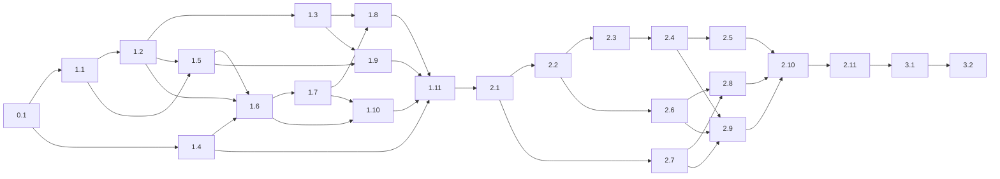

# Tasks · authentication (T03–T04)

**Status:** Implemented and verified locally at revision 5. **Revision 5 (password maximum of 10, change C12) is group 4 (tasks 4.1–4.7), done on 2026-11-19 after the `implement authentication` invocation approved the plan. Checks and results are in `evidence/authentication-T03-T04.md`, Revision 5. The Playwright suite passed 58 of 58 afterwards. Pending: a real phone, a browser-level step for the 11-character rejection, and the T16 decision on keeping the cap.** Revision 3 (password policy, P11) is applied and verified in `evidence/authentication-T03-T04.md`, section "Revision 3" (task 0.1 in the spec round, tasks 1.1 to 3.2 in the implementation round). Results and open items are in `evidence/authentication-T03-T04.md`. Rate-limit results are local behavior only. Real-phone checks, Playwright and the production rate-limit decisions stay open for T15 and T16.

**Root tasks:** T03 (native 1.1–1.11), T04 (native 2.1–2.11), plus decision task 0.1 and handoff tasks 3.1–3.2. Existing root IDs are preserved. No new root IDs are proposed.

**Inputs:** `requirements.md` (AUTH-R1–R13, decisions P1–P11, changes C1–C12, assumptions A1–A15) and `design.md` (DD1–DD16, §3–§12, revision 5 in DD16 and §4.10).

## Rules for this task list

- Do tasks in numeric order unless the **Depends on** line allows otherwise.
- A task is complete only when its **Done when** checks pass with actual output. Partial work and blocked verification stay unchecked.
- Local rate-limit checks prove local behavior only. Do not describe them as production protection (AUTH-AC6.6).
- Group 2 starts after task 1.11, because root T04 depends on T03. Group 2 code is tested against mocks first and against real Flask in task 2.11.
- Source files named in `design.md` §3 are the plan, and so is its folder layout: no `src/` directory, `app/`, `components/`, `hooks/` and `lib/` at the frontend root, flat `backend/tests/`. If implementation needs a different file or an unplanned dependency, record why in the evidence file and check it in review.
- Backend files follow `guidelines/backend.md` (BE rule IDs) and `guidelines/database.md` (DB rule IDs). Frontend files follow `guidelines/frontend.md` (FE rule IDs). Attach the matching guideline file when creating a file with no matching file context.
- Real passwords, tokens, secrets and connection strings never go into specs, evidence, logs, commits or shell arguments. Smoke tests generate a throwaway password into a shell variable and send bodies on stdin.
- No schema change and no migration belong to this slice. If one becomes necessary, stop and report it.
- GitHub, deployment, Playwright, profile editing (E31) and board features are out of scope.

## Dependency map

Group 4 (revision 5) runs after 3.2 in the order 4.1, then 4.2 and 4.3 (parallel), 4.4, 4.5, 4.6, 4.7.

After 1.1, tasks 1.2 to 1.5 can be done in any order that respects the arrows. Tasks 2.6 and 2.7 are independent of 2.3 to 2.5.

## Tasks

### Group 0 · Decisions

- [x] **0.1 Record the approved decisions and align the shared documents**
  - Root tasks: T03, T04. Depends on: decisions P1–P10 (given in the Requirements review).
  - Done in spec revision 2, with no source code. Changed: `specs/CHANGELOG.md` (six entries, verification marked pending), `specs/tasks.md` (T03, T04 native links, T03 and T12 text, T16 clause), `specs/traceability.md` (AC12.1 tasks, E30 and E31 ownership rows), `specs/design.md` D2, `docs/API.md` (conventions, E02, E03, E04), `backend/specs/api-contract.md`, `frontend/specs/api-integration.md`, `frontend/specs/error-handling.md`, `frontend/specs/pages-and-components.md`, `docs/TEST-PLAN.md` (V01, V02) and `docs/DEPLOYMENT.md` (sections 3 and 4). No root checkbox changed.
  - Check run: every relative link in those files resolves, and `git diff` shows no checkbox change in `specs/tasks.md`.
  - Done when: each document change matches `design.md` §10. If a later review changes a decision, edit the native spec first and add a new changelog entry.
  - _Requirements: P1–P10 (record only). Verification: AUTH-V9._
### Group 1 · T03 Flask authentication

- [x] **1.1 Add and verify the backend dependencies on CPython 3.14.5**
  - Root task: T03. Depends on: 0.1.
  - Install `argon2-cffi`, `marshmallow` and `Flask-Limiter` into `backend/.venv`, choose exact versions, and add them to `backend/requirements.txt` with `==` pins (A12).
  - Import each package. Hash and verify one value with `PasswordHasher`. Build a `Limiter` with `memory://` on a scratch Flask app. Confirm the Marshmallow 4 behavior that §4.3 and §4.4 rely on: a field subclass that normalizes in `_deserialize` before validators run, custom `error=` messages, `unknown=RAISE` field messages. Confirm `sqlstate` and `diag.constraint_name` on a psycopg `IntegrityError` from a duplicate email in the test database.
  - **Stop condition:** IF any package fails to install or import, stop this task, report the package, version and error, and propose nothing else until you decide.
  - Done when: install exits 0, every import and probe succeeds, `pip freeze` is kept for the evidence file, and the existing `pytest -v` (186 tests) and Ruff checks still pass.
  - _Requirements: AUTH-AC1.2 (library), AUTH-AC6.1 (library). Open item 6. Verification: AUTH-V1._

- [x] **1.2 Add request parsing, auth error classes and the framework error mapping**
  - Root task: T03. Depends on: 1.1.
  - Create `app/validation.py` (`load_json_body`, `first_messages`). Extend `app/exceptions.py` with `ApiError.headers` and the seven classes in design §4.2. Update `app/errors.py`: pass `headers` through, map `BadRequest` to the 400 `VALIDATION_ERROR` envelope, `UnsupportedMediaType` to 415 `UNSUPPORTED_MEDIA_TYPE`, `RequestEntityTooLarge` to 413 `CONTENT_TOO_LARGE`, `TooManyRequests` to the 429 envelope with `Retry-After` when present, and keep every other HTTPException as it is. Add `MAX_REQUEST_BODY_BYTES` to `config.py` and `MAX_CONTENT_LENGTH` in `create_app`.
  - Write `tests/test_validation.py` using probe routes: malformed JSON (400), `null`, array and empty bodies (400), a missing `Content-Type` (415), `text/plain` (415), `application/json; charset=utf-8` accepted, a JSON body over 64 KiB (413), a non-JSON content type with an oversized body (415), and an unknown-field case. Assert status, code, envelope shape, `request_id`, and that no sentinel input value appears in `fields`.
  - Edit `tests/test_errors.py`: replace `test_other_framework_400_keeps_flask_default_response_until_t03` with a test that bare `abort(400)` returns the JSON `VALIDATION_ERROR` envelope, and add a test that `abort(406)` still returns Flask's default response. State the reason in the evidence file.
  - Done when: the new tests pass, all other foundation tests pass unchanged, and the one replaced test is listed with its reason.
  - _Requirements: AUTH-AC7.1, AUTH-AC7.2, AUTH-AC7.3, AUTH-AC7.4, AUTH-AC7.5. Guidelines: BE03, BE05. Verification: AUTH-V3._
- [x] **1.3 Add JWT configuration, the callbacks, `@token_required` and the `actor_id` log field**
  - Root task: T03. Depends on: 1.2.
  - Create `app/auth_guard.py` (design §4.7). In `create_app` set `JWT_ACCESS_TOKEN_EXPIRES`, `JWT_TOKEN_LOCATION=["headers"]` and `JWT_ALGORITHM`, and register the five JWT callbacks plus the blocklist loader. Append `actor_id` to the request log line in `request_context.py`, using `-` when absent.
  - Add a guarded probe route to `tests/probe_routes.py`. Write `tests/test_auth_guard.py` with a token helper that can mint: valid, expired, wrong secret, `alg: none`, missing `jti`, missing `sub`, non-UUID `sub`, unknown-user `sub` and revoked tokens. Insert users and `RevokedToken` rows directly with the model, and remove them after each test.
  - Done when: every case in AUTH-AC3.2 returns 401 `AUTH_REQUIRED` with the same message, a valid token reaches the handler with `g.current_user` set, no response has a `msg` key or a 422 status, and a captured log line shows `actor_id=<uuid>` and no token text.
  - _Requirements: AUTH-AC3.1–3.4. Guidelines: BE04, BE05. Verification: AUTH-V2._

- [x] **1.4 Add private caching headers for `/api/` responses**
  - Root task: T03. Depends on: 0.1.
  - Create `app/response_headers.py` and register it in `create_app` (design §4.9).
  - Write `tests/test_response_headers.py`: unknown `/api/...` path, a guarded probe route (200 and 401), and a 405 under `/api/` carry `Cache-Control: private, no-store`. `GET /api/health` carries no `Cache-Control` header from the app, and a path outside `/api/` is unchanged.
  - Done when: the tests pass and the health tests from foundation still pass.
  - _Requirements: AUTH-AC6.5. Verification: AUTH-V3._

- [x] **1.5 Add the auth schemas, the shared field cases, the public user DTO and password hashing**
  - Root task: T03. Depends on: 1.1, 1.2.
  - Create `app/blueprints/auth/__init__.py` (`auth_bp`), `auth/schema.py` (`RegisterSchema`, `LoginSchema`, `TrimmedString`, `NormalizedEmail`, `normalize_email`), `auth/service.py` with the password functions from design §4.5 (`hash_password`, `verify_password`, `verify_dummy`; task 1.6 adds `register_user` to the same file), `app/blueprints/users/__init__.py` (`users_bp`) and `users/schema.py` (`PublicUserSchema`).
  - Create `specs/fixtures/auth-field-cases.json` from the table in design §4.4 (C9). Each entry names the form, the input body, and either the normalized accepted body or the exact `fields` map. Use `{"repeat": "a", "times": 81}` style values for long strings. Leave a short note at the top of the file saying that both test suites read it.
  - Write `tests/test_auth_schema.py` and `tests/test_auth_passwords.py`. The schema test loads the case file and runs every entry, and adds: extra and missing keys on both forms, wrong types, uppercase and padded email, Unicode and emoji lengths counted in code points, password whitespace preserved, and sentinel values absent from every message. Password tests cover the hash prefix `$argon2id$`, verify success and mismatch, an invalid stored hash returning false, and `verify_dummy` running a verification. `PublicUserSchema` tests dump an object with extra attributes and assert the keys are exactly `id`, `name`, `email`.
  - Record the hasher parameters and a measured hash time (milliseconds, local machine) for the evidence file.
  - Done when: both test files pass and the recorded numbers are in hand.
  - _Requirements: AUTH-AC1.2, AUTH-AC1.3, AUTH-AC2.3, AUTH-AC2.4, AUTH-AC5.1, AUTH-AC10.7 (API side). Guidelines: BE02, BE03. Verification: AUTH-V1._
- [x] **1.6 Implement registration (E02)**
  - Root task: T03. Depends on: 1.2, 1.4, 1.5.
  - Create `auth/service.py` (`register_user`, `is_unique_violation`) and `auth/routes.py` (`register`). Register `auth_bp` in `create_app`.
  - Write `tests/test_auth_register.py` with unique emails per test and cleanup: 201 shape and exact keys, stored email trimmed and lowercase, stored name trimmed, stored hash starts `$argon2id$` and differs from the password, no `password` or `hash` text in the response body, no `Set-Cookie` and no token, each 400 case from the shared case file through HTTP, extra and missing keys (exactly `name`, `email`, `password` accepted), 415 for a non-JSON content type, 413 for an oversized body, 409 for the same email and for case and whitespace variants, a `Cache-Control` check, and a race test: eight threads with separate clients and a `threading.Barrier` submit the same email. Expect one 201, seven 409, no 500, one row.
  - Done when: AUTH-AC1.1–1.6 tests pass, and the race test passes in five consecutive runs.
  - _Requirements: AUTH-AC1.1–1.6. Guidelines: BE02, BE04, BE06, BE07, DB04. Verification: AUTH-V1._

- [x] **1.7 Implement login (E03)**
  - Root task: T03. Depends on: 1.6.
  - Add `login_user` to the service and `login` to the routes (design §4.6, §4.8). Skip the rate-limit decorators here. Task 1.10 adds them.
  - Write `tests/test_auth_login.py`: 200 shape with `expires_in` 3600, token decoded with the test secret has `sub` equal to the user ID, `exp - iat` equal to 3600, a UUID `jti`, and none of `name`, `email`, `password` as claims. Email matching ignores case and padding. A wrong password and an unknown email return identical status, code, message and body. `verify_dummy` is called exactly once for an unknown email (patch and count). Validation 400 for missing, wrong type, over-length and unknown fields (exactly `email` and `password` accepted), 415 for a non-JSON content type and 413 for an oversized body. Captured logs contain neither the password nor the token. The response has no `password_hash`.
  - Done when: AUTH-AC2.1–2.5 tests pass.
  - _Requirements: AUTH-AC2.1–2.5. Guidelines: BE02, BE04, BE05, BE07. Verification: AUTH-V1._

- [x] **1.8 Implement logout and revocation (E04)**
  - Root task: T03. Depends on: 1.3, 1.7.
  - Add `revoke_token` and the `logout` route (design §4.6, §4.8).
  - Write `tests/test_auth_logout.py`: 200 with `{"data": null}`; one `revoked_tokens` row with the right `jti` and `expires_at` equal to the token's `exp`; the token string is not stored; replay on logout and on a guarded probe route returns 401; a second token for the same user still works; calling `revoke_token` twice leaves one row; a patched `db.session.commit` that raises `OperationalError` returns the sanitized 500, leaves no row, and the token still works afterward; logout without a token returns 401.
  - Done when: AUTH-AC4.1–4.5 tests pass.
  - _Requirements: AUTH-AC4.1–4.5. Guidelines: BE04, BE06, BE07. Verification: AUTH-V2._

- [x] **1.9 Implement the current-user read (E30)**
  - Root task: T03 (under P1). Depends on: 1.3, 1.5.
  - Create `users/routes.py` (`get_me`) and register `users_bp` in `create_app`.
  - Write `tests/test_users_me.py`: 200 with exactly `id`, `name`, `email`; 401 without a token and with a revoked token; `PATCH /api/users/me` returns 405 with an `Allow` header that lists GET; the response carries `Cache-Control: private, no-store`.
  - Done when: AUTH-AC5.1–5.2 tests pass.
  - _Requirements: AUTH-AC5.1, AUTH-AC5.2. Guidelines: BE01, BE02. Verification: AUTH-V2._

- [x] **1.10 Add rate limiting to register and login (local behavior)**
  - Root task: T03. Depends on: 1.6, 1.7.
  - Add `limiter` to `extensions.py`, `Settings.rate_limit_enabled` and the production rule to `config.py`, the limiter setup to `create_app` after `register_request_context` (DD11), decorators and `login_email_key` to the routes, and an optional commented `RATE_LIMIT_ENABLED` line to `backend/.env.example`. Add a comment at the limiter setup saying that memory storage is for local development and that shared storage and trusted client address handling are tracked for T16. Set `"RATE_LIMIT_ENABLED": "false"` in `tests/conftest.py`.
  - Write `tests/test_rate_limit.py` with its own app (limiter on, test database URL). Register: the sixth request in a minute returns 429. Login: the sixth attempt for one email returns 429, while a different email from the same address still gets a normal 401. Each 429 has code `RATE_LIMITED`, a non-empty `request_id`, a numeric `Retry-After`, and `Cache-Control: private, no-store`. A malformed body still counts against the address limit and does not raise. Config tests: `RATE_LIMIT_ENABLED` accepts `true` and `false`, rejects other values and rejects `false` in production, and the error text names the variable and not its value.
  - Verify where Flask-Limiter supplies `Retry-After` for a response built by our handler. If it is missing, compute it from the limit's reset time in `errors.py` and keep the test.
  - Done when: AUTH-AC6.1–6.4 tests pass, the earlier auth tests still pass with the limiter disabled by the fixture, and the evidence file labels these results as local behavior only.
  - _Requirements: AUTH-AC6.1–6.4, AUTH-AC6.6 (labeling). Guidelines: BE05, BE08. Verification: AUTH-V3._
- [x] **1.11 Run the backend gate**
  - Root task: T03. Depends on: 1.4, 1.8, 1.9, 1.10.
  - From `backend/`: `ruff check .`, `ruff format --check .`, `pytest -v`. Record the passed count, and the added count against foundation's 186.
  - Run the race test five more times. Rebuild the image with `docker compose build backend`, start it, confirm `GET /api/health` returns 200 and `POST /api/auth/register` with `{}` returns the 400 envelope, then `docker compose down`. If Docker is not running, record that check as blocked, and leave T03 open.
  - Review the diff against `requirements.md` AUTH-R1–R7 and BE01–BE08 and list findings in the evidence file.
  - Done when: all commands pass with output saved for the evidence file, and every AUTH-AC in R1–R7 appears in at least one passing test.
  - _Requirements: AUTH-AC12.1, AUTH-R1–R7. Verification: AUTH-V1, AUTH-V2, AUTH-V3._

### Group 2 · T04 Next.js authentication

- [x] **2.1 Add the frontend dependencies and test configuration**
  - Root task: T04. Depends on: 1.11.
  - Install `react-hot-toast` and `server-only` (exact versions) and `@testing-library/user-event` as a dev dependency. Update `vitest.config.mts` (`include` globs from design §6.10) and `vitest.setup.ts` (`vi.mock("server-only", () => ({}))`). Read the installed Next.js docs for `cookies`, Route Handlers and `redirect` before using them, and note any difference from design §6.
  - Done when: `npm ci`, `npm run lint`, `npm run typecheck`, `npm test` (the existing test passes) and `npm run build` pass. `npm audit --omit=dev` output is recorded. The dev-only advisories from foundation are unchanged and are not part of this task.
  - _Requirements: AUTH-AC12.2 (tooling). Verification: AUTH-V5._

- [x] **2.2 Add shared types and the typed `ApiError`**
  - Root task: T04. Depends on: 2.1.
  - Create `lib/types.ts` (`PublicUser`, envelope types) and `lib/errors.ts` (design §6.6) with `ApiError`, `apiErrorFromEnvelope`, `networkApiError` and `parsePublicUser` (allowlist). No server import.
  - Write `lib/errors.test.ts`: envelope with and without `fields`, `request_id`, `Retry-After` parsing (seconds), unknown code gets fallback copy, the known codes include `CONTENT_TOO_LARGE` and `UNSUPPORTED_MEDIA_TYPE`, malformed body, null status for transport failure, and `parsePublicUser` dropping extra keys and rejecting a bad shape.
  - Done when: tests pass.
  - _Requirements: AUTH-AC9.1, AUTH-AC11.6. Guidelines: FE-A1, FE-A4. Verification: AUTH-V4._

- [x] **2.3 Add the server environment reader and the server-only Flask client**
  - Root task: T04. Depends on: 2.2.
  - Create `lib/server/env.ts` and `lib/server/flask.ts` (design §6.2).
  - Write tests with a mocked `fetch` and stubbed environment: path comes only from `FLASK_PATHS`; URL origin equals `API_BASE_URL`; headers include the bearer only when a token is passed, plus `X-Request-ID`; `cache: "no-store"` and `redirect: "manual"` are set; a timeout, a rejected fetch and a 3xx throw `ApiError` with null status and fixed copy; a non-JSON body gives `body: null`; logged text contains neither token nor body. Environment tests: missing or malformed `API_BASE_URL` and `APP_ORIGIN` throw an error that names the variable and not the value; `APP_ORIGIN` accepts `https://app.example`, `http://localhost:3000`, `http://127.0.0.1:3000` and `http://[::1]:3000`, and rejects `http://app.example`, `http://localhost.evil.example`, a trailing slash, a path and a missing value; `secureCookie` is true exactly for https.
  - Done when: tests pass.
  - _Requirements: AUTH-AC8.5, AUTH-AC8.6, AUTH-AC8.7, AUTH-AC8.8. Guidelines: FE-A1. Verification: AUTH-V4._
- [x] **2.4 Add Origin validation, request and response helpers and the session cookie helper**
  - Root task: T04. Depends on: 2.3.
  - Create `lib/server/origin.ts`, `lib/server/bff.ts` (`privateJson`, `errorResponse`, `readJsonObject`, `passThrough`, `newRequestId`) and `lib/server/sessionCookie.ts` (`sessionCookie`, `clearedSessionCookie`, `sessionMaxAge`) from design §6.3 and §6.4.
  - Write tests:
    - `checkOrigin` accepts the exact origin and rejects absent, `null`, a different scheme, port, host, a trailing-slash variant and a suffix trick (`http://localhost:3000.evil.example`).
    - `readJsonObject(request, allowedKeys)` returns 415 for a missing or non-JSON content type and accepts `application/json; charset=utf-8`; returns 413 for a body over 64 KiB, including one with no `Content-Length` header and one whose header understates the size; returns 400 for invalid JSON, arrays, primitives, `null` and empty bodies; returns 400 with `fields` for an extra key (`Unknown field.`) and a missing key (`Required.`); and returns the object for an exact key set.
    - `passThrough` keeps valid envelopes and statuses, copies `Retry-After` on 429, and turns HTML, empty bodies and 5xx into the 503 envelope.
    - Cookie attributes match AUTH-AC8.2: HttpOnly, `SameSite=Lax`, `Path=/`, no `Domain`, no `Secure` when `secure` is false, `Secure` when true. The clearing cookie has `Max-Age=0` and the same `Path`, `SameSite` and `Secure`.
    - `sessionMaxAge` returns the smaller of `expires_in` and the seconds left until `exp`, rounded down, and returns null for a non-integer or out-of-range `expires_in`, a token without three parts, a payload that is not JSON, a missing or non-numeric `exp`, and an `exp` in the past.
  - Done when: tests pass.
  - _Requirements: AUTH-AC8.2 (cookie), AUTH-AC8.4, AUTH-AC8.5, AUTH-AC8.6, AUTH-AC8.7. Verification: AUTH-V4._
- [x] **2.5 Implement the register, login and logout Route Handlers**
  - Root task: T04. Depends on: 2.4.
  - Create `app/api/auth/register/route.ts`, `login/route.ts` and `logout/route.ts` (design §6.5). Each exports only `POST`.
  - Write a `route.test.ts` beside each handler using `NextRequest` and a mocked `fetch`. Cover:
    - Origin rejection (absent, mismatched) with no `fetch` call and no cookie change.
    - Register and login: 415, 413, invalid body, extra key and missing key each with no `fetch` call. Register accepts exactly `name`, `email`, `password`. Login accepts exactly `email`, `password`.
    - Register pass-through for 201, 400, 409, 429 and 503, with no `Set-Cookie`.
    - Login success sets one cookie with the AUTH-AC8.2 attributes, returns only `{"data": {"user"}}`, and the token appears nowhere in the body or in headers other than `Set-Cookie`. The cookie `Max-Age` is the smaller of `expires_in` and the token's remaining life.
    - Login 401 passes through with no `Set-Cookie`. A malformed upstream 200, an `expires_in` of 0, a string or 100000, and a token whose `exp` has passed each return 503 with no cookie.
    - Logout for each row of AUTH-AC8.3: no cookie (no `fetch` call, cookie cleared, 200), Flask 200, Flask 401, Flask 500, unreachable Flask, malformed reply.
    - Request ID forwarded and returned. Caller `Authorization` and `Cookie` headers are not forwarded, except that logout sends the cookie-derived bearer. Every response has `Cache-Control: private, no-store`.
    - A wrong `APP_ORIGIN` configuration (non-loopback http) returns the sanitized 500 and names the variable only in the log.
  - Done when: tests pass.
  - _Requirements: AUTH-AC8.1–8.8. Guidelines: FE-A1, FE-A4. Verification: AUTH-V4._
- [x] **2.6 Add the browser API client, feedback helpers and the error hook**
  - Root task: T04. Depends on: 2.2.
  - Create `lib/apiClient.ts`, `lib/toast.ts`, `lib/navigation.ts`, `components/shared/ToasterHost.tsx`, `hooks/useErrorHandler.ts` (design §6.6). Mount `ToasterHost` once in `app/layout.tsx`.
  - Write tests: `apiClient` unwraps `data`, throws `ApiError` from error envelopes, maps `fetch` rejection to a null-status error, rethrows aborts, and only accepts the three declared paths. `useErrorHandler` covers every row of the AUTH-AC9.2 table, including 413 and 415, with `hardRedirect` and `toast` mocked. The 401 `AUTH_REQUIRED` case writes `next` only after `safeRedirectPath`. It ignores aborts and never reports the same error twice. `ToasterHost` renders once.
  - In `app/layout.tsx` replace `min-h-screen` with `min-h-dvh` (AUTH-AC13.4) and add no `viewport` export. Give `ToasterHost` a `toastOptions.style.maxWidth` of `calc(100vw - 2rem)`. Test that `ToasterHost` passes that style and that `app/layout.tsx` has no zoom-locking text.
  - Done when: tests pass.
  - _Requirements: AUTH-AC13.3, AUTH-AC13.4, AUTH-AC13.5, AUTH-AC9.1–9.3, AUTH-AC10.3 (writer side). Guidelines: FE-S4–S6, FE-A2, FE-N4, FE-N6. Verification: AUTH-V4, AUTH-V5._
- [x] **2.7 Add `safeRedirectPath`, `authRules`, `BaseButton` and `FormField`**
  - Root task: T04. Depends on: 2.1.
  - Create `lib/safeRedirect.ts`, `lib/authRules.ts` (design §6.8), `components/shared/BaseButton.tsx` and `components/shared/FormField.tsx`. Props interfaces are named `<Component>Props` (FE-N3).
  - Write tests:
    - `safeRedirectPath` accepts `/`, `/boards/abc?x=1` (query kept) and `/boards/abc#top` (returns `/boards/abc`). It returns `/` for `//evil.example`, `/\evil.example`, `https://evil.example`, `javascript:alert(1)`, a path with a newline, tab or other control character, `/login`, `/register`, `/login?x=1`, a value over 2,048 characters, an empty value, `undefined`, a number and an array.
    - `authRules` loads `specs/fixtures/auth-field-cases.json` with `fs.readFileSync` and runs every entry against `validateRegister` and `validateLogin`. It also checks the key sets of the returned `body` objects, that the password is never trimmed, and that lengths use code points.
    - `BaseButton` disables and shows a spinner when `loading`. `FormField` links the label, `aria-invalid` and `aria-describedby` to the error text, and sets no `minLength` or `maxLength`.
  - If the shared cases reveal a difference from the Flask result, correct the case file with Flask as the reference, rerun both suites, and record the finding in the evidence file.
  - Give `BaseButton` and `FormField` their own `min-h-11 min-w-11` and `text-base` classes, and test for them (AUTH-AC13.2).
  - Done when: tests pass and the Flask schema tests from 1.5 still pass on the same case file.
  - _Requirements: AUTH-AC13.2, AUTH-AC10.3, AUTH-AC10.4, AUTH-AC10.7. Guidelines: FE-S4–S6, FE-C2, FE-C3, FE-C4, FE-N1–N3, FE-S1, FE-S3. Verification: AUTH-V5._
- [x] **2.8 Implement the register and login pages and forms**
  - Root task: T04. Depends on: 2.6, 2.7.
  - Create `app/(public)/layout.tsx`, `app/(public)/register/page.tsx` (`RegisterPage`), `app/(public)/login/page.tsx` (`LoginPage`), `components/auth/RegisterForm.tsx` and `components/auth/LoginForm.tsx` (design §6.8). Neither page reads the cookie.
  - Write component tests with `user-event` and a mocked `apiClient`:
    - Exact fields: `RegisterForm` renders inputs named `name`, `email`, `password` and nothing else that submits data; `LoginForm` renders `email` and `password` only. The captured request body has exactly those keys, with the email normalized and the password untouched (leading and trailing spaces kept).
    - Local validation: an empty or invalid submit shows the §4.4 messages, focuses the first invalid field in field order, keeps entered values, and makes no request.
    - Server errors: a 400 with `fields` shows inline text and sets `aria-invalid`; a 409 shows the error on email; a 401 shows the generic form-level `role="alert"` message and keeps the email; a 429, 413, 415 and 503 call the toast helper.
    - Pending state disables submit and sets `aria-busy`. `noValidate` is set.
    - Register success calls `notifySuccess` and navigates to `/login`, sets no cookie and does not call the login endpoint. Login success calls `hardRedirect` with the `redirectTo` prop.
    - `LoginPage` with `next=//evil.example`, `next=https://evil.example` and `next=/login` passes `/` to the form, and with `next=/boards/abc` passes that path.
  - Build the pages and forms to design §6.11: `items-start sm:items-center`, `w-full max-w-md`, `p-4 sm:p-6`, full-width submit, `break-words` on error text. Test that the form container and submit button carry those classes and that a very long server error message renders inside an element with `break-words`.
  - Done when: tests pass.
  - _Requirements: AUTH-AC13.1, AUTH-AC13.2, AUTH-AC13.4, AUTH-AC10.1, AUTH-AC10.2, AUTH-AC10.3, AUTH-AC10.4, AUTH-AC10.5, AUTH-AC10.6, AUTH-AC10.7. Guidelines: FE-S4–S6, FE-C1, FE-C2, FE-C4, FE-N6, FE-S2, FE-A2, FE-A4. Verification: AUTH-V5, AUTH-V7._
- [x] **2.9 Implement the session check, `AuthContext` and the protected shell**
  - Root task: T04. Depends on: 2.4, 2.6, 2.7.
  - Create `lib/server/session.ts` (`getSessionToken`, `fetchPrivate`, `getCurrentUser`; design §6.4), `components/auth/AuthContext.tsx`, `hooks/useAuth.ts`, `components/shared/AppHeader.tsx`, `components/auth/LogoutButton.tsx`, `components/auth/SessionRevalidator.tsx`, `app/error.tsx` and `app/(protected)/layout.tsx`. Move `app/page.tsx` and `app/page.test.tsx` to `app/(protected)/` with `git mv`, then update them as design §8 describes. Do not add `loading.tsx`. Add a short comment in `session.ts` saying that every protected page and data helper must verify the session through it, and that the layout is not the authorization boundary (DD6).
  - Write tests:
    - `getCurrentUser` and `fetchPrivate` with mocked `cookies`, `redirect` and `fetch`: no cookie redirects to `/login` without a `fetch` call; upstream 401 redirects; upstream 200 returns only the public user; upstream 503 and a transport failure throw `ApiError` without a redirect; the bearer is attached only from the cookie.
    - A repository test that lists every `page.tsx` under `app/(protected)/` and fails when one does not import and call `getCurrentUser` or `fetchPrivate`.
    - `AuthProvider` drops extra props; `useAuth` throws outside the provider. `AppHeader` renders the user's name and a Sign out button.
    - `LogoutButton` success calls `hardRedirect("/login")`; failure calls the toast helper, does not navigate, and re-enables the button for a retry; it is disabled while pending.
    - `SessionRevalidator` refreshes on `pageshow` with `persisted: true`, ignores `persisted: false`, and removes its listener on unmount.
    - `error.tsx` shows a message and calls `reset` when the button is pressed. The moved page test passes.
  - Build the header, the moved page and `error.tsx` to design §6.11: `flex-wrap`, a truncating user name with `min-w-0`, `min-h-11` buttons, and no `min-h-screen` on the moved page. Test with a 200-character user name and a long email that the name sits in a truncating element.
  - Done when: tests pass.
  - _Requirements: AUTH-AC13.1, AUTH-AC13.2, AUTH-AC13.4, AUTH-AC11.1–11.6, AUTH-AC11.8, AUTH-AC11.9. Guidelines: FE-S4–S6, FE-C1, FE-C2, FE-C4, FE-S2, FE-S3, FE-A1, FE-A4. Verification: AUTH-V5._
- [x] **2.10 Run the frontend gate and the build checks**
  - Root task: T04. Depends on: 2.5, 2.8, 2.9.
  - From `frontend/`: `npm run lint`, `npm run typecheck`, `npm test`, `npm run build`. Record the test count against foundation's 1.
  - Build with sentinel values for `API_BASE_URL` and `APP_ORIGIN` and search `.next/static` (and the rest of `.next` for the Server Component output as a control that the search works) for the sentinels. Negative control: temporarily import `lib/server/flask` from a client component, confirm `next build` fails, then revert the import and confirm the build passes again. Record both outcomes.
  - Review the diff against `requirements.md` AUTH-R8–R11 and FE rules, and list findings in the evidence file.
  - Add `lib/mobileGuard.test.ts` (design §6.11, AUTH-AC13.6): it fails on `h-screen`, `min-h-screen`, `100vh`, `user-scalable`, `maximum-scale` and an unprefixed arbitrary width above 320 px in non-test files under `app/`, `components/` and `hooks/`. Prove it works with small in-memory samples that should pass and fail, then run it against the real tree. It passes only because tasks 2.6, 2.8 and 2.9 removed `min-h-screen`.
  - Done when: all commands pass with output saved, the sentinel is absent from `.next/static`, and the negative control fails as expected.
  - _Requirements: AUTH-AC13.3, AUTH-AC13.6, AUTH-AC12.2, AUTH-AC11.7. Verification: AUTH-V5, AUTH-V8._

- [x] **2.11 Run the local integration smoke and the manual browser check**
  - Root task: T04. Depends on: 1.11, 2.10.
  - Use the foundation configuration: Flask on `127.0.0.1:5001` (native or Compose, limiter on), and `npm run build && npm run start` on port 3000 with `frontend/.env.local` (`API_BASE_URL=http://127.0.0.1:5001`, `APP_ORIGIN=http://localhost:3000`). Generate a throwaway email and password into shell variables. Send bodies on stdin. Keep the cookie jar in a temporary file that is deleted at the end. Do not print the password, token or cookie value.
  - Check each with `curl`, recording status, selected headers and redacted `Set-Cookie` attributes:
    1. **Exact fields and Origin.** `POST /api/auth/register` on Next without `Origin` and with `Origin: http://evil.example` returns 403. With `Origin: http://localhost:3000`: an extra field returns 400 (`Unknown field.`), a missing field returns 400 (`Required.`), `Content-Type: text/plain` returns 415, a body over 64 KiB returns 413, the exact three fields return 201 with the public user. The same extra-field and wrong-content-type checks sent straight to Flask on 5001 return 400 and 415. A repeat returns 409. The same exact-field checks for login (`email`, `password`).
    2. **Invalid credentials.** A wrong-password login and an unknown-email login return the same 401 body with no `Set-Cookie`.
    3. **Login and cookie flags.** The correct login returns 200 with `{"data": {"user": ...}}` and no `access_token` in the body. `Set-Cookie` has `revotask_session`, HttpOnly, `SameSite=Lax`, `Path=/`, no `Domain`, `Max-Age` at most 3600, and no `Secure` because the origin is loopback http.
    4. **Protected render.** `GET /` without a cookie returns 307 with `Location: /login`. With the jar it returns 200 and the user's name. Both carry `no-store`.
    5. **Expired and tampered sessions.** Mint an expired token for the registered user with PyJWT and the development secret read from `backend/.env` in a short script that prints nothing secret. `GET /api/users/me` on Flask with it returns 401 `AUTH_REQUIRED`. `GET /` on Next with it as the cookie returns 307. A tampered cookie returns 307 on `/` and 200 on `/login`.
    6. **Logout.** `POST /api/auth/logout` without `Origin` returns 403. With `Origin` it returns 200 and clears the cookie. Logout again with no cookie returns 200. Logout with an already-revoked cookie returns 200 and clears it.
    7. **Revoked session.** The token from step 3, sent directly to Flask `GET /api/users/me`, returns 401. The old cookie sent to Next `GET /` returns 307.
    8. **Upstream failure.** With a fresh session, stop Flask. `GET /` returns the error page and not a redirect. `POST /api/auth/logout` returns 503 and keeps the cookie (no clearing `Set-Cookie`). Restart Flask and confirm the session still works.
    9. **Unsafe redirects.** `GET /login?next=//evil.example`, `?next=https://evil.example` and `?next=/login` return 200 and the response body contains no `evil.example`. `?next=/boards/abc` returns 200 and the body contains `/boards/abc`.
    10. **Rate limit (local behavior).** Wrong-password logins for one email within a minute end in 429 with `Retry-After`. Compose runs one worker, so the sixth attempt is the first 429 (F-AUTH-11). Record this as local behavior with in-memory counters per worker, not as production protection.
  - Remove the throwaway user's rows from the development database with a targeted `DELETE` on that one email, and delete the cookie jar.
  - Mobile check (AUTH-R13). In a desktop browser's device emulator, and on a real phone if one is available, open `/login`, `/register`, `/` (signed in), the error state (stop Flask and reload `/`) and a toast (a wrong-password login) at 320, 375, 768 and 1280 px. For each width and route record the result of `document.documentElement.scrollWidth <= document.documentElement.clientWidth` in the console, the measured tappable area of every interactive element (`getBoundingClientRect()` width and height, at least 44 each) with `document.elementFromPoint` at its center returning that element or a child, and that inputs compute to at least 16 px. Use a small Chrome DevTools Protocol script (Node's built-in WebSocket, no new dependency) to run the same measurement at every width and route, save it as `evidence/authentication-mobile-measure.mjs`, and keep its output in the evidence file. At 320 px also check a 60-character name and a long email in the header, a toast that stays inside the screen, and a focused invalid field that is visible with the on-screen keyboard open (real device only). Record the browser and version and whether each run used an emulator or a real device.
  - Manual browser check (record browser name and version, results as manual): register then sign in at 375 px width; keyboard-only completion; field error focus; sign out, then press Back and confirm the login page appears and no private content shows; open `/login` with a stale cookie; open `/login?next=//evil.example` and sign in, and confirm the app lands on `/`.
  - Done when: every step has an observed result in the evidence file. A step that cannot run is recorded as blocked and T04 stays open.
  - _Requirements: AUTH-AC12.3, AUTH-AC13.1–13.2, AUTH-AC13.5, AUTH-AC13.7, AUTH-AC6.3, AUTH-AC8.2–8.5, AUTH-AC10.3, AUTH-AC10.6, AUTH-AC11.1–11.5, AUTH-AC11.8. Verification: AUTH-V6, AUTH-V7._
### Group 3 · Handoff and documentation checkpoint

- [x] **3.1 Apply the documentation checkpoint**
  - Root tasks: T03, T04. Depends on: 2.11.
  - Review the actual diff against `requirements.md` and `design.md` first.
  - The contract and ownership documents were changed in task 0.1. Here, re-read each changed statement in `docs/API.md`, `backend/specs/api-contract.md`, the frontend layer specs, `docs/TEST-PLAN.md`, `docs/DEPLOYMENT.md` and `specs/design.md` against a test or smoke result, and correct any that the implementation contradicts. Fill in each authentication entry's **Verification** line in `specs/CHANGELOG.md` with the real results.
  - `docs/DEVELOPMENT.md`: new backend dependencies, `RATE_LIMIT_ENABLED`, the local smoke steps, and the rule that `Origin` must match `APP_ORIGIN` (use `localhost`, not `127.0.0.1`, in the browser).
  - `README.md`: update **Status** with verified facts only. Do not claim live URLs, Playwright runs, production rate limiting or later features.
  - `CHANGELOG.md`, `backend/CHANGELOG.md`, `frontend/CHANGELOG.md`: add the authentication entries under the `## YYYY-MM-DD` heading for the commit date, with a `### <short-sha> <subject>` entry. Refine the existing foundation lines that say auth is pending, and remove "no API client, Route Handlers or auth UI yet (T04)" from the frontend known limitations.
  - Done when: each statement matches a command output in the evidence file, and entries for unverified work say "pending".
  - _Requirements: AUTH-AC12.4. Verification: AUTH-V9._
- [x] **3.2 Record evidence and synchronize task status**
  - Root tasks: T03, T04. Depends on: 3.1.
  - Create `evidence/authentication-T03-T04.md` with the commands, versions, outputs, the `pip freeze` change, hasher parameters and time, the replaced test and its reason, review findings, the smoke results, the manual browser result, and open items. Remove tokens, passwords, cookie values, connection strings and account data first.
  - Add a row to the Verification index in `evidence/README.md`.
  - Update `specs/traceability.md` with an authentication evidence status table for AC01.1, AC01.2, AC02.1, AC02.2, AC02.3, AC12.1 (read part), AC13.3 (auth surface) and AC14.1 (local part). Mark each as passed locally or partial, with the evidence path. State that the rate-limit results are local behavior only and that shared storage and trusted client address handling remain open for T16.
  - Add to `evidence/spec-review.md` only the findings and refinements confirmed in the phase reviews, with file and heading references.
  - Check T03 in `specs/tasks.md` only when tasks 1.1–1.11 are done and AUTH-R1 to AUTH-R7 are verified. Check T04 only when tasks 2.1–2.11 are done and AUTH-R8 to AUTH-R11 are verified. Otherwise leave it open and list the blocker.
  - Done when: native checkboxes and the root tracker agree, and the final report lists changed files, completed IDs, checks run, open work and documentation updated.
  - _Requirements: AUTH-AC12.5. Verification: AUTH-V9._

### Group 4 · Revision 5: password maximum of 10 (C12, DD16)

Root tasks: T03 and T04 stay checked. Revision 5 refines verified work, so each task below records its own verification and reopens nothing. Order follows `design.md` §4.10: case file first so the tests fail for the right reason, then constants, then test data, then scripts, then the straggler check, then the gates, then documents. Run group 4 on a branch or a clean tree, so one commit holds the revision.

- [x] **4.1 Update the shared case file and see the tests fail**
  - Root tasks: T03, T04. Depends on: plan approval.
  - In `specs/fixtures/auth-field-cases.json`: change the `_note` to "8 to 10" and "1 to 10". Replace the base password `Horse-Battery-42` with `Horse-4Bat` (both register and profile sections). Change every `Must be 8 to 128 characters.` to `Must be 8 to 10 characters.` and every `Must be 1 to 128 characters.` to `Must be 1 to 10 characters.`
  - Register cases: replace the 128 and 129 character cases with 10 (accepted) and 11 (rejected). Add 7 (rejected), 8 and 9 (accepted), `Aa1!` plus 6 emoji (10, accepted) and `Aa1!` plus 7 emoji (11, rejected with the length message). Login cases: replace the 128 and 129 cases with 10 (accepted) and 11 (rejected), and keep empty (rejected) and 1 character (accepted). Keep every composition case, now at lengths of 10 or less (`Éééééééé1` stays at 9 and `Aaaaaaa😀` at 8).
  - Run `pytest tests/test_auth_schema.py` and `npx vitest run lib/authRules.test.ts` before any code change. Record that the new boundary cases fail at the old constants. That shows the cases test the limit.
  - Done when: the file parses as JSON, the register and login case counts are recorded, and the 10 and 11 character cases fail against the revision 4 constants.
  - **Result (2026-11-19, Claude Code):** register 43 cases (42 before: 9-character case added, 128 and 129 cases replaced by 10 and 11, in plain and emoji forms), login 19 (the 128 and 129 cases replaced by 10 and 11). The file parses, and no `128` or `Horse-Battery` text remains in it. Against the revision 4 constants, `tests/test_auth_schema.py` shows 6 failed and 96 passed, and `lib/authRules.test.ts` shows 6 failed and 101 passed: `password-empty` and `password-7-chars` (register) and `password-empty` (login) fail on the message, `password-11-chars` (register and login) and `password-11-chars-with-emoji` fail because 11 characters are still accepted. The same six IDs fail on both sides. The repository is red on these cases until 4.2 and 4.3.
  - _Requirements: AUTH-AC1.3, AUTH-AC2.4, AUTH-AC10.7, C12. Verification: AUTH-V1, AUTH-V5._
- [x] **4.2 Backend: set the maximum and update backend test data**
  - Root task: T03. Depends on: 4.1.
  - `backend/app/config.py`: `PASSWORD_MAX = 10`. Do not touch `schema.py`. Its messages and `validate.Length` calls read the constants.
  - Replace `Horse-Battery-42` with `Horse-4Bat` where it is a valid register or login password: `test_auth_register.py`, `test_auth_login.py`, `test_auth_logout.py`, `test_rate_limit.py`, `test_users_me.py`, `profile_helpers.py`. Leave it where it is an unknown-key value (`test_users_profile.py`, `test_boards_properties_rules.py` `REGISTER_OK` if it never reaches register), and record each decision.
  - Replace wrong login passwords of 11 or more characters with `wrong-pw-0` (or another of at most 10 characters): `test_rate_limit.py`, `test_auth_login.py` (`not the right password`, `wrong password`). Replace the log sentinel `secret-wrong-password-777` with `S3cret-pw!` and keep the assertions. Update the message strings in `test_auth_schema.py`.
  - Add to `test_auth_login.py` a case that an 11-character password returns 400 `VALIDATION_ERROR` with `fields.password` = `Must be 1 to 10 characters.` and still counts toward the login limit in `test_rate_limit.py`. `test_auth_passwords.py` stays unchanged.
  - Done when: `ruff check .`, `ruff format --check .` and `pytest -v` pass from `backend/`, with the passed count compared to the pre-change count. Foundation and other feature tests that register users still pass.
  - **Result (2026-11-19, Claude Code):** `PASSWORD_MAX = 10`. `Horse-4Bat` replaced `Horse-Battery-42` in the 8 listed test files, including the unknown-key uses in `test_users_profile.py` (harmless, and fewer straggler hits). Wrong login passwords are `wrong-pw-0`, `wrong-pw-1`, `wrong-pw-2`, and the log sentinel is `S3cret-pw!`. Two more tests needed changes that the search missed: `test_users_profile_session.py` (`Wrong-Password-1!`, then its first replacement was 11 characters) and `test_auth_schema.py` (`" Spaced Pass 1! "`). Two tests added (login 11 characters, 400 with the message and a 10-character wrong password still 401; the limiter counts five 400s then 429). `ruff check .` and `ruff format --check .` clean, `pytest`: 2177 passed and 1 skipped (2173 and 1 before).
  - _Requirements: AUTH-AC1.3, AUTH-AC2.4, AUTH-AC6.2, C12. Verification: AUTH-V1, AUTH-V3._
- [x] **4.3 Frontend: set the maximum, hint and frontend test data**
  - Root task: T04. Depends on: 4.1. May run in parallel with 4.2.
  - `frontend/lib/authRules.ts`: `PASSWORD_MAX = 10`, the comment on `PASSWORD_MIN` ("login accepts 1 to 10"), and `PASSWORD_HINT` = `8 to 10 characters, with an uppercase letter, a lowercase letter and a special character such as ! ? # or %.`
  - Tests: `Horse-4Bat` as the valid base in `RegisterForm.test.tsx`, `register/route.test.ts`, `authRules.test.ts`. Message strings to 8 to 10 and 1 to 10 in `authRules.test.ts`, `RegisterForm.test.tsx` and `LoginForm.test.tsx`. Wrong or entered login passwords of 11 or more characters (`correct horse battery` in `login/route.test.ts`, `  my password  ` in `LoginForm.test.tsx`) become values of at most 10 characters. Assert the new hint text in `RegisterForm.test.tsx`. Leave `users/me/route.test.ts` and `flask.test.ts` unchanged when the value is an unknown-key or sentinel value that never meets a length rule, and record that.
  - `frontend/e2e/support/run.ts`: `makePassword()` returns `Aa1!${randomBytes(3).toString("hex")}` (10 characters) and its doc comment says "8 to 10". `run.unit.ts`: the upper bound becomes 10.
  - Done when: `npm run lint`, `npm run typecheck`, `npm test` and `npm run e2e:unit -- run.unit.ts` pass from `frontend/`.
  - **Result (2026-11-19, Claude Code):** done as listed. The padded password in `RegisterForm.test.tsx` is now `" Hor-4Bt "` (9 characters) because padding counts toward the maximum. `e2e/auth.spec.ts` also needed a change: its wrong password (`${ownerPassword}-wrong`, 16 characters) would have returned 400. `npm run lint`, `npm run typecheck` clean, `npm test`: 2173 passed in 100 files (2172 before), `npm run e2e:unit -- run.unit.ts`: 2 passed. The live Playwright run followed on 2026-11-19: 58 passed.
  - _Requirements: AUTH-AC10.7, AUTH-AC10.8, C12. Verification: AUTH-V5._
- [x] **4.4 Update the smoke and measure scripts**
  - Root tasks: T03, T04. Depends on: 4.2, 4.3.
  - `evidence/authentication-http-smoke.py`: `LEN_MSG` to `Must be 8 to 10 characters.`, the wrong passwords at lines near 170, 311 and 321 to at most 10 characters, and the password-rule section to probe 7, 8, 10 and 11 characters at Next and at Flask. Add one login check: an 11-character password returns 400 `Must be 1 to 10 characters.` at both.
  - `evidence/authentication-mobile-measure.mjs`: the generated password (`${randomBytes(12).toString("hex")}Aa1!`) and `a-password-value` to 10 characters or fewer. The nine other scripts (`analytics-`, `boards-membership-sprint-`, `comments-`, `kanban-`, `my-tasks-search-` `mobile-measure` or `timing`, `notifications-`, `profile-`, `analytics-timing`) change `randomBytes(9)` to `randomBytes(3)`.
  - Done when: `python3 -m py_compile` passes on the smoke script and `node --check` passes on every changed `.mjs`. A script that registers users and cannot run here (it needs a live stack) is recorded as "syntax checked only".
  - **Result (2026-11-19, Claude Code):** smoke script: 10-character generated password, `LEN_MSG` 8 to 10, wrong passwords `wrong-pw-0`, and a new length-boundary group (11 characters at register and login, at Next and at Flask, after a limiter reset). `authentication-mobile-measure.mjs` also checks the new hint text and the two 11-character messages at 375 px. `py_compile` passes and `node --check` passes on all changed `.mjs`. The nine other measure and timing scripts are syntax checked only.
  - _Requirements: AUTH-AC12.3, C12. Verification: AUTH-V6._
- [x] **4.5 Check for stragglers**
  - Root tasks: T03, T04. Depends on: 4.2, 4.3, 4.4.
  - Search `backend`, `frontend`, `evidence`, `specs` and `docs` (excluding `node_modules`, `.next`, `playwright-report`, `.venv`) for `Horse-Battery`, `to 128 characters`, `randomBytes(9)`, `randomBytes(12)`, `PASSWORD_MAX = 128` and `1–128` or `8–128`. Read each remaining hit. A hit is allowed only when it is (a) an unknown-key value recorded in 4.2 or 4.3, (b) a historic evidence file that records a revision 4 run, or (c) a document that task 4.7 will change. List every allowed hit with its reason in the evidence file.
  - Done when: the search output and the list of allowed hits are saved, and no other hit remains.
  - **Result (2026-11-19, Claude Code):** no code, test or script hit remains. Allowed hits are the changelogs, `evidence/spec-review.md`, the revision 4 smoke and browser text files, the Revision 3 section of the evidence file and the three native spec files (history). The list is in `evidence/authentication-T03-T04.md`, Revision 5.
  - _Requirements: C12. Verification: AUTH-V9._
- [x] **4.6 Run the gates, the real HTTP smoke and the browser check**
  - Root tasks: T03, T04. Depends on: 4.5.
  - Backend gate and frontend gate as in tasks 1.11 and 2.10 (`ruff`, `pytest -v`, `npm run lint`, `npm run typecheck`, `npm test`, `npm run build`). Record the passed counts against the pre-change counts. Run the full backend suite, not only the auth files, because other features register users.
  - Start the stack as in task 2.11 (Compose backend with one worker, Next on its own port, `APP_ORIGIN` to match). Run the smoke script and record the result. Local accounts with a longer password cannot sign in, so the smoke creates its own throwaway users and deletes them with a targeted `DELETE` on those emails. The change does not reset or drop any database.
  - Manual browser check at 375 px (record browser, version, emulator or device): `/register` shows the new hint, an 11-character password shows the length error in the same place and takes focus, a 10-character valid password registers and signs in, and `/login` with an 11-character password shows `Must be 1 to 10 characters.`. Confirm the page has no horizontal scroll on these screens (AUTH-AC13.1).
  - Done when: every gate command passes with output saved, the smoke has no failed check, and the browser results are recorded. A step that cannot run is recorded as blocked and 4.7 does not start.
  - **Result (2026-11-19, Claude Code):** backend gate, frontend gate and `next build` pass. Docker Desktop was started, the backend image rebuilt and Flask run with one worker. Smoke: 79 of 79. Chrome emulation (not a real phone): 106 of 106 including the new 375 px checks. Details and counts: `evidence/authentication-T03-T04.md`, Revision 5. The Playwright suite ran afterwards: 58 passed (see Revision 5 in the evidence file).
  - _Requirements: AUTH-AC12.1–12.3, AUTH-AC13.1, C12. Verification: AUTH-V1, AUTH-V3, AUTH-V5, AUTH-V6, AUTH-V7._
- [x] **4.7 Apply the documentation checkpoint and record evidence**
  - Root tasks: T03, T04. Depends on: 4.6.
  - Apply the §10 "Revision 5 document impact" table: `docs/API.md` E02 and E03, `backend/specs/api-contract.md`, `specs/design.md` D2, `docs/USER_GUIDE.md`, `frontend/specs/pages-and-components.md`, `docs/TEST-PLAN.md` V01 and V02. Re-read each against a test or smoke result.
  - `specs/CHANGELOG.md`: one entry with before (8 to 128 at register, 1 to 128 at login), after (8 to 10 and 1 to 10), reason (owner request, 2026-11-19) and the verification from 4.6. `CHANGELOG.md`, `backend/CHANGELOG.md`, `frontend/CHANGELOG.md`: entries under the `## YYYY-MM-DD` heading for the commit date, with a `### <short-sha> <subject>` entry. `README.md`: only if its status text names the password rule.
  - `evidence/authentication-T03-T04.md`: a "Revision 5" section with the commands, counts, smoke result, browser result, the allowed straggler hits and the lockout note (Open item 8). Add a dated note to the revision 4 smoke and browser text files that they record the earlier rule. In `requirements.md` and `design.md` change the status lines from "awaits approval" to "implemented and verified locally", only after 4.6 passes. Leave root T03 and T04 checked.
  - Done when: each statement in the documents matches a command output in the evidence file, and any unverified item says "pending".
  - **Result (2026-11-19, Claude Code):** applied the §10 table to `docs/API.md`, `backend/specs/api-contract.md` (the sentence that a stored account is never locked out by a policy change is replaced, because older long passwords are now locked out), `specs/design.md` D2, `docs/USER_GUIDE.md`, `frontend/specs/pages-and-components.md` and `docs/TEST-PLAN.md` V01. README status (rule and verified counts), `CHANGELOG.md`, `backend/CHANGELOG.md`, `frontend/CHANGELOG.md`, `specs/CHANGELOG.md` verification, the evidence file, `evidence/README.md` row and dated notes on the two revision 4 text files. Entries use `(commit pending)` because nothing is committed yet.
  - _Requirements: AUTH-AC12.4, C12. Verification: AUTH-V9._

## Implementation notes

Where the work differed from the plan. Each item is also in the evidence file (findings F-T03-xx and F-T04-xx).

- **1.3:** the guard also rejects a token with no numeric `exp`, because PyJWT does not require one (F-T03-02).
- **1.5:** `app/blueprints/auth/` has `__init__.py`, `routes.py`, `service.py` and `schema.py`. Hashing is in `service.py`, as the folder decision asked. The shared case file has 37 register and 19 login cases.
- **1.10:** a negative control showed Flask-Limiter checks decorator limits in the view wrapper, so the initialization order the plan called necessary is only a precaution. DD11 was corrected (F-T03-04).
- **1.11:** `tests/conftest.py` `schema_at_head` became a per-test check, because the foundation migration tests rebuild the schema (F-T03-03).
- **2.5:** `Set-Cookie` is written by hand, because `NextResponse.cookies` also copies the token into `x-middleware-set-cookie` (F-T04-02). A `__proto__` key slipped past the first key-set check and was fixed in `bff.ts` and `authRules.ts` (F-T04-01).
- **2.6:** `lib/safeRedirect.ts` was created here, with its tests, because `hardRedirect` needs it. It exports `safeLocalPath` and `safeRedirectPath`, because one function would have turned every session-expired redirect into `/` (F-T04-03). Task 2.7 holds `authRules`, `BaseButton`, `FormField` and their tests.
- **2.8:** the forms use individual refs. ESLint's `react-hooks/refs` rule flagged an object of refs.
- **2.9:** `app/error.tsx` calls `retry()`. The first draft used `reset()`, which does not re-fetch in Next 16.4 (F-T04-04). Added `app/(public)/public.guard.test.ts` for AUTH-AC10.5.
- **2.10:** `lib/mobileGuard.test.ts` is in place and passes on the real tree.
- **Revision 4 (rate limit, one worker):** Compose runs `GUNICORN_WORKERS=1`. The limiter test resets state and checks the normalized-email sequence (five 401s then 429). Login and register use separate limit keys, tested. A 401 no longer carries `Retry-After` (`response_headers.py`). The smoke restarts the backend before each check group so no group spends another's quota. Live results: `evidence/authentication-T03-T04.md`, revision 4.
- **Revision 3 (password policy):** the register rule is 8 to 128 characters with an uppercase letter, a lowercase letter and an ASCII special character, applied in `backend/app/blueprints/auth/schema.py` and `frontend/lib/authRules.ts`. The shared case file and the tests were updated, and the register form shows the rules as a hint (`FormField` `hint`). Login is unchanged. The smoke script and the browser check now also test the rejections, and were re-run after the change.
- **Revision 5 (password maximum of 10):** `PASSWORD_MAX = 10` in `backend/app/config.py` and `frontend/lib/authRules.ts`. The schemas needed no change. Two tests the first search missed were found by the full backend run, and `e2e/auth.spec.ts` had a 16-character wrong password (evidence F-AUTH-R5-01, F-AUTH-R5-02). The smoke is 79 checks, the Chrome run 106, and Playwright 58 passed with no suite change.
- **2.11:** port 3000 was held by a `next-server` that was not started in this work, so the smoke used port 3100 with `APP_ORIGIN` set to match. The two scripts are in `evidence/`. The real-browser script found the `reset()` bug and was extended to delete its own tokens.

## Coverage check

| Requirement | Tasks |
|---|---|
| AUTH-R1 | 1.5, 1.6, 1.11, 4.1, 4.2, 4.6 |
| AUTH-R2 | 1.5, 1.7, 1.11, 4.1, 4.2, 4.6 |
| AUTH-R3 | 1.3, 1.11 |
| AUTH-R4 | 1.8, 1.11 |
| AUTH-R5 | 1.5, 1.9, 1.11 |
| AUTH-R6 | 1.4, 1.10, 1.11, 2.11, 3.1, 4.2 |
| AUTH-R7 | 1.2, 1.11 |
| AUTH-R8 | 2.3, 2.4, 2.5, 2.10, 2.11 |
| AUTH-R9 | 2.2, 2.6, 2.10 |
| AUTH-R10 | 1.5, 2.6, 2.7, 2.8, 2.10, 2.11, 4.1, 4.3, 4.6 |
| AUTH-R11 | 2.9, 2.10, 2.11 |
| AUTH-R12 | 1.11, 2.10, 2.11, 3.1, 3.2, 4.6, 4.7 |
| AUTH-R13 | 2.6, 2.7, 2.8, 2.9, 2.10, 2.11 |
| P1–P10 (recorded) | 0.1 |
| C12 (revision 5: AUTH-AC1.3, 2.4, 6.2, 10.7, 10.8) | 4.1, 4.2, 4.3, 4.4, 4.5, 4.6, 4.7 |

Every acceptance criterion in `requirements.md` appears in at least one task's **Requirements** line or in the table above. The verification IDs AUTH-V1 to AUTH-V9 are defined in `design.md` §8.
