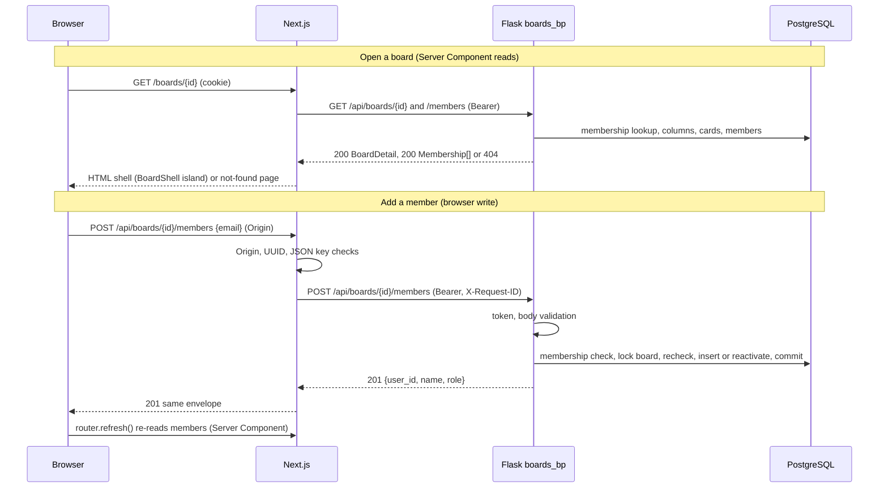

# Design Document: boards-membership (T05–T06)

## Overview

This slice adds the Flask boards and membership API (E05–E12, root task T05) and the Next.js dashboard, board shell and membership controls (root task T06). It implements R03 (AC03.1–AC03.3), R04 (AC04.1–AC04.2) and AC13.1 for every new page and dialog. It refines root `specs/design.md` D2, D3 and D5 and the layer references in `backend/specs/` and `frontend/specs/`.

The original slice added no table, column or migration (Revision 2 adds one, see the end of this document). It adds four typed exceptions, one blueprint (`boards_bp`), a small move of generic validators into the existing `backend/app/validation.py`, one Next.js server helper set, four Route Handlers, two shared components, a Confirm_Dialog and the dashboard and board pages.

This document uses the requirement numbering of `requirements.md` ("Requirements 2.4" means Requirement 2, criterion 4). Work packages (WP-…) are the units that `tasks.md` splits into checkbox tasks linked to T05 and T06. Review items R1–R14 are all resolved (see "Review Items and Decisions").

### Verified facts about the existing code

| Question                                       | Finding                                                                                                                                                                                                                                                                                                      | Evidence                                                      |
| ---------------------------------------------- | ------------------------------------------------------------------------------------------------------------------------------------------------------------------------------------------------------------------------------------------------------------------------------------------------------------ | ------------------------------------------------------------- |
| Does `cards` have an assignee column?          | Yes. `cards.assignee_id` is a nullable UUID foreign key to `users.id`, with a partial index on active rows and a `Card.assignee` relationship. There is no `assignee_name` column. The name comes from `users.name` through a join.                                                                          | `backend/app/models/card.py`                                  |
| Does the E07 `Card` shape need a model change? | No. `Card { id, column_id, title, description, assignee_id, assignee_name, order }` maps to `cards.id`, `column_id`, `title`, `description`, `assignee_id`, `LEFT JOIN users.name` and `order`. `Column { id, board_id, name, is_done, order }` maps one to one.                                             | `docs/API.md` data shapes, `board_column.py`                  |
| Does `users` support soft deletion?            | No. Account deletion is outside v1, so a membership join to `users` needs no active filter on the user.                                                                                                                                                                                                      | `backend/app/models/user.py`                                  |
| Which boards-related exceptions exist?         | None. `exceptions.py` has no 403, 404 or 409 class. The central handler already maps Werkzeug `NotFound` to `NOT_FOUND`.                                                                                                                                                                                     | `backend/app/exceptions.py`, `errors.py`                      |
| Does the cache header already apply?           | Yes. `after_request` sets `Cache-Control: private, no-store` on every `/api/` response except `health.get_health`. The new blueprint inherits it, and the slice only adds tests.                                                                                                                             | `backend/app/response_headers.py`                             |
| Where do shared validators live today?         | `backend/app/validation.py` already holds `first_messages` and `load_json_body`. `TrimmedString`, `NormalizedString`, `normalize_email`, `EMAIL_PATTERN`, `EMAIL_MAX` and the fixed messages live in `blueprints/auth/schema.py`.                                                                            | `backend/app/validation.py`, `blueprints/auth/schema.py`      |
| What does the Next side support today?         | `FLASK_PATHS` has four static routes and `FlaskRequest.method` allows only GET and POST. `apiClient.ts` has only `apiPost` with three declared paths. `KnownErrorCode` has no `NOT_FOUND`, `USER_NOT_FOUND` or `STATE_CONFLICT`, so such a code gets the generic fallback message. All three need extending. | `frontend/lib/server/flask.ts`, `apiClient.ts`, `errors.ts`   |
| Is a property-testing library installed?       | No, and none is added (R8). Parameterized pytest and Vitest tests with deterministic fixtures cover the properties.                                                                                                                                                                                          | `backend/requirements-dev.txt`, `frontend/package.json`       |
| Is Playwright installed?                       | No. Playwright automation stays in T15 (R9).                                                                                                                                                                                                                                                                 | `frontend/package.json`                                       |
| How do DB-writing tests clean up today?        | `Tracker` in `backend/tests/auth_helpers.py` records committed users and deletes them by tracked ID. The test database guard in `backend/tests/db_guard.py` requires `TEST_DATABASE_URL` to differ from `DATABASE_URL` and to end in the test suffix.                                                        | `backend/tests/auth_helpers.py`, `db_guard.py`, `conftest.py` |

## Architecture



Reads (E05, E07, E10) run in Server Components through the server-only Flask helper (FE-A1, D5). Writes (E06, E08, E09, E11, E12) run in the browser through same-origin Route Handlers. No browser Route Handler is added for the three reads (R7). After a successful local E11 or E12, the Members_Panel updates its list from the response and calls `router.refresh()`, which re-runs the Server Component E10 read and replaces the local list with the server list (Requirements 4.15).

### Key design decisions

| ID   | Decision                                                                                                                                                                                                                                                                                                                                                                                                                                                                                                                                                                                                                                                                      | Alternatives considered                                              | Reason                                                                                                                                                                                                                                                                                                                                           |
| ---- | ----------------------------------------------------------------------------------------------------------------------------------------------------------------------------------------------------------------------------------------------------------------------------------------------------------------------------------------------------------------------------------------------------------------------------------------------------------------------------------------------------------------------------------------------------------------------------------------------------------------------------------------------------------------------------- | -------------------------------------------------------------------- | ------------------------------------------------------------------------------------------------------------------------------------------------------------------------------------------------------------------------------------------------------------------------------------------------------------------------------------------------ |
| DD1  | Authorization is one service function, `authorize_board(board_id, user_id, *, role=None, lock=False)`. A missing board, a soft-deleted board, a nonmember and a removed member all raise the same `NotFoundError`. A participant with the wrong role raises `UnauthorizedBoardAccessError` (403). **Approved (R2, C1).**                                                                                                                                                                                                                                                                                                                                                      | Per-endpoint checks. 403 for nonmembers (as D2 says today).          | One path cannot drift between endpoints. 404 for nonmembers satisfies Requirements 2.4 and hides which board IDs exist. This changes D2 and `backend/specs/api-contract.md`, so D2, Requirements 7.8, `docs/API.md` and the tests are updated together (C1).                                                                                     |
| DD2  | Writes follow check, lock, recheck. The function reads the caller's membership without a lock. If the caller is a participant, it locks the board row with `SELECT … FOR UPDATE` in one statement and reads the membership again in a second statement. Reads use the first step only.                                                                                                                                                                                                                                                                                                                                                                                        | Lock first. One joined `FOR UPDATE` statement.                       | The recheck must be a new statement. In PostgreSQL READ COMMITTED, a joined row is not refreshed when the lock wait ends, so a membership removed during the wait would still look active. Checking before locking keeps nonmembers from queuing on a board lock, which would reveal that the board exists. D2 requires board lock then recheck. |
| DD3  | Request order is: authenticate (`token_required`), validate path IDs and body (thin route, as in `auth_bp`), then authorize against the board. Body validation uses only the schema, with no board or user lookup, so a bad body returns 400 for a Nonmember, a Member or an Admin alike. **Approved (R5, Requirements 7.9).**                                                                                                                                                                                                                                                                                                                                                | Authorize first, then validate.                                      | A 400 does not depend on the board, so it reveals nothing about existence. It keeps routes thin (BE02) and `load_json_body` unchanged. A Member who sends a bad body to E08 gets 400, not 403.                                                                                                                                                   |
| DD4  | E11 reactivation reuses the soft-deleted `board_members` row. The row's `deleted_at` is cleared and its role is set to `member`.                                                                                                                                                                                                                                                                                                                                                                                                                                                                                                                                              | Insert a second row.                                                 | `uq_board_members_board_id_user_id` forbids a second row, and D3 says re-add reactivates the same membership. The admin row is never soft-deleted (DD5), so reactivation always yields `member`.                                                                                                                                                 |
| DD5  | A board has exactly one admin, the creator. E11 only creates `member` rows and E12 refuses an `admin` target. This also covers an admin removing themselves.                                                                                                                                                                                                                                                                                                                                                                                                                                                                                                                  | Allow admin transfer or leaving.                                     | Matches D3 ("No admin removal in v1"). The invariant is checked by Property 9.                                                                                                                                                                                                                                                                   |
| DD6  | E12 removes the membership and clears the removed user's active card assignments on that board in one transaction under the existing board lock: `UPDATE cards SET assignee_id = NULL` for cards with `deleted_at IS NULL`, `assignee_id = target` and `column_id` in the active columns of that board (revised by the kanban design review, L7: cards in soft-deleted columns keep their assignee). The statement runs after the soft delete and before `_commit()`. **Approved (R1).** The T08 deferral and its marked comment are removed.                                                                                                                                                                                                                                     | Defer to T08.                                                        | `cards` already exists, the statement is valid today, and tests can seed card rows directly. This closes AC04.2 in T05. The `column_id IN (columns of this board)` filter keeps assignments on other boards intact.                                                                                                                              |
| DD7  | New exceptions: `NotFoundError` (404 `NOT_FOUND`), `UserNotFoundError` (404 `USER_NOT_FOUND`), `UnauthorizedBoardAccessError` (403 `FORBIDDEN`) and `StateConflictError` (409 `STATE_CONFLICT`). All use fixed messages. The 403 and 404 names follow the table in `backend/specs/architecture.md`.                                                                                                                                                                                                                                                                                                                                                                           | One generic `HttpError`. Reuse Werkzeug `abort(404)`.                | BE05 asks for typed domain exceptions. `STATE_CONFLICT` is already listed in `api-contract.md`. Both E11 (already active) and E12 (admin target) use it. `EMAIL_ALREADY_EXISTS` stays for registration only.                                                                                                                                     |
| DD8  | E11 with an unregistered email returns a plain 404 envelope with code `USER_NOT_FOUND`, only after `authorize_board(role="admin", lock=True)` succeeds. The envelope has no `fields`. Board-access 404s keep code `NOT_FOUND`. **Approved (R4, R13).** Replaces the earlier `fields.email` design.                                                                                                                                                                                                                                                                                                                                                                            | 404 `NOT_FOUND` with `fields.email`. 400 with a field error.         | A distinct code lets the UI tell "no such user" from "board gone" without parsing messages or adding `fields` to a 404. Only an Admin of the target board can reach this branch. The account-enumeration risk is accepted for v1 and recorded (see R4).                                                                                          |
| DD9  | Responses are built from explicit marshmallow schemas with `Meta.fields` (BoardSummary, BoardDetail parts, Membership). No ORM object is dumped directly.                                                                                                                                                                                                                                                                                                                                                                                                                                                                                                                     | `jsonify` of dicts built inline.                                     | Same allowlist pattern as `PublicUserSchema` (BE03, D3).                                                                                                                                                                                                                                                                                         |
| DD10 | E07 uses explicit batched queries for columns and cards, not relationship loaders.                                                                                                                                                                                                                                                                                                                                                                                                                                                                                                                                                                                            | `selectinload(Board.columns.and_(…))` as written in `data-model.md`. | The relationship has no `order_by`, and explicit queries give SQL `ORDER BY ("order", id)` and a single join for `assignee_name`. The query count stays constant (three: membership and board, columns, cards), which meets the intent of DB03.                                                                                                  |
| DD11 | Dashboard and board data are Server Component reads. The dashboard list is held in a client island so a created board appears in the list before navigation.                                                                                                                                                                                                                                                                                                                                                                                                                                                                                                                  | Rely on `router.refresh()`.                                          | Requirements 1.7 says the board shows in the list and its page opens. A local list update followed by `router.push` does both and needs no extra request.                                                                                                                                                                                        |
| DD12 | Confirm_Dialog uses the native `<dialog>` with `showModal()`, wrapped by a new `BaseModal` (FE-C3).                                                                                                                                                                                                                                                                                                                                                                                                                                                                                                                                                                           | A hand-built focus trap.                                             | The browser gives an inert background, Tab containment and Escape (`cancel` event). The component adds initial focus on Cancel, focus return to the opener, and blocks closing while the request is pending.                                                                                                                                     |
| DD13 | The Next Flask helper gets parameterized routes with UUID-only substitution, plus PATCH and DELETE. The browser client gets `apiRequest` with a declared method and path allowlist. `apiPost` keeps its signature.                                                                                                                                                                                                                                                                                                                                                                                                                                                            | A free-form fetch wrapper.                                           | Keeps the rule that callers pick a route key and never a free string or URL (`flask.ts`). Path traversal through an ID segment is impossible because the value must match a UUID pattern.                                                                                                                                                        |
| DD14 | Only the generic validators needed by both blueprints move into the existing `backend/app/validation.py`: `TrimmedString`, `NormalizedString`, `normalize_email`, `EMAIL_PATTERN`, `EMAIL_MAX`, and the fixed messages `REQUIRED`, `NOT_TEXT`, `UNKNOWN`, `EMAIL_LENGTH`, `EMAIL_FORMAT`, plus the not-blank and email-format validator functions. `blueprints/auth/schema.py` imports them from there. Auth-only items (`NAME_MAX` rules, password rules, `RegisterSchema`, `LoginSchema`) stay in the auth blueprint. Boards schemas import from `app.validation`, not from auth. **Approved (R10).** Replaces the earlier "boards schemas import from auth schema" choice. | Import from `auth/schema.py`. A new shared module.                   | `validation.py` is the existing shared location, so no new module is needed. Behavior is preserved and proved by the existing auth regression tests plus `auth-field-cases.json`.                                                                                                                                                                |
| DD15 | Every DB-writing test runs against `TEST_DATABASE_URL` through the existing `db_guard`. A boards `Tracker` (extending the pattern in `auth_helpers.py`) records the IDs of users, boards and any cards or columns a test creates, directly or through the API, and a fixture finalizer deletes them in foreign-key order even when an assertion fails. See "Test data isolation". **Approved (Requirements 7.12).**                                                                                                                                                                                                                                                           | Truncate tables. Delete by name pattern.                             | Deleting only tracked IDs cannot touch rows the run did not create, and the guard refuses dev or production URLs.                                                                                                                                                                                                                                |
| DD16 | Duplicate board names are allowed. There is no unique constraint and no uniqueness check on E06 or E08. **Approved (R12).**                                                                                                                                                                                                                                                                                                                                                                                                                                                                                                                                                   | Reject duplicates per user.                                          | No requirement forbids them, and E05 order ends with the ID tie-breaker.                                                                                                                                                                                                                                                                         |

## Components and Interfaces

### Backend layout (T05)

```text
backend/app/
  exceptions.py                    + NotFoundError, UserNotFoundError, UnauthorizedBoardAccessError, StateConflictError
  validation.py                    + TrimmedString, NormalizedString, normalize_email, EMAIL_PATTERN, EMAIL_MAX,
                                     REQUIRED, NOT_TEXT, UNKNOWN, EMAIL_LENGTH, EMAIL_FORMAT, validator functions
  blueprints/auth/schema.py        imports the moved items from app.validation (behavior unchanged)
  blueprints/boards/
    __init__.py                    boards_bp = Blueprint("boards", __name__)
    routes.py                      E05–E12, thin (BE02)
    schema.py                      BoardCreateSchema, BoardUpdateSchema, MemberAddSchema, BoardSummarySchema,
                                   ColumnSchema, CardSchema, MembershipSchema
    service.py                     authorize_board, create_board, list_boards, get_board_detail,
                                   rename_board, delete_board, list_members, add_member, remove_member
  __init__.py                      register boards_bp
```

`MemberAddSchema` and `BoardCreateSchema` use the shared validators from `app.validation` (DD14). Board name messages (`Must be 1 to 100 characters.`) are defined in the boards schema.

### Routes

| ID  | Route                                             | Auth             | Body schema                            | Service call                               | Success                    |
| --- | ------------------------------------------------- | ---------------- | -------------------------------------- | ------------------------------------------ | -------------------------- |
| E05 | `GET /api/boards`                                 | `token_required` | none                                   | `list_boards(user)`                        | 200 `data: BoardSummary[]` |
| E06 | `POST /api/boards`                                | `token_required` | `BoardCreateSchema` (`name`)           | `create_board(user, name)`                 | 201 `data: BoardSummary`   |
| E07 | `GET /api/boards/<board_id>`                      | `token_required` | none                                   | `get_board_detail(board_id, user)`         | 200 `data: BoardDetail`    |
| E08 | `PATCH /api/boards/<board_id>`                    | `token_required` | `BoardUpdateSchema` (`name`, required) | `rename_board(board_id, user, name)`       | 200 `data: BoardSummary`   |
| E09 | `DELETE /api/boards/<board_id>`                   | `token_required` | none                                   | `delete_board(board_id, user)`             | 200 `data: null`           |
| E10 | `GET /api/boards/<board_id>/members`              | `token_required` | none                                   | `list_members(board_id, user)`             | 200 `data: Membership[]`   |
| E11 | `POST /api/boards/<board_id>/members`             | `token_required` | `MemberAddSchema` (`email`)            | `add_member(board_id, user, email)`        | 201 `data: Membership`     |
| E12 | `DELETE /api/boards/<board_id>/members/<user_id>` | `token_required` | none                                   | `remove_member(board_id, user, target_id)` | 200 `data: null`           |

Each route converts path IDs with `parse_uuid` and raises `RequestValidationError` for a non-UUID (Requirements 2.6) before any query. Body validation (`load_json_body(schema)`) runs in the route before the service call, so the service is reached only with a valid body (Requirements 7.9). A route body is at most five executable lines.

### Service design

```python
# backend/app/blueprints/boards/service.py (design sketch)
def authorize_board(board_id: uuid.UUID, user_id: uuid.UUID, *, role: str | None = None,
                    lock: bool = False) -> tuple[Board, BoardMember]:
    """Return the active board and the caller's active membership.

    NotFoundError: board missing or deleted, or the caller has no active membership.
    UnauthorizedBoardAccessError: caller is a participant but `role` is not satisfied.
    With lock=True: check first, lock the board row, then read the membership again.
    """
    found = _active_membership(board_id, user_id)          # select Board, BoardMember (one statement)
    if found is None:
        raise NotFoundError()
    if lock:
        db.session.execute(select(Board.id).where(Board.id == board_id,
                           Board.deleted_at.is_(None)).with_for_update())
        db.session.expire_all()
        found = _active_membership(board_id, user_id)      # new statement, new snapshot
        if found is None:
            raise NotFoundError()
    board, member = found
    if role is not None and member.role != role:
        raise UnauthorizedBoardAccessError()
    return board, member

def create_board(user: User, name: str) -> tuple[Board, str]:
    board = Board(name=name, creator_id=user.id)           # duplicate names allowed (DD16)
    board.members.append(BoardMember(user_id=user.id, role="admin"))
    db.session.add(board)
    _commit()                                              # rollback on SQLAlchemyError, then re-raise
    return board, "admin"

def add_member(board_id, caller, email) -> BoardMember:
    board, _ = authorize_board(board_id, caller.id, role="admin", lock=True)
    target = db.session.scalar(select(User).where(User.email == email))
    if target is None:                                     # only reached by an Admin of this board
        raise UserNotFoundError()                          # 404 USER_NOT_FOUND, no fields (DD8)
    row = db.session.scalar(select(BoardMember).where(
        BoardMember.board_id == board.id, BoardMember.user_id == target.id))
    if row is not None and row.deleted_at is None:
        raise StateConflictError("This user is already a member of the board.")
    if row is None:
        row = BoardMember(board_id=board.id, user_id=target.id, role="member")
        db.session.add(row)
    else:
        row.deleted_at, row.role = None, "member"          # reactivate the same row (DD4)
    _commit()
    return row

def remove_member(board_id, caller, target_id) -> None:
    board, _ = authorize_board(board_id, caller.id, role="admin", lock=True)
    row = _active_member_row(board.id, target_id)          # NotFoundError if none
    if row.role == "admin":
        raise StateConflictError("The board admin cannot be removed.")
    row.deleted_at = utcnow()
    db.session.execute(                                    # DD6: same transaction, same board lock
        update(Card)
        .where(Card.assignee_id == target_id,
               Card.deleted_at.is_(None),
               Card.column_id.in_(select(BoardColumn.id).where(BoardColumn.board_id == board.id)))
        .values(assignee_id=None))
    _commit()                                              # one commit: membership and assignments together
```

Notes on behavior:

- `_commit()` calls `db.session.commit()`. On `SQLAlchemyError` it calls `db.session.rollback()` and re-raises, which the central handler turns into the sanitized 500 (same pattern as `register_user`, BE06). A failure in the card update or the commit therefore leaves the membership active and the assignments unchanged (Requirements 5.5).
- The `UPDATE` touches only cards whose column belongs to the board in the URL, so assignments of the same user on other boards are preserved (Requirements 5.9). It does not depend on the order of the soft delete and the update, because both commit together.
- `add_member` also catches an `IntegrityError` on `uq_board_members_board_id_user_id` and raises `StateConflictError`. The board lock already prevents this race, so this is a backstop.
- `list_boards` selects `Board` joined to the caller's active `BoardMember` with `Board.deleted_at IS NULL`, ordered by `Board.name, Board.id`. Name ordering uses the database collation. The collation is documented in `backend/specs/` (database notes) and in the evidence notes, and tests use collation-neutral names, for example all-lowercase ASCII letters without accents (R11).
- `get_board_detail` runs `authorize_board`, then selects active columns ordered by `("order", id)`, then selects active cards for those column IDs with `LEFT JOIN users` for `assignee_name`, ordered by `("order", id)`, and groups cards by column. With no columns the second query is skipped and `columns` is `[]` (Requirements 2.3).
- `list_members` selects `board_members.user_id`, `users.name`, `board_members.role` for active rows, ordered with the admin first (`CASE WHEN role = 'admin' THEN 0 ELSE 1 END`), then `users.name` in the database collation, then `board_members.user_id` (Requirements 4.1, R6).
- `delete_board` sets `Board.deleted_at`. Columns, cards and memberships are hidden by parent filtering (D3). A second delete returns 404 because the board is no longer active.
- `rename_board` and `delete_board` lock the board row and return the caller's role (`admin`).

### Serialization

```python
class MembershipSchema(Schema):
    user_id = fields.UUID()
    name = fields.String()
    role = fields.String()
    class Meta:
        fields = ("user_id", "name", "role")

class BoardSummarySchema(Schema):
    id = fields.UUID(); name = fields.String(); role = fields.String(); position_version = fields.Integer()
    class Meta:
        fields = ("id", "name", "role", "position_version")
```

`ColumnSchema` allows `id, board_id, name, is_done, order` plus a nested `cards` list of `CardSchema` (`id, column_id, title, description, assignee_id, assignee_name, order`). The service passes plain dicts, so no ORM attribute (email, hash, timestamp) can reach a schema.

### Frontend layout (T06)

```text
frontend/
  app/(protected)/page.tsx                         dashboard (Server Component, E05)
  app/(protected)/boards/[id]/page.tsx             board page (Server Component, E07 + E10)
  app/(protected)/boards/[id]/not-found.tsx        not-found state with link to "/"
  app/api/boards/route.ts                          POST (E06)
  app/api/boards/[id]/route.ts                     PATCH (E08), DELETE (E09)
  app/api/boards/[id]/members/route.ts             POST (E11)
  app/api/boards/[id]/members/[userId]/route.ts    DELETE (E12)
  components/boards/BoardList.tsx                  server-compatible, props only
  components/boards/CreateBoardForm.tsx            client
  components/boards/BoardsDashboard.tsx            client: list state + form, navigates on create
  components/boards/BoardShell.tsx                 client island: header, panel, placeholder
  components/boards/BoardHeader.tsx                client: name, role badge, rename and delete controls
  components/boards/RenameBoardForm.tsx            client
  components/boards/MembersPanel.tsx               client: list, add form, remove controls, refresh after mutation
  components/boards/AddMemberForm.tsx              client
  components/boards/ColumnsPlaceholder.tsx         server-compatible
  components/shared/BaseBadge.tsx                  new (FE-C3)
  components/shared/BaseModal.tsx                  new, native <dialog> (FE-C3)
  components/shared/ConfirmDialog.tsx              new, composes BaseModal
  components/shared/AppHeader.tsx                  brand becomes a link to "/" (min-h-11)
  lib/boardRules.ts                                name rule; email rule re-exported from authRules.ts
  lib/boards.ts                                    parsers (allowlist) for BoardSummary, Membership, BoardDetail
  lib/types.ts                                     + BoardSummary, BoardDetail, Membership, BoardRole
  lib/errors.ts                                    + NOT_FOUND, USER_NOT_FOUND, STATE_CONFLICT codes and fallback copy
  lib/apiClient.ts                                 + apiRequest(method, path, body, signal) with allowlist
  lib/server/flask.ts                              + parameterized routes, PATCH, DELETE
  lib/server/privateRoute.ts                       + handlePrivateWrite helper
  lib/server/boards.ts                             getBoards, getBoard, getBoardMembers (server-only helper, Server Components)
```

Component boundaries follow FE-C1 and FE-C2. `BoardShell` receives only serializable data: the `BoardSummary`, the members and the viewer role. `columns` is read by the page but not passed to the client in this slice, because only the placeholder renders (the Kanban island arrives in T09).

### Server helpers

```ts
// lib/server/flask.ts (additions)
export const FLASK_PATHS = {
  /* existing four */
  boards: "/api/boards",
  board: "/api/boards/:boardId",
  boardMembers: "/api/boards/:boardId/members",
  boardMember: "/api/boards/:boardId/members/:userId",
} as const;
export type FlaskRequest = {
  route: FlaskRoute;
  method: "GET" | "POST" | "PATCH" | "DELETE";
  params?: Partial<Record<"boardId" | "userId", string>>; // each value must match the UUID pattern
  body?: unknown;
  token?: string;
  requestId: string;
};
```

`flaskRequest` replaces `:name` tokens only with values that match `^[0-9a-f]{8}-[0-9a-f]{4}-[0-9a-f]{4}-[0-9a-f]{4}-[0-9a-f]{12}$` (case-insensitive) and throws otherwise. The origin check on the final URL stays.

```ts
// lib/server/boards.ts (server-only helper, R7)
export async function getBoards(): Promise<BoardSummary[]>; // 200 only, else throws ApiError
export async function getBoard(id: string): Promise<BoardDetail>; // 404 -> notFound()
export async function getBoardMembers(id: string): Promise<Membership[]>; // 404 -> notFound()
```

They use `fetchPrivate` (no cookie or 401 redirects to `/login`) and the parsers in `lib/boards.ts`, which keep only allowlisted fields. A non-UUID `[id]` calls `notFound()` before any Flask call. The board page runs `getBoard` and `getBoardMembers` with `Promise.all`. No `loading.tsx` is added under `(protected)` (see the redirect note in `frontend/specs/error-handling.md`).

```ts
// lib/server/privateRoute.ts (new): shared by the four write handlers
export async function handlePrivateWrite(
  request: NextRequest,
  spec: {
    route: FlaskRoute;
    method: "POST" | "PATCH" | "DELETE";
    params?: { boardId?: string; userId?: string };
    allowedKeys?: readonly string[]; // present: JSON body with exactly these keys; absent: no body
  },
): Promise<NextResponse>;
```

Order of checks, matching the auth handlers: server environment, exact Origin (403), session cookie (none: 401 `AUTH_REQUIRED` with the cookie cleared), UUID params (400), then `readJsonObject` for 415, 413 and 400 key checks, then `callFlask`, then `passThrough`. A 401 from Flask clears the cookie (`api-integration.md`). A transport failure or a non-envelope reply returns the fixed 503 envelope.

```ts
// lib/apiClient.ts (addition). Declared method/path pairs only.
type ApiMethod = "POST" | "PATCH" | "DELETE";
export function isDeclaredApiRequest(method: ApiMethod, path: string): boolean;
export async function apiRequest<T>(
  method: ApiMethod,
  path: string,
  body?: unknown,
  signal?: AbortSignal,
): Promise<T>;
```

`isDeclaredApiRequest` matches `POST /api/boards`, `PATCH|DELETE /api/boards/{uuid}`, `POST /api/boards/{uuid}/members`, `DELETE /api/boards/{uuid}/members/{uuid}` and the three existing auth paths. `apiPost` calls `apiRequest` and keeps its current behavior and tests.

### Screens and states

| Surface                   | Behavior                                                                                                                                                                                                                                                                                                                                                                                                                                                                                                           |
| ------------------------- | ------------------------------------------------------------------------------------------------------------------------------------------------------------------------------------------------------------------------------------------------------------------------------------------------------------------------------------------------------------------------------------------------------------------------------------------------------------------------------------------------------------------ |
| `/` Dashboard             | Server Component calls `getBoards()` and renders `BoardsDashboard`. Each board is a link (`min-h-11 block break-words`) with its name and a `BaseBadge` reading Admin or Member. With zero boards it shows "You have no boards yet." above the create form. The create form is always shown. On 201 the island inserts the board in name order and calls `router.push('/boards/{id}')`. On 400 the field message shows under the input and the typed name stays. Any other failure goes through `useErrorHandler`. |
| `/boards/[id]` Board page | Server Component calls `getBoard` and `getBoardMembers`. A 404 renders `not-found.tsx` (a message and a link to `/`). The shell shows the header (`h1` name, role badge), the Members_Panel and `ColumnsPlaceholder` ("Columns will appear here.").                                                                                                                                                                                                                                                                |
| Rename (Admin)            | A "Rename board" button reveals `RenameBoardForm` seeded with the current name. On 200 the header shows the returned name and the form closes. On 400 the field error shows and the value stays. Duplicate names are accepted.                                                                                                                                                                                                                                                                                     |
| Delete (Admin)            | "Delete board" opens `ConfirmDialog` naming the board. Confirm calls E09. On 200 the page calls `router.push('/')`. A 404 is a board-access 404 (see below).                                                                                                                                                                                                                                                                                                                                                       |
| Members_Panel             | A list of `name` with a role badge, in the order the server returns (admin first, then name, then `user_id`). For an Admin it also shows `AddMemberForm` and a Remove button on each row whose role is `member`. A Member sees the list only.                                                                                                                                                                                                                                                                      |
| Add member                | Submits `{email}` (trimmed and lowercased on the client). On 201 the panel appends the returned membership, clears the field and calls `router.refresh()`, so the Server Component re-reads E10 and replaces the local list. On 400, 409 or 404 with code `USER_NOT_FOUND` the message shows under the email field and the email stays. Only the code `USER_NOT_FOUND` maps to the email field. A 404 with any other code is a board-access 404.                                                                   |
| Remove member             | "Remove" opens `ConfirmDialog` naming the member. Confirm calls E12. On 200 the row leaves the list and the panel calls `router.refresh()`. A 404 is a board-access 404. A 409 or 403 shows a toast and keeps the row.                                                                                                                                                                                                                                                                                             |
| Board-access 404          | Any Board_Page action (E08, E09, E11 without `USER_NOT_FOUND`, E12) that returns 404 after the page loaded shows the generic access error toast ("You no longer have access to this board.") and calls `router.push('/')` (Requirements 2.10, 4.14, R14). The message never says whether the board was deleted or access was removed.                                                                                                                                                                              |
| `ConfirmDialog`           | Props: `open`, `title`, `message` (names the target), `confirmLabel`, `pending`, `onConfirm`, `onCancel`. Focus starts on Cancel. Escape and Cancel call `onCancel` and never call the API. While `pending` it ignores Escape and disables both buttons. On close, focus returns to the opener (kept in a ref). The `modal-box` is `w-full max-w-md` with `modal-bottom sm:modal-middle`.                                                                                                                          |

Controls that depend on role come from one pure function so Property 13 can test it:

```ts
// lib/boardPermissions.ts
export function boardControls(viewerRole: BoardRole) {
  /* canRename, canDelete, canAddMember */
}
export function canRemoveMember(
  viewerRole: BoardRole,
  row: Membership,
): boolean {
  return viewerRole === "admin" && row.role === "member";
}
```

### Mobile design (Requirements 6, FE-S4–S6)

| Surface                               | 320–639 px                                                                                                                           | 640 px and wider                                |
| ------------------------------------- | ------------------------------------------------------------------------------------------------------------------------------------ | ----------------------------------------------- |
| `main` on both pages                  | `mx-auto w-full max-w-3xl p-4`, no `min-h-screen` or `h-screen`                                                                      | `sm:p-6`                                        |
| Create-board form and add-member form | `flex flex-col gap-2`, input via `FormField` (`min-h-11 text-base w-full`), submit `BaseButton` full width                           | `sm:flex-row sm:items-end`, submit `sm:w-auto`  |
| Board list                            | `ul` of links, each `min-h-11 flex items-center justify-between gap-2`, name `min-w-0 break-words`, badge `shrink-0`                 | Same                                            |
| Board header                          | `flex flex-col gap-2`. The `h1` has `break-words min-w-0`. Rename and Delete buttons wrap below (`flex flex-wrap gap-2`, `min-h-11`) | `sm:flex-row sm:items-start sm:justify-between` |
| Members list                          | `li` is `flex flex-wrap items-center justify-between gap-2`. Name `min-w-0 break-words`. Remove button `min-h-11 min-w-11`           | Same                                            |
| `ConfirmDialog`                       | `modal-bottom`, buttons stacked and full width, `min-h-11`                                                                           | `sm:modal-middle`, buttons in a row             |
| `AppHeader` brand link                | `inline-flex min-h-11 items-center`                                                                                                  | Same                                            |

`BaseButton` and `FormField` already carry `min-h-11 min-w-11` and `text-base`. New shared components set the same classes themselves, and tests assert them. The existing `lib/mobileGuard.test.ts` runs unchanged over the new files. jsdom does not compute layout, so the measured check is a script in the style of `evidence/authentication-mobile-measure.mjs`, run at 320, 375, 768 and 1280 px for `/`, `/boards/[id]` with an Admin and a Member, the rename form, both Confirm_Dialog states (delete board and remove member), the not-found state, and a real-browser check of dialog focus entry, Tab containment, Escape and focus return. It reads `getBoundingClientRect()` for every interactive element, checks `elementFromPoint` at its center, reads the computed input font size and checks `document.documentElement.scrollWidth <= innerWidth`. This slice runs it and records the widths and whether the browser was an emulator or a real device in `evidence/boards-membership-T05-T06.md`, together with the manual browser journey of create, open, add member, remove member and delete board (Requirements 6.6, 7.6). Playwright automation of that journey stays in T15 (R9).

## Data Models

No schema change in the original slice. Revision 2 adds `boards.sprint_start` and `boards.sprint_end` (see "Revision 2: Sprint date range"). The slice uses these existing tables only.

| Table           | Use in this slice                                                                                                                                |
| --------------- | ------------------------------------------------------------------------------------------------------------------------------------------------ |
| `boards`        | Insert on E06, `name` update on E08, `deleted_at` on E09, `position_version` read on E05 and E07.                                                |
| `board_members` | Insert on E06 (admin) and E11 (member), reactivation on E11, `deleted_at` on E12. All reads filter `deleted_at IS NULL`.                         |
| `users`         | Read `name` for E10 and E07, lookup by normalized `email` on E11.                                                                                |
| `board_columns` | Read on E07. Read in the E12 assignment-clearing subquery (`board_id`). Empty of rows until T07.                                                 |
| `cards`         | Read on E07. `assignee_id` set to NULL by E12 for active cards on the board's columns. Empty of rows until T08, except for rows seeded by tests. |

### Wire shapes (unchanged from `docs/API.md`)

```text
BoardSummary { id, name, role, position_version }
BoardDetail  { ...BoardSummary, columns: ColumnWithCards[] }
Column       { id, board_id, name, is_done, order }
ColumnWithCards { ...Column, cards: Card[] }
Card         { id, column_id, title, description, assignee_id, assignee_name, order }
Membership   { user_id, name, role }
```

### Frontend types

```ts
export type BoardRole = "admin" | "member";
export type BoardSummary = {
  id: string;
  name: string;
  role: BoardRole;
  position_version: number;
};
export type Membership = { user_id: string; name: string; role: BoardRole };
export type BoardDetail = BoardSummary & { columns: unknown[] }; // typed fully in T07–T08
```

`KnownErrorCode` in `lib/errors.ts` gains `NOT_FOUND`, `USER_NOT_FOUND` and `STATE_CONFLICT`.

### Request rules

| Field                   | Rule (server and client)                                                                  | Message source                                                                                                |
| ----------------------- | ----------------------------------------------------------------------------------------- | ------------------------------------------------------------------------------------------------------------- |
| Board `name` (E06, E08) | Trimmed, 1 to 100 Unicode code points. Required. Duplicates allowed.                      | Fixed messages: `Required.`, `Must be text.`, `Must be 1 to 100 characters.`; `Unknown field.` for extra keys |
| Member `email` (E11)    | Trimmed, lowercased, at most 254 code points, matches the shared email pattern. Required. | Shared `EMAIL_FORMAT`, `EMAIL_LENGTH`, `REQUIRED` from `app.validation`                                       |

Both rule sets are covered by a new shared fixture, `specs/fixtures/board-field-cases.json`, read by the Flask schema tests and `lib/boardRules.test.ts`, as the auth rules do with `auth-field-cases.json`. The auth regression tests and `auth-field-cases.json` run unchanged after the validator move (Requirements 7.11).

## Error Handling

All errors use the existing envelope and `request_id`.

| Situation                                                               | Status and code                                                                | Source                              |
| ----------------------------------------------------------------------- | ------------------------------------------------------------------------------ | ----------------------------------- |
| No, invalid, expired or revoked token                                   | 401 `AUTH_REQUIRED`                                                            | `token_required`                    |
| Path ID not a UUID, bad or empty body, unknown field, bad name or email | 400 `VALIDATION_ERROR` (with `fields` for field problems)                      | route and schema                    |
| Missing or non-JSON `Content-Type`, body over 64 KiB                    | 415 `UNSUPPORTED_MEDIA_TYPE`, 413 `CONTENT_TOO_LARGE`                          | existing handlers                   |
| Board missing, soft-deleted, or caller not a participant (E07–E12)      | 404 `NOT_FOUND`, message "Resource not found." for all four cases, no `fields` | `NotFoundError`                     |
| Participant lacks the admin role on E08, E09, E11, E12                  | 403 `FORBIDDEN`                                                                | `UnauthorizedBoardAccessError`      |
| E11 email matches no user (caller is Admin of the board)                | 404 `USER_NOT_FOUND`, plain envelope, no `fields`                              | `UserNotFoundError`                 |
| E11 user already active                                                 | 409 `STATE_CONFLICT`                                                           | `StateConflictError`                |
| E12 target has no active membership on this board                       | 404 `NOT_FOUND`                                                                | `NotFoundError`                     |
| E12 target is the admin (including the caller)                          | 409 `STATE_CONFLICT`                                                           | `StateConflictError`                |
| Database failure during a write                                         | Rollback, then 500 `INTERNAL_ERROR`                                            | `_commit()` and the central handler |

Check order for every route: token (401), path UUID and body (400), board and caller (404), role (403), then the target (404, 409). For E11 the user lookup happens after the role check, so only an Admin of the target board learns whether an email is registered. A Member or Nonmember sending an unregistered email gets 403 or 404 `NOT_FOUND`, never `USER_NOT_FOUND`.

Security note (R4): `USER_NOT_FOUND` lets a board Admin test whether an email is registered (account enumeration). This is accepted for v1. A per-admin E11 rate limit using shared storage is tracked in T16 before public release and is recorded in `specs/traceability.md` and the evidence notes (Requirements 7.7).

Frontend mapping, using `useErrorHandler` and `error-handling.md`:

| Condition                                               | Behavior                                                                                                                   |
| ------------------------------------------------------- | -------------------------------------------------------------------------------------------------------------------------- |
| 401                                                     | Existing redirect to `/login`. The Route Handler clears the cookie.                                                        |
| 400                                                     | Field messages inline under the input, input kept, first invalid field focused.                                            |
| 403 on a write                                          | Toast with the server message and the view unchanged. The Board_Page then calls `router.refresh()` so a role change shows. |
| 404 on a page read                                      | `notFound()` renders the not-found state.                                                                                  |
| 404 on E08, E09 or E12, or E11 without `USER_NOT_FOUND` | Generic access error toast, then `router.push('/')`.                                                                       |
| 404 on E11 with code `USER_NOT_FOUND`                   | Inline under the email field, email kept. Only this code maps to the field.                                                |
| 409 on E11 or E12                                       | E11: inline under the email field. E12: toast, row kept.                                                                   |
| 5xx or transport failure                                | Existing safe retry toast. The form or dialog stays open and the typed value is kept.                                      |

`lib/errors.ts` adds `NOT_FOUND` ("That item was not found."), `USER_NOT_FOUND` ("No registered user has this email.") and `STATE_CONFLICT` ("That change conflicts with the current state.") to `KnownErrorCode` and the fallback copy. Without this, `apiErrorFromEnvelope` replaces the server message with the generic text.

## Testing Strategy

### Approach

- Unit and example tests cover specific shapes, status codes and UI states.
- No property-testing library is added (R8, Requirements 7.10). Each property below is covered by parameterized pytest and Vitest tests. Pure-function properties (1, 2, 3, 13, 14) run over the shared JSON case tables, which include boundary, whitespace, Unicode and malformed values. DB-backed properties (4–12, 15–17) run over enumerated, deterministic fixture matrices: fixed user, board, membership and card sets built per test, covering each role, relationship and state combination named in the property. There is no random generation and no iteration minimum.
- Each property test carries the tag `Feature: boards-membership, Property N: <title>`.
- Infrastructure behavior (Cache-Control header, Origin check, cookie handling) is covered by example tests.

### Test data isolation (Requirements 7.12, DD15)

- Every DB-writing test uses the Flask app configured from `TEST_DATABASE_URL`. The existing `db_guard` refuses a URL equal to `DATABASE_URL` or without the test suffix, so dev and production data are never touched.
- A `BoardTracker` extends the `Tracker` pattern in `auth_helpers.py`. It records the IDs of every user, board, column, card and membership that a test or fixture creates. IDs created through the API (for example the board ID in an E06 response) are registered by the test helper that makes the call.
- Cleanup runs from a pytest fixture finalizer (`yield` inside `try/finally`, or `request.addfinalizer`), so it runs when assertions fail. It deletes only tracked IDs, in foreign-key order: cards (by tracked card IDs and by tracked board column IDs), `board_columns` of tracked boards, `board_members` of tracked boards and tracked users, tracked boards, then tracked users. Related rows such as memberships and cards that reference tracked users or boards are removed even when the test did not track them individually, because they are selected by tracked board or user ID. No `TRUNCATE`, no name patterns.
- One teardown test creates data, forces a failed assertion inside a subtest harness, and checks that the tracked rows are gone and that a pre-seeded untracked sentinel row remains.
- Two-board assignment fixture (Property 15, BT5): users A (admin of boards 1 and 2) and B (member of both); one column per board; cards on board 1 and board 2 assigned to B, one soft-deleted card assigned to B on board 1, and one card assigned to A. After E12 on board 1, active board 1 cards assigned to B are NULL, board 2 cards assigned to B are unchanged, and A's card is unchanged.

### Backend test files (V03; pytest on the guarded test database)

| File                           | Covers                                                                                                                                                                                                                                                                                                                                |
| ------------------------------ | ------------------------------------------------------------------------------------------------------------------------------------------------------------------------------------------------------------------------------------------------------------------------------------------------------------------------------------- |
| `test_boards_schema.py`        | BT1: name and email rules against `board-field-cases.json`, unknown fields, serializer allowlists.                                                                                                                                                                                                                                    |
| `test_boards_create_list.py`   | BT2: E06 201 and admin membership, 400 cases, duplicate names, E05 filtering and order (collation-neutral names).                                                                                                                                                                                                                     |
| `test_boards_detail.py`        | BT3: E07 shape, empty columns, ordering with directly seeded columns and cards, `assignee_name` join, soft-deleted children excluded.                                                                                                                                                                                                 |
| `test_boards_update_delete.py` | BT4: E08 and E09 as Admin, 403 as Member, state unchanged, later 404s, duplicate names on rename.                                                                                                                                                                                                                                     |
| `test_board_members.py` | BT5: E10 order (admin first, name, `user_id`), E11 (201, reactivation, 409, 404 `USER_NOT_FOUND` after admin check, 400), E12 (200, 404, 409), allowlist, no email in the body. |
| `test_board_members_assignments.py` | BT5 (Property 15): E12 assignment clearing on two boards with the two-board fixture, and rollback after the card update. |
| `test_boards_access.py` | BT6: nonmember 404 matrix over E07–E12 (nonexistent board, soft-deleted board, Nonmember, removed member, user ID from another board), invalid UUID 400, anonymous 401, Cache-Control on success and error responses. |
| `test_boards_roles.py` | BT6: 403 for a Member on each admin-only route (E08, E09, E11, E12) with state unchanged; Admin succeeds on the same requests. |
| `test_boards_request_order.py` | BT6: request order (401, then 400, then 404/403) on E08 and E11, including a bad body from a Nonmember; `USER_NOT_FOUND` only for an Admin. |
| `test_boards_atomicity.py` | BT7: failure injection after the first insert on E06, then a read shows the prior state. Concurrent double E11 gives one 201 and one 409. Concurrent E12 and E11 on the same user ends in a consistent state. The E12 rollback is in `test_board_members_assignments.py`. |
| `test_boards_properties_rules.py` | Properties 1–3 (backend), as parameterized tests. |
| `test_boards_properties_reads.py` | Properties 4–7 (backend), as parameterized tests. |
| `test_boards_properties_writes.py` | Properties 8–12 (backend), as parameterized tests. |
| `test_boards_properties_scoping.py` | Properties 15–17 (backend), as parameterized tests. |
| `test_boards_cleanup.py`       | Teardown isolation test described above.                                                                                                                                                                                                                                                                                              |
| Existing auth tests            | Run unchanged after the validator move (Requirements 7.11).                                                                                                                                                                                                                                                                           |

### Frontend test files (Vitest and React Testing Library)

| File                                                                                                               | Covers                                                                                                                                                                                                                                              |
| ------------------------------------------------------------------------------------------------------------------ | --------------------------------------------------------------------------------------------------------------------------------------------------------------------------------------------------------------------------------------------------- |
| `lib/boardRules.test.ts`                                                                                           | FT1: shared fixture, client/server parity.                                                                                                                                                                                                          |
| `lib/errors.test.ts` (extended)                                                                                    | `NOT_FOUND`, `USER_NOT_FOUND`, `STATE_CONFLICT` keep their copy.                                                                                                                                                                                    |
| `lib/apiClient.test.ts` (extended)                                                                                 | FT2: `apiRequest` allowlist, unwrap of `data: null`, error mapping, existing `apiPost` tests unchanged.                                                                                                                                             |
| `lib/server/flask.test.ts` (extended)                                                                              | Parameter substitution accepts UUIDs only and rejects `..`, `/`, `?` and empty values.                                                                                                                                                              |
| `app/api/boards/**/route.test.ts`                                                                                  | FT3: Origin 403, missing cookie 401, bad UUID 400, key checks, 415 and 413, forwarded method, path and bearer, 401 clears the cookie, non-envelope upstream gives 503.                                                                              |
| `components/shared/ConfirmDialog.test.tsx`, `BaseModal.test.tsx`                                                   | FT4: focus placement, Tab containment, Escape without calling `onConfirm`, focus return, pending state, named target.                                                                                                                               |
| `components/boards/BoardsDashboard.test.tsx`, `BoardList.test.tsx`, `CreateBoardForm.test.tsx`                     | FT5: list, badges, links, empty state, create success and failure with the name kept.                                                                                                                                                               |
| `components/boards/BoardShell.test.tsx`, `MembersPanel.test.tsx`, `AddMemberForm.test.tsx`, `BoardHeader.test.tsx` | FT6: role-based controls, add, remove through the dialog, rename, delete, `router.refresh()` after a successful E11 or E12, `USER_NOT_FOUND` mapped to the email field only, other 404 navigates to `/` with the access error, 400 and 409 mapping. |
| `app/(protected)/boards/[id]/page.test.tsx`, `page.test.tsx`                                                       | FT7: server pages call the helpers, redirect without a session, `notFound()` on 404 and on a non-UUID.                                                                                                                                              |
| `lib/boardPermissions.test.ts`                                                                                     | Property 13.                                                                                                                                                                                                                                        |
| `lib/mobileGuard.test.ts`                                                                                          | Unchanged. Runs over the new files.                                                                                                                                                                                                                 |

### Browser checks (V10, V11)

The measured mobile check is a script in the style of `evidence/authentication-mobile-measure.mjs` (see Mobile design). This slice runs it and a manual browser pass of the create, open, add member, remove member and delete board journey (Chrome device emulation, or a real device if available), and records the widths checked, emulator or real device, and the journey result in `evidence/boards-membership-T05-T06.md`. Playwright is not added here. The automated Playwright journey (PW1) is delivered in T15 and carried there from this slice (R9, Requirements 7.6).

## Correctness Properties

_A property is a characteristic or behavior that should hold true across all valid executions of a system-essentially, a formal statement about what the system should do. Properties serve as the bridge between human-readable specifications and machine-verifiable correctness guarantees._

Prework reflection merged these criteria: 1.3 and 1.4 with 3.6 and 5.2 (listing), 2.4 and 2.5 with 3.6, 5.2 and 7.1 (indistinguishable 404), 3.2, 3.3 and 4.7 (role gate), 4.1 to 4.4, 5.1, 5.3 and 5.4 (membership model), 4.8 with 7.3 (allowlist), 3.10, 4.10, 4.13 and 5.8 (control gating), 4.5, 4.6 and 7.9 (request order), and 5.1, 5.9 (assignment clearing). Criteria 7.10 (no new library) and 7.11 (validator move) are process or regression checks, not properties.

### Property 1: Board name rule

For any string `s`, the board name schema accepts `s` if and only if the trimmed value has 1 to 100 Unicode code points, and the accepted value equals the trimmed value. For any string, the client rule in `boardRules.ts` accepts it exactly when the server schema accepts it, and both return the same message when they reject it.

**Validates: Requirements 1.1, 1.2, 1.8, 3.1, 3.4**

### Property 2: Request schemas accept exactly their field set

For any JSON object, the E06 and E08 schemas accept it only if its keys are exactly `{name}`, and the E11 schema accepts it only if its keys are exactly `{email}`. For any object with an extra key or a missing key, the schema rejects it with `VALIDATION_ERROR` and the failing key in `fields`.

**Validates: Requirements 1.2, 3.4, 4.6**

### Property 3: Member email rule and normalization

For any string `s`, the E11 email rule accepts `s` if and only if the normalized value (trimmed, lowercased) is at most 254 code points and matches the shared email pattern. The accepted value equals the normalized value, and the client rule agrees with the server rule on acceptance and message. For any string, the shared validators in `app.validation` give the same result when called from the auth schemas and from the boards schemas.

**Validates: Requirements 4.2, 4.6, 7.11**

### Property 4: Board listing visibility and order

For any set of users, boards (active or soft-deleted) and memberships (active or removed), and for any caller `u`, E05 returns exactly the active boards on which `u` has an active membership, each with `u`'s role, ordered by name and then ID. A board that is deleted or whose membership for `u` is removed does not appear.

**Validates: Requirements 1.3, 1.4, 3.6, 5.2**

### Property 5: Board detail filtering and order

For any board with any set of columns and cards, active or soft-deleted, with arbitrary `order` values including ties, E07 for a participant returns exactly the active columns sorted by `(order, id)`, each carrying exactly its own active cards sorted by `(order, id)`. Every card's `assignee_name` equals the assignee's name, or null when `assignee_id` is null.

**Validates: Requirements 2.1, 2.2**

### Property 6: Inaccessible boards are indistinguishable

For any UUID that names a nonexistent board, a soft-deleted board, a board on which the caller has no membership, or a board on which the caller's membership was removed, and for each of E07 through E12 with an otherwise valid request, the response status, error code (`NOT_FOUND`), message and absence of `fields` are identical across all four cases. For E12, a `user_id` that belongs to another board's member returns 404 and changes nothing.

**Validates: Requirements 2.4, 2.5, 3.6, 5.2, 7.1**

### Property 7: Non-UUID identifiers are rejected before lookup

For any path segment that is not a valid UUID, E07 through E12 return 400 `VALIDATION_ERROR` and perform no database lookup of that segment.

**Validates: Requirements 2.6**

### Property 8: Role gate

For any board and any caller whose active role is `member`, E08, E09, E11 and E12 with otherwise valid input return 403 `FORBIDDEN`, and the board name, board `deleted_at`, the set of memberships and all card assignments are unchanged.

**Validates: Requirements 3.2, 3.3, 4.7**

### Property 9: Membership model and admin invariant

For any sequence of E11 and E12 calls by the admin over any set of registered users, the E10 list equals a simple model (a set of active members plus the admin), ordered with the admin first, then by name, then by `user_id` (names chosen to be collation-neutral). E11 on an active participant returns 409, E11 on a removed user reuses the original membership row ID with role `member` and returns 201, E12 on a non-participant returns 404, and E12 on the admin returns 409. After every step the board has exactly one active admin, the creator.

**Validates: Requirements 4.1, 4.2, 4.3, 4.4, 5.1, 5.3, 5.4**

### Property 10: Response allowlist

For any board, user, membership and card data, including records that carry extra attributes such as email, password hash or timestamps, the serialized BoardSummary has exactly the keys `{id, name, role, position_version}`, the Membership has exactly `{user_id, name, role}`, each column has exactly `{id, board_id, name, is_done, order, cards}` and each card has exactly `{id, column_id, title, description, assignee_id, assignee_name, order}`.

**Validates: Requirements 4.8, 7.3**

### Property 11: Failed writes leave no partial state

For any failure injected after the first write of E06 or E12 and before commit (including after the card update in E12), a later read shows the state from before the call. No board or admin membership exists after a failed E06. The membership is still active and every card assignment is unchanged after a failed E12.

**Validates: Requirements 1.1, 5.1, 5.5**

### Property 12: Authentication and private caching on every board route

For any of E05 through E12 and any missing, malformed, expired or revoked token, the response is 401 `AUTH_REQUIRED`. For any of E05 through E12 and any outcome (success or error), the response carries `Cache-Control: private, no-store`.

**Validates: Requirements 7.2**

### Property 13: Role-based controls

For any viewer role and any list of memberships, the Members_Panel renders the add-by-email form if and only if the role is `admin`, and renders a Remove control for a row if and only if the viewer is `admin` and the row's role is `member`. The Board_Page renders the rename and delete controls if and only if the viewer role is `admin`.

**Validates: Requirements 3.10, 4.10, 4.13, 5.8**

### Property 14: Browser client sends only declared requests

For any method and any string used as a board or user ID segment, `isDeclaredApiRequest` and the Route Handler parameter check accept the segment only if it is a UUID. For any other string, including values with `..`, `/`, `?` or `#`, `apiRequest` throws before calling `fetch` and a Route Handler returns 400 before calling Flask.

**Validates: Requirements 2.6, 7.4**

### Property 15: Removal clears only this board's assignments

For any user `u` removed from board `b` by its Admin, with any arrangement of active and soft-deleted cards assigned to `u` on `b`, on other boards, and cards assigned to other users, after E12 every active card on `b` that was assigned to `u` has `assignee_id` NULL, every card on any other board keeps its assignee, every card assigned to another user keeps its assignee, and the membership of `u` on `b` is soft-deleted, all committed together.

**Validates: Requirements 5.1, 5.9**

### Property 16: Request order of authentication, validation and authorization

For any E08 or E11 request, any caller relationship to the board (anonymous, Nonmember, Member, Admin) and any body (valid or invalid), and any email (registered or not): an anonymous caller gets 401; an authenticated caller with an invalid body gets 400 regardless of the board or the user lookup; with a valid body a Nonmember gets 404 `NOT_FOUND`, a Member gets 403, and an Admin of an E11 request with an unregistered email gets 404 `USER_NOT_FOUND`. The code `USER_NOT_FOUND` appears only for an Admin of the target board.

**Validates: Requirements 4.5, 4.6, 7.9**

### Property 17: Duplicate board names are accepted

For any valid board name and any set of existing active boards (owned by anyone) that already use that name, E06 creates a board and E08 renames a board to that name, and both return success. E05 then lists all boards with that name ordered by ID.

**Validates: Requirements 1.9**

## Acceptance Criteria Map

Work packages group the tasks that `tasks.md` will create. Test IDs refer to the files in the Testing Strategy.

| WP    | Scope                                                                                                    | Root task |
| ----- | -------------------------------------------------------------------------------------------------------- | --------- |
| WP-B0 | Move generic validators into `app/validation.py`, update auth imports, run auth regression tests         | T05       |
| WP-B1 | Exceptions (including `UserNotFoundError`), `authorize_board`, `_commit` helper                          | T05       |
| WP-B2 | Schemas and serializers, `board-field-cases.json`                                                        | T05       |
| WP-B3 | Board services and E05–E09 routes                                                                        | T05       |
| WP-B4 | Member services (including assignment clearing) and E10–E12 routes, blueprint registration               | T05       |
| WP-B5 | Backend tests BT1–BT7, `BoardTracker` fixtures, cleanup test and properties                              | T05       |
| WP-F1 | Error codes (including `USER_NOT_FOUND`), types, parsers, `boardRules`, `boardPermissions`, `apiRequest` | T06       |
| WP-F2 | Flask route table, `handlePrivateWrite`, server board reads                                              | T06       |
| WP-F3 | Four Route Handlers and their tests                                                                      | T06       |
| WP-F4 | `BaseBadge`, `BaseModal`, `ConfirmDialog`, `AppHeader` brand link                                        | T06       |
| WP-F5 | Dashboard page and components                                                                            | T06       |
| WP-F6 | Board page, shell, header, rename, members panel, refresh and access-error handling                      | T06       |
| WP-F7 | Mobile check script, manual journey and the 320, 375, 768 and 1280 px record                             | T06       |
| WP-D  | Documentation: traceability, changelogs, evidence, contract clarifications                               | T05, T06  |

| Requirement | API and UI                                                                       | WP            | Tests                                                      |
| ----------- | -------------------------------------------------------------------------------- | ------------- | ---------------------------------------------------------- |
| 1.1         | E06; `CreateBoardForm`                                                           | WP-B2, B3, F5 | BT2, BT7, P1, P11                                          |
| 1.2         | E06 400; form error                                                              | WP-B2, B3, F1 | BT1, BT2, P1, P2                                           |
| 1.3         | E05                                                                              | WP-B3         | BT2, P4                                                    |
| 1.4         | E05 filter                                                                       | WP-B3         | BT2, BT6, P4                                               |
| 1.5         | `/` `BoardList`, `BaseBadge`                                                     | WP-F4, F5     | FT5                                                        |
| 1.6         | `/` empty state                                                                  | WP-F5         | FT5                                                        |
| 1.7         | `BoardsDashboard` insert and `router.push`                                       | WP-F5         | FT5, manual journey, PW1 (T15)                             |
| 1.8         | `CreateBoardForm` error path                                                     | WP-F1, F5     | FT1, FT5, P1                                               |
| 1.9         | E06 and E08 accept duplicate names                                               | WP-B3         | BT2, BT4, P17                                              |
| 2.1         | E07                                                                              | WP-B3         | BT3, P5                                                    |
| 2.2         | E07 order                                                                        | WP-B3         | BT3, P5                                                    |
| 2.3         | E07 empty `columns`                                                              | WP-B3         | BT3                                                        |
| 2.4         | `authorize_board` 404 (C1)                                                       | WP-B1, B3, B4 | BT6, P6                                                    |
| 2.5         | `authorize_board` 404                                                            | WP-B1         | BT6, P6                                                    |
| 2.6         | `parse_uuid` in routes; `notFound()` for bad `[id]`                              | WP-B3, B4, F2 | BT6, FT7, P7, P14                                          |
| 2.7         | `/boards/[id]` `BoardShell`, `ColumnsPlaceholder`                                | WP-F6         | FT6, FT7                                                   |
| 2.8         | `not-found.tsx`                                                                  | WP-F6         | FT7                                                        |
| 2.9         | `fetchPrivate` redirect on both pages                                            | WP-F2, F5, F6 | FT7                                                        |
| 2.10        | Board-access 404 handling: access error toast and `router.push('/')`             | WP-F6         | FT6                                                        |
| 3.1         | E08; `RenameBoardForm`                                                           | WP-B3, F6     | BT4, P1                                                    |
| 3.2         | E08, E09 403                                                                     | WP-B1, B3     | BT4, BT6, P8                                               |
| 3.3         | 403 for a Member on every admin-only action                                      | WP-B1, B3, B4 | BT6, P8                                                    |
| 3.4         | E08 400                                                                          | WP-B2, B3     | BT1, BT4, P1, P2                                           |
| 3.5         | E09                                                                              | WP-B3         | BT4                                                        |
| 3.6         | E05, E07–E12 after delete                                                        | WP-B3         | BT4, BT6, P4, P6                                           |
| 3.7         | `BoardHeader` rename                                                             | WP-F6         | FT6                                                        |
| 3.8         | `ConfirmDialog` for delete                                                       | WP-F4, F6     | FT4, FT6                                                   |
| 3.9         | Delete confirm and `router.push('/')`                                            | WP-F6         | FT6, manual journey, PW1 (T15)                             |
| 3.10        | `boardControls`                                                                  | WP-F1, F6     | FT6, P13                                                   |
| 4.1         | E10 (admin, name, `user_id` order)                                               | WP-B4         | BT5, P9                                                    |
| 4.2         | E11 201                                                                          | WP-B4         | BT5, P3, P9                                                |
| 4.3         | E11 reactivation                                                                 | WP-B4         | BT5, P9                                                    |
| 4.4         | E11 409                                                                          | WP-B4         | BT5, BT7, P9                                               |
| 4.5         | E11 404 `USER_NOT_FOUND` after admin check                                       | WP-B1, B4     | BT5, BT6, P16                                              |
| 4.6         | E11 400 before board authorization                                               | WP-B2, B4     | BT1, BT5, BT6, P2, P3, P16                                 |
| 4.7         | E11, E12 403                                                                     | WP-B1, B4     | BT5, P8                                                    |
| 4.8         | `MembershipSchema`                                                               | WP-B2         | BT1, BT5, P10                                              |
| 4.9         | `MembersPanel` list                                                              | WP-F6         | FT6                                                        |
| 4.10        | `AddMemberForm` for Admin                                                        | WP-F6         | FT6, P13                                                   |
| 4.11        | `AddMemberForm` success                                                          | WP-F6         | FT6, manual journey, PW1 (T15)                             |
| 4.12        | `AddMemberForm` maps only `USER_NOT_FOUND` to the email field                    | WP-F1, F6     | FT6                                                        |
| 4.13        | Member view                                                                      | WP-F1, F6     | FT6, P13                                                   |
| 4.14        | E11 404 without `USER_NOT_FOUND`: access error and navigate                      | WP-F6         | FT6                                                        |
| 4.15        | `router.refresh()` after local E11 or E12                                        | WP-F6         | FT6                                                        |
| 5.1         | E12 with assignment clearing, one transaction under the board lock               | WP-B4         | BT5, BT7, P9, P11, P15                                     |
| 5.2         | E07–E12 and E05 after removal                                                    | WP-B4         | BT5, BT6, P4, P6                                           |
| 5.3         | E12 409                                                                          | WP-B4         | BT5, P9                                                    |
| 5.4         | E12 404                                                                          | WP-B4         | BT5, P9                                                    |
| 5.5         | `_commit()` rollback                                                             | WP-B1, B4     | BT7, P11                                                   |
| 5.6         | `ConfirmDialog` for removal                                                      | WP-F4, F6     | FT4, FT6                                                   |
| 5.7         | Remove confirm                                                                   | WP-F6         | FT6, manual journey, PW1 (T15)                             |
| 5.8         | `canRemoveMember`                                                                | WP-F1, F6     | FT6, P13                                                   |
| 5.9         | Other-board assignments preserved                                                | WP-B4, B5     | BT5, P15                                                   |
| 6.1         | Mobile classes on all new surfaces                                               | WP-F4–F7      | BM1                                                        |
| 6.2         | `min-h-11 min-w-11`                                                              | WP-F4–F7      | FT4–FT6 (classes), BM1 (measured)                          |
| 6.3         | `text-base` inputs (create, rename, add member)                                  | WP-F4–F7      | FT5, FT6 (classes), BM1 (measured)                         |
| 6.4         | Native `<dialog>`, focus ref                                                     | WP-F4         | FT4 (stubbed jsdom), BM1 (real-browser focus, Tab, Escape) |
| 6.5         | Check at 320, 375, 768, 1280                                                     | WP-F7         | BM1                                                        |
| 6.6         | Evidence record of measured check and manual journey                             | WP-F7, D      | Evidence review                                            |
| 6.7         | Create, open, add, remove flow on mobile                                         | WP-F5, F6, F7 | Manual journey at 375 px (recorded); PW1 in T15            |
| 7.1         | `authorize_board` and queries scoped by board                                    | WP-B1, B4     | BT6, P6                                                    |
| 7.2         | Existing `after_request`; `token_required`                                       | WP-B3, B4     | BT6, P12                                                   |
| 7.3         | Schemas with `Meta.fields`                                                       | WP-B2         | BT1, P10                                                   |
| 7.4         | Route Handlers (writes), server helper (reads), `apiRequest`                     | WP-F1, F2, F3 | FT2, FT3, FT7, P14                                         |
| 7.5         | Backend tests                                                                    | WP-B5         | BT1–BT7                                                    |
| 7.6         | Measured mobile check and manual journey now; Playwright suite in T15            | WP-F7, D      | BM1, evidence review                                       |
| 7.7         | Traceability and evidence notes (AC04.2 clearing, enumeration risk, T16 limiter) | WP-D          | Documentation review                                       |
| 7.8         | Contract clarifications C1–C5 below                                              | WP-D          | Documentation review                                       |
| 7.9         | Route order: token, body, then authorization                                     | WP-B3, B4     | BT6, P16                                                   |
| 7.10        | Parameterized pytest and Vitest, no new library                                  | WP-B5         | Test files above                                           |
| 7.11        | Validators in `app/validation.py`, auth imports                                  | WP-B0         | Auth regression tests, BT1, P3                             |
| 7.12        | `BoardTracker` and finalizer cleanup on `TEST_DATABASE_URL`                      | WP-B5         | `test_boards_cleanup.py`                                   |

PW1 is the Playwright journey delivered in T15. BM1 is the measured mobile script run in this slice.

## Contract and Document Impact

In the original slice no endpoint path, method, request field or response shape changes. The only added contract item is the error code `USER_NOT_FOUND` for E11. Revision 2 changes shapes (C39–C41, below). The items below clarify behavior that `docs/API.md`, `specs/design.md` or `backend/specs/api-contract.md` leaves open or states differently. Each needs a `specs/CHANGELOG.md` entry with before, after, reason and verification.

| ID  | Document                                                                                                 | Before                                                           | After                                                                                                                                                                                                                                                         | Status and conflict                                                                                                                                                              |
| --- | -------------------------------------------------------------------------------------------------------- | ---------------------------------------------------------------- | ------------------------------------------------------------------------------------------------------------------------------------------------------------------------------------------------------------------------------------------------------------- | -------------------------------------------------------------------------------------------------------------------------------------------------------------------------------- |
| C1  | `specs/design.md` D2, `backend/specs/api-contract.md` 403 row, `docs/API.md`, Requirements 7.8 reference | "Authenticated nonmembers who target an existing board get 403." | Nonmembers and removed members get 404 on board-scoped E07–E12, the same status and envelope as a missing or deleted board. A participant with the wrong role still gets 403.                                                                                 | **Approved (R2).** Changes D2 and `api-contract.md`. D2, the 7.8 reference, `docs/API.md` and the tests (BT6, P6) are updated together. No client exists yet, so nothing breaks. |
| C2  | `docs/API.md` E09 row                                                                                    | "200 soft-deleted board"                                         | 200 with `{"data": null}`                                                                                                                                                                                                                                     | Wording only. The Conventions section already says deletes return `data: null`.                                                                                                  |
| C3  | `docs/API.md` E12 row                                                                                    | "200 membership removed and assignments cleared"                 | 200 with `{"data": null}`. Assignment clearing for the removed user's active cards on that board happens in T05, in the same transaction.                                                                                                                     | No conflict. AC04.2 is verified in this slice (BT5, P15).                                                                                                                        |
| C4  | `docs/API.md` E11 row and error codes                                                                    | "Registered `email` → 201 membership; already active 409."       | Adds: unregistered email returns 404 with code `USER_NOT_FOUND` and a plain envelope (no `fields`), only after the caller is confirmed as an Admin of the board; a previously removed user is reactivated as `member` with 201; 409 code is `STATE_CONFLICT`. | Adds the code `USER_NOT_FOUND` to the error-code list. Replaces the earlier `fields.email` wording.                                                                              |
| C5  | `docs/API.md` E12 row                                                                                    | "Admin removal 409."                                             | Adds: 404 when the target has no active membership on the board; 409 code is `STATE_CONFLICT`.                                                                                                                                                                | None.                                                                                                                                                                            |

`specs/traceability.md` gets a boards-membership evidence status table that records the AC04.2 clearing verification, the account-enumeration risk of `USER_NOT_FOUND`, and the per-admin E11 rate limit with shared storage tracked in T16. T16 in `specs/tasks.md` gains the E11 limiter wording. `CHANGELOG.md`, `backend/CHANGELOG.md` and `frontend/CHANGELOG.md` get entries under the `## YYYY-MM-DD` heading for the commit date, with a `### <short-sha> <subject>` entry. `README.md` status and `specs/tasks.md` keep T05 and T06 unchecked until their acceptance checks pass.

## Review Items and Decisions

All items are resolved. Decisions R1–R14 were approved with the wording below.

| ID  | Item                                        | Status             | Resolution                                                                                                                                                                                                                                                         |
| --- | ------------------------------------------- | ------------------ | ------------------------------------------------------------------------------------------------------------------------------------------------------------------------------------------------------------------------------------------------------------------ |
| R1  | **Assignment clearing (AC04.2).**           | Resolved, approved | E12 clears the removed user's active card assignments on that board in the same transaction under the board lock (DD6). Tested with seeded cards on two boards, other-board assignments preserved (P15, BT5). The T08 deferral and the marked comment are removed. |
| R2  | **404 for nonmembers (C1).**                | Resolved, approved | Nonmembers get the same 404 status and envelope as a missing board on board-scoped endpoints. D2, the 7.8 reference, API contract and tests updated together (DD1, C1).                                                                                            |
| R3  | **403 for a Member on admin-only actions.** | Resolved, approved | Matches D2. Covered by P8 and BT6.                                                                                                                                                                                                                                 |
| R4  | **E11 unknown email.**                      | Resolved, approved | 404 `USER_NOT_FOUND` only after the admin check (DD8, P16). The account-enumeration risk is documented. A per-admin E11 rate limit with shared storage is tracked in T16 before public release.                                                                    |
| R5  | **Order of validation and authorization.**  | Resolved, approved | Authenticate, then validate the body (400), then authorize against the board, independent of board and user lookups (DD3, P16).                                                                                                                                    |
| R6  | **E10 order.**                              | Resolved, approved | Admin first, then name, then `user_id` (P9).                                                                                                                                                                                                                       |
| R7  | **Reads and writes through Next.**          | Resolved, approved | A server-only helper serves E05, E07 and E10 reads. Route Handlers serve browser writes.                                                                                                                                                                           |
| R8  | **Property-test libraries.**                | Resolved, approved | No Hypothesis or fast-check. Parameterized pytest and Vitest tests with deterministic DB fixtures cover the properties.                                                                                                                                            |
| R9  | **Playwright.**                             | Resolved, approved | Automation stays in T15. This slice runs and records the measured mobile check and the manual browser journey.                                                                                                                                                     |
| R10 | **Shared validators.**                      | Resolved, approved | Generic string and email validators move into the existing `app/validation.py`. Auth behavior preserved and auth regression tests run (DD14). Replaces the earlier import-from-auth choice.                                                                        |
| R11 | **Sort collation.**                         | Resolved, approved | Name sorting uses the database collation, documented. Tests use collation-neutral names.                                                                                                                                                                           |
| R12 | **Duplicate board names.**                  | Resolved, approved | Allowed (DD16, P17).                                                                                                                                                                                                                                               |
| R13 | **E11 404 shape.**                          | Resolved, approved | Plain 404 envelope with code `USER_NOT_FOUND`. The UI maps only that code to the email field. Inaccessible-board errors stay generic. `USER_NOT_FOUND` is added to the frontend `KnownErrorCode`. Replaces the `fields.email` idea and the earlier C4 wording.     |
| R14 | **Stale members list.**                     | Resolved, approved | The members list refreshes after each successful local mutation. A later board-access 404 shows the access error and navigates to the boards list.                                                                                                                 |

## Risks

| Risk                                                                        | Mitigation                                                                                                                                             |
| --------------------------------------------------------------------------- | ------------------------------------------------------------------------------------------------------------------------------------------------------ |
| A joined `FOR UPDATE` read hides a concurrent removal under READ COMMITTED. | DD2: recheck in a separate statement after the lock. BT7 includes a concurrent E11 and E12 test.                                                       |
| The native `<dialog>` behaves differently in jsdom.                         | The test setup stubs `showModal` and `close`. Focus containment and Escape are also checked in the real browser pass.                                  |
| Extending `flaskRequest` weakens the fixed-route rule.                      | UUID-only substitution, the origin check on the final URL, and Property 14.                                                                            |
| Unknown error codes lose their message.                                     | The three new codes are added to `KnownErrorCode`, and `lib/errors.test.ts` covers them.                                                               |
| Moving validators changes auth behavior.                                    | Names are re-imported unchanged in `auth/schema.py`. The auth regression tests and `auth-field-cases.json` run before and after the move (WP-B0).      |
| A DB test leaves rows behind or touches real data.                          | `db_guard` on `TEST_DATABASE_URL`, `BoardTracker` finalizer cleanup by tracked IDs, and `test_boards_cleanup.py`.                                      |
| `USER_NOT_FOUND` allows email enumeration by board Admins.                  | Accepted for v1. Only Admins of the target board reach it (P16). Per-admin E11 rate limit with shared storage is tracked in T16 before public release. |


## Revision 2: Sprint date range (2026-11-18, design approved 2026-11-18)

Implements Requirements 8 and 9 and decisions SP1–SP8 (approved 2026-11-18). It adds one optional date range to a board, lets the Admin edit it through E08, and makes E29 count inside it. Root tasks stay T05, T06 and T14. The T14 analytics spec is changed only where Requirement 9 says so, and its text is aligned in Finalize.

### Verified facts about the existing code (Revision 2)

| Question | Finding | Evidence |
| --- | --- | --- |
| Where does E29 get the window? | `week_bounds(utcnow())` in `analytics/service.py`. `board_analytics` already calls `authorize_board`, so the board row is read once per request. | `backend/app/blueprints/analytics/service.py` |
| What does `authorize_board` read? | One statement: role, `Board.name`, `Board.position_version`. It returns a frozen `BoardAccess`. Adding two columns costs no query. | `boards/service.py` `_active_access` |
| How does E08 validate? | `BoardUpdateSchema` has one required field, `name`. An empty body gives `fields.name = "Required."`. | `boards/schema.py`, `board-field-cases.json` (`name-missing`) |
| What do the Route Handlers allow? | Each lists `allowedKeys`. E06 and E08 allow only `name`. | `frontend/app/api/boards/route.ts`, `[id]/route.ts` |
| How does the analytics read refresh? | `useBoardAnalytics` re-reads when the Kanban `version` rises or on `refresh`. It has no sprint input. | `frontend/hooks/useBoardAnalytics.ts` |
| Does a constraint name get a prefix? | Yes. `NAMING_CONVENTION` gives `ck_<table>_<name>`. | `backend/app/extensions.py` |

### Design decisions (Revision 2)

| ID | Decision | Why |
| --- | --- | --- |
| DS1 | Two nullable `Date` columns, `sprint_start` and `sprint_end`, on `boards`. A check constraint `sprint_range_valid` allows both null, or both set with `sprint_end >= sprint_start` and `sprint_end - sprint_start <= 89` (90 days inclusive). The API checks the same rules first, so the database is a backstop and a violation never reaches the user as a 500 in normal use. | SP1, SP4, SP7. A pair constraint prevents a half-set range from any future writer. |
| DS2 | The window is derived at read time. `sprint_window(start, end)` returns `[start 00:00:00Z, end + 1 day 00:00:00Z)`. No event is rewritten, so editing the Sprint is a single `UPDATE boards`. | SP5, Requirement 9.5. |
| DS3 | `BoardAccess` gains `sprint_start` and `sprint_end`. `_active_access` selects them. `_summary` takes them. E05, E06, E07 and E08 return them through `BoardSummarySchema`, whose `Meta.fields` gains the two keys. | One read path for every caller (DD1). No new query. |
| DS4 | `rename_board` becomes `update_board(board_id, user_id, changes)`. It takes the board lock, applies only the submitted keys with one `UPDATE`, and builds the returned summary from the locked read plus `changes`. The route function is renamed to match. | PATCH changes only submitted fields (API conventions). |
| DS5 | `BoardUpdateSchema` makes every field optional and adds one `validates_schema` check that at least one key is present. An empty body keeps `fields.name = "Required."`, so the existing fixture rows `name-missing` and `extra-key-and-bad-name` still hold. | Requirement 8.7, "as before". |
| DS6 | One shared `SprintDate` field and one pair rule serve both schemas. A value must match `^\d{4}-\d{2}-\d{2}$` and parse with `date.fromisoformat`, which also rejects `2026-02-30`. Python 3.11 `fromisoformat` accepts `20261116` and week dates, so the regular expression runs first. Messages: `Enter a valid date.` (bad value or non-string), `Enter both sprint dates.` (the missing or null partner), `Must be on or after the start date.`, `Must be at most 90 days long.` The first two go on the named field. The last two go on `sprint_end`. | Requirement 8.3–8.5, no echo of input. |
| DS7 | E29 gets `window` (`"sprint"` or `"week"`) from `board_window(access, now)`. With no Sprint it returns `week_bounds(now)` and `"week"`, so the no-sprint path is byte-for-byte the current behavior plus one key. `week_bounds` stays. `_iso_z` formats both bounds. | Requirement 9.1–9.3. |
| DS8 | The frontend shares one rule module. `validateSprint(startRaw, endRaw)` in `lib/boardRules.ts` mirrors the Flask rules and reads the same fixture file, extended with sprint rows. Date arithmetic uses `Date.UTC`, never local time, so a daylight saving change cannot move a day. | Client and server must agree (FE-A1, existing pattern). |
| DS9 | Display helpers live in a new `lib/sprint.ts`: `formatSprintRange(start, end)` ("Sprint 16 Nov to 22 Nov", years added when either date is not in the current UTC year), and `sprintFromWindow(weekStart, weekEnd)` that returns the two dates for the analytics line (the end is the day before `week_end`). A fixed month list is used, as in `formatWeekRange`. The current year is read with `getUTCFullYear()`. | Requirements 8.12, 9.6. A server render and a client render agree except in the first hours of a new year (accepted, see Risks). |
| DS10 | `RenameBoardForm` is extended, not replaced: it keeps its file and tests, takes `currentSprint`, and calls `onSaved({name, sprint_start, sprint_end})` in place of `onRenamed(name)`. Its visible labels change to "Edit board" (toggle) and "Save changes" (submit). A "Clear dates" button empties both date fields. It sends `name` always, the pair when both are filled, both `null` when both are empty and the board had a Sprint, and no sprint key otherwise. | Requirement 8.13. The label must not say "Rename" when it edits dates. The measure scripts in `evidence/` record earlier runs and are not edited. |
| DS11 | `CreateBoardForm` stacks name, a two-column date grid (one column below 640 px) and the submit button at every width. It sends the pair only when both are filled. `FormField` gains `type="date"`. | Requirement 8.10, 8.14. The old row layout cannot hold three fields at 375 px. |
| DS12 | `BoardShell` holds `sprint` state beside `name`, passes `formatSprintRange(...)` to `BoardHeader` as an optional `sprintLabel`, and passes a `sprintKey` string (`"start|end"` or `""`) to `AnalyticsPanel` and `useBoardAnalytics`. The hook reads again when `sprintKey` changes after mount, and ignores it on mount. | Requirement 9.8. A new input beside `version`, same stale-response guards (FE-A2). |
| DS13 | Route Handlers for E06 and E08 add `sprint_start` and `sprint_end` to `allowedKeys`. Nothing else in `handlePrivateWrite` changes. | Requirement 8.15. |
| DS14 | `parseBoardSummary` accepts the two keys: each is `null` or a `YYYY-MM-DD` string, and both are null or both are strings. `parseBoardDetail` inherits it. `parseAnalytics` requires `window` to be `"sprint"` or `"week"`. `BoardAnalytics` and `BoardSummary` types gain the new keys. | Requirement 8.15, FE-A1. |
| DS15 | `AnalyticsFigures` picks its line and its three labels from `data.window`. `formatWeekRange` is unchanged and used only for `"week"`. | Requirements 9.6, 9.7. |

### Data model change

`backend/app/models/board.py`:

```python
sprint_start: Mapped[date | None] = mapped_column(Date, nullable=True)
sprint_end: Mapped[date | None] = mapped_column(Date, nullable=True)
# in __table_args__:
CheckConstraint(
    "(sprint_start IS NULL AND sprint_end IS NULL) OR "
    "(sprint_start IS NOT NULL AND sprint_end IS NOT NULL "
    "AND sprint_end >= sprint_start AND sprint_end - sprint_start <= 89)",
    name="sprint_range_valid",
)
```

One new Alembic revision after `a265fb5e7047` adds both columns and `ck_boards_sprint_range_valid` in `upgrade()` and drops them in `downgrade()`. Existing rows keep both columns null, so the constraint holds without a backfill. The migration is tested up and down on an empty database and on a database that already holds boards.

### Backend design

```python
# boards/schema.py (sketch)
SPRINT_MAX_DAYS = 90

class SprintDate(fields.Field):                       # DS6
    def _deserialize(self, value, attr, data, **kw):
        if not isinstance(value, str) or not DATE_RE.fullmatch(value):
            raise self.make_error("invalid")
        try: return date.fromisoformat(value)
        except ValueError: raise self.make_error("invalid") from None

def _check_sprint(data: dict) -> None:                # shared by both schemas
    has_start, has_end = "sprint_start" in data, "sprint_end" in data
    start, end = data.get("sprint_start"), data.get("sprint_end")
    if not (has_start or has_end): return
    if (start is None) != (end is None):
        raise ValidationError({"sprint_end" if end is None else "sprint_start": BOTH_DATES})
    if start is None: return                          # both null: clear (E08) or no sprint (E06)
    if end < start: raise ValidationError({"sprint_end": END_BEFORE_START})
    if (end - start).days >= SPRINT_MAX_DAYS: raise ValidationError({"sprint_end": TOO_LONG})
```

`SprintDate(allow_none=True, load_default=missing)` keeps "key absent" apart from "key is null". On E06 the pair rule above applies unchanged, so an absent pair and a null pair both mean no Sprint. `_check_sprint` runs in `@validates_schema(skip_on_field_errors=True)`.

```python
# analytics/service.py (sketch)
def board_window(access, now):                        # DS7
    if access.sprint_start is None:
        start, end = week_bounds(now); return start, end, "week"
    start = datetime.combine(access.sprint_start, time.min, tzinfo=UTC)
    end = datetime.combine(access.sprint_end + timedelta(days=1), time.min, tzinfo=UTC)
    return start, end, "sprint"
```

`board_analytics` keeps `access = authorize_board(...)`, calls `board_window(access, utcnow())`, uses `start` and `end` in `in_week` (renamed `in_window`), and adds `"window": kind`. `AnalyticsSchema` gains `window = fields.String(dump_only=True)` as its last key, and the response allowlist test lists six keys. The `ponytail:` note about the `kind` index stays: a 90-day window holds more events than a week, so the timing record (T14 A10) is measured again with a 90-day Sprint (task in `tasks.md`).

### Frontend design

| File | Change |
| --- | --- |
| `lib/types.ts` | `BoardSummary` gains `sprint_start` and `sprint_end` (`string | null`). `BoardAnalytics` gains `window: "sprint" | "week"`. |
| `lib/boardRules.ts` | `SPRINT_MAX_DAYS`, sprint messages, `validateSprint`. Result: `{ok: true, sprint: {sprint_start, sprint_end} | null}` or `{ok: false, errors: {sprint_start?, sprint_end?}}`. |
| `lib/sprint.ts` (new) | `formatSprintRange`, `sprintFromWindow`. |
| `lib/boards.ts`, `lib/analytics.ts` | Parsers (DS14). |
| `components/shared/FormField.tsx` | `type` accepts `"date"`. |
| `components/boards/CreateBoardForm.tsx` | Two date fields, client check, send pair only when set, map `sprint_start` and `sprint_end` field errors (DS11). |
| `components/boards/RenameBoardForm.tsx` | DS10. |
| `components/boards/BoardHeader.tsx` | Optional `sprintLabel` under the title, button text "Edit board". |
| `components/boards/BoardShell.tsx` | `sprint` state, `sprintKey` (DS12). |
| `hooks/useBoardAnalytics.ts`, `components/analytics/AnalyticsPanel.tsx`, `AnalyticsFigures.tsx` | `sprintKey` input, labels from `window` (DS12, DS15). |
| `app/api/boards/route.ts`, `app/api/boards/[id]/route.ts` | `allowedKeys` (DS13). |

Screens:

```text
Create board (every width)          Board header
Board name                          All boards
[______________________]            Board name  [Admin]
Sprint start     Sprint end         Sprint 16 Nov to 22 Nov
[dd/mm/yyyy]     [dd/mm/yyyy]       [avatars]        [Analytics] [Edit board] [Delete board]
Optional. Set both or neither.
[ Create board ]                    Analytics dialog
                                    Sprint 16 Nov to 22 Nov
                                    4  Cards completed this sprint
```

Mobile rules (Requirement 8.14): the date grid is one column below 640 px and two from `sm`. Each date input has `min-h-11`, `text-base` (16 px) and a visible label. `Clear dates` is a `BaseButton` of at least 44 px. The sprint text wraps (`min-w-0 break-words`). No new color, font or dependency (FE-D1). The native date control is used on every device, so there is no custom calendar to make accessible (FE-S3).

### Error handling (Revision 2)

| Case | Result |
| --- | --- |
| E06 or E08 with one date, a bad date, end before start or a range over 90 days | 400 `VALIDATION_ERROR` with the field entry of DS6. Nothing is written. |
| E08 body with only unknown keys | 400, `Unknown field.`, as before. |
| E08 by a Member with a valid sprint | 403, nothing changes (the role check runs after body validation, Requirement 7.9). |
| The database check fires (a bug in the API rule) | `IntegrityError` rolls back through `commit_or_rollback` and returns the sanitized 500. A test asserts that no API input reaches it. |
| E29 on a board whose Sprint lies in the future | 200 with zero counts and `window: "sprint"`. |
| UI client check fails | Field error under the field, no request, name and dates kept. |

### Correctness properties (Revision 2)

| ID | Property | Requirements | Checked by |
| --- | --- | --- | --- |
| P18 | A Sprint is accepted exactly when both dates are real calendar dates, `end >= start` and the length is at most 90 days. Every other pair is a 400 that writes nothing. The Flask schema and `validateSprint` agree on every row of `board-field-cases.json`. | 8.3–8.5 | `test_boards_sprint.py`, `boardRules.test.ts` |
| P19 | A board has both dates or neither, through every write path, including a direct insert (database constraint). | 8.1–8.3, 8.16 | `test_boards_sprint.py`, `test_boards_migration_sprint.py` |
| P20 | E08 changes only submitted fields. A name-only request leaves the Sprint, a Sprint-only request leaves the name, and `{sprint_start: null, sprint_end: null}` clears the Sprint. | 8.7 | `test_boards_sprint.py` |
| P21 | `sprint_start` and `sprint_end` appear in E05, E06, E07 and E08 for every role, and in no other response. | 8.9 | `test_boards_sprint.py`, existing allowlist tests |
| P22 | With a Sprint, an event is counted exactly when `start 00:00Z <= occurred_at < (end + 1 day) 00:00Z`. Without one, the window is the current UTC week. `window` says which. | 9.1–9.3 | `test_analytics_sprint.py` |
| P23 | Editing or clearing the Sprint changes only the next E29 window. Events and `cards_per_column` are unchanged. | 9.5 | `test_analytics_sprint.py` |

### Testing (Revision 2)

Backend: `test_boards_sprint.py` (create with and without dates, each invalid case from the fixture, E08 name-only, sprint-only, both, clear, Member 403, body-before-authorization order, list and detail carry the keys, a 90-day boundary and a 91-day failure, a one-day Sprint, past and future), `test_boards_migration_sprint.py` (up, down, existing boards stay null, direct insert of half a range fails on the constraint), `test_analytics_sprint.py` (the four boundary instants with a fixed clock, a one-day Sprint, a future Sprint gives 0, a past Sprint, no Sprint keeps the week, a Sprint edited and cleared after events, six response keys, cleanup of rows). Existing analytics tests that compare the response keys are updated for `window`. `board-field-cases.json` gains `board_create` and `board_update` sprint rows, read by Flask and Vitest.

Frontend (Vitest and React Testing Library): `boardRules.test.ts` (fixture rows), `sprint.test.ts` (format in the same year, across years, a one-day range, the day-before rule for the window end, a month and a year boundary), `boards.test.ts` and `analytics.test.ts` (parsers accept and reject), `CreateBoardForm.test.tsx` (dates optional, one date, end before start, server field error keeps values, body keys), `RenameBoardForm.test.tsx` (prefill, send rules, Clear dates, 403 and 404 paths unchanged), `BoardHeader.test.tsx` and `BoardShell.test.tsx` (sprint line, no line without a Sprint, Member hides controls, analytics read again after a save), `useBoardAnalytics.test.tsx` (`sprintKey` change reads again, mount does not read twice, a late response is ignored), `AnalyticsFigures.test.tsx` and `AnalyticsPanel.test.tsx` (sprint and week labels), route tests for both handlers.

Browser: `evidence/boards-membership-mobile-measure.mjs` and `evidence/analytics-mobile-measure.mjs` are extended with the create form and the edit form with dates, and the analytics dialog with a Sprint, at 320, 375, 768 and 1280 px (emulator or real device recorded). The manual journey adds: create a board with dates, see the header line, add a card to Done, open analytics, edit the dates, see the window and counts change, clear the dates and see the week line. The Playwright journey stays in T15; adding the date fields to it is a follow-up task there, recorded and not done in this revision.

### Acceptance Criteria Map (Revision 2)

| Requirement | Design | Verification |
| --- | --- | --- |
| 8.1, 8.2 | DS1, DS3, DS4, `create_board` | P18, P19, P21 |
| 8.3–8.6 | DS6, DS1 | P18 |
| 8.7, 8.8 | DS4, DS5 | P20 |
| 8.9 | DS3, DS14 | P21 |
| 8.10, 8.11 | DS8, DS11 | `CreateBoardForm.test.tsx`, `boardRules.test.ts` |
| 8.12 | DS9, DS12 | `sprint.test.ts`, `BoardHeader.test.tsx` |
| 8.13 | DS10, DS12 | `RenameBoardForm.test.tsx`, `BoardShell.test.tsx` |
| 8.14 | DS11, Mobile rules | mobile measure scripts, manual journey |
| 8.15 | DS13, DS14 | route and parser tests |
| 8.16 | DS1, migration | P19, `test_boards_migration_sprint.py` |
| 9.1–9.4 | DS7 | P22 |
| 9.5 | DS2 | P23 |
| 9.6, 9.7 | DS9, DS15 | `AnalyticsFigures.test.tsx` |
| 9.8 | DS12 | `useBoardAnalytics.test.tsx` |
| 9.9 | Testing (Revision 2) | `test_analytics_sprint.py` |

### Contract changes (Revision 2)

| ID | Document | Before | After | Status |
| --- | --- | --- | --- | --- |
| C39 | `docs/API.md` E06, E08, BoardSummary and BoardDetail shapes; `backend/specs/api-contract.md`; `specs/design.md` D2 where it lists shapes | E06 `name` only. E08 `name` required. BoardSummary `{id, name, role, position_version}`. | E06 and E08 accept optional `sprint_start` and `sprint_end` (`YYYY-MM-DD` or `null`, both or neither, end on or after start, at most 90 days). E08 needs at least one of `name`, the pair. BoardSummary and BoardDetail add the two keys, `null` when unset. | Approved as SP8. Changes a shared contract. |
| C40 | `docs/API.md` E29 row and shape; analytics C34 | `week_start` and `week_end` are the current UTC Monday-to-Monday week. | They are the Sprint_Window when the board has a Sprint, else the current UTC week. E29 adds `window`: `"sprint"` or `"week"`. Bounds stay ISO 8601 UTC ending in `Z`, `week_end` exclusive. | Approved as SP6, SP8. Supersedes C34 for boards with a Sprint. |
| C41 | `docs/API.md` conventions, `backend/specs/data-model.md` | `boards` has `name`, `creator_id`, `position_version`. | `boards` adds nullable `sprint_start` and `sprint_end` with `ck_boards_sprint_range_valid`. | Approved as SP7. |

Documents to align in Finalize: `specs/requirements.md` (AC03.1–AC03.3, AC11.1 wording), `specs/design.md`, `specs/traceability.md` (AC11.1, AC03.x rows), `docs/API.md`, `docs/USER_GUIDE.md` (create-board step and the analytics step), `docs/TEST-PLAN.md`, `backend/specs/api-contract.md`, `backend/specs/data-model.md`, `.kiro/specs/analytics/requirements.md` (Requirements 2, 3, 4, 6.2, 6.3, the out-of-scope note, A2), `.kiro/specs/analytics/design.md` (DD2, C34, the panel and labels), `specs/CHANGELOG.md`. Implementation adds `CHANGELOG.md`, `backend/CHANGELOG.md`, `frontend/CHANGELOG.md` entries and the `README.md` status, not in this spec phase.

### Risks (Revision 2)

| Risk | Mitigation |
| --- | --- |
| A 90-day window holds many more events than a week, so E29 may slow down. | The `(board_id, occurred_at)` index bounds the scan. The T14 timing script runs again with a 90-day Sprint and the result is recorded. The `ponytail:` note about adding `kind` to the index stays open until then. |
| The existing T14 tests assume the response has five keys. | They are updated in the same task as the schema change, and `window` is the only new key. |
| `fromisoformat` accepts forms that are not `YYYY-MM-DD`. | The regular expression runs first (DS6), with a test row for `20261116` and `2026-W47-1`. |
| The year shown in the sprint text depends on the viewer's clock. | UTC year, and the text is the same on server and client except in the first hours of a new year. Accepted. The text is not used for logic. |
| Renaming the toggle button breaks tests or scripts that look for "Rename board". | The frontend tests are updated in the same task. The earlier evidence scripts are records of past runs and are left as they are. |
| Native date inputs look different per browser. | Accepted for v1 (no date library, FE-D1). The label, hint and 16 px size make them usable, and the format hint is the browser's own. |
| A Sprint of the wrong dates silently empties analytics. | The Sprint line is shown in the board header and in the dialog, and an Admin can edit or clear it. |
| The Playwright journey (T15) does not cover the date fields. | Recorded as a follow-up in `tasks.md`. This revision does not change T15 results. |

### Review items for approval

| ID | Item | Proposed answer |
| --- | --- | --- |
| DR1 | The toggle button text changes from "Rename board" to "Edit board" and the submit from "Save name" to "Save changes" (DS10). | Yes. The control now edits dates too. |
| DR2 | `RenameBoardForm` keeps its file name although it now edits dates. | Keep the name. Renaming a file only for tidiness touches imports and tests with no behavior gain. |
| DR3 | The create form becomes a stacked layout at all widths (DS11). | Yes. The old row layout does not fit three fields at 375 px. |
| DR4 | Re-measure E29 on a 90-day Sprint (risk row 1). | Yes, in `tasks.md`. |
| DR5 | The Playwright date-field step is not added in this revision. | Yes, left for T15 as a recorded follow-up. **Done 2026-11-18:** local-acceptance task 5.3. |
