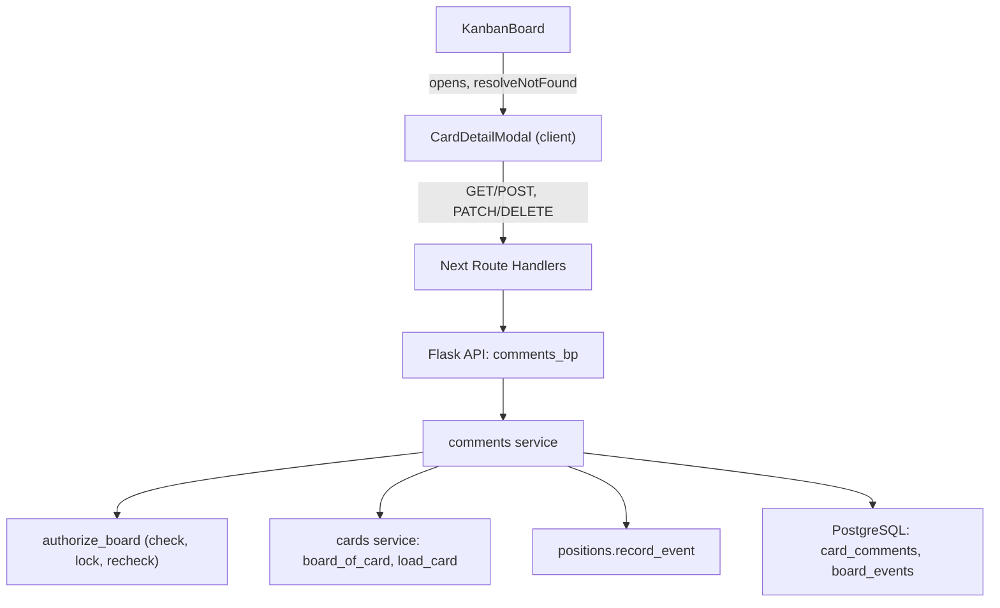

# Design Document: comments (T10)

## Overview

This design implements the comments API (E23–E26) and the card detail modal on `/boards/[id]` (root T10). It follows `requirements.md` (Requirements 1 to 9, decisions M1–M13 approved on 2026-11-13, design clarifications N1–N5) and the shared design D2, D3 and D5. Python (Flask, SQLAlchemy, Marshmallow, pytest) and TypeScript (Next.js App Router, Tailwind, daisyUI, Vitest) are the languages already in the repository. No table, migration, dependency, `docs/API.md` path or field, or E07 shape changes.

### Verified facts about the existing code

| Fact | Where | Consequence |
|---|---|---|
| `CardComment` has `card_id`, `author_id`, `content` (TEXT), `created_at`, `updated_at`, `deleted_at`, and an active index on `(card_id, created_at, id)`. | `backend/app/models/card_comment.py` | No migration. The list query uses the index. |
| `created_at` and `updated_at` use separate `default=utcnow` calls, so a new row gets two slightly different values. `updated_at` has `onupdate=utcnow`, which fires only when SQLAlchemy emits an UPDATE. | `backend/app/models/base.py` | The service sets both from one `utcnow()` on insert, otherwise every new comment would look edited (DD6). A same-content edit emits no UPDATE, but the service skips the write explicitly (DD5). |
| `authorize_board(board_id, user_id, *, role, lock)` returns 404 for a nonmember or removed member, locks and rechecks. `UnauthorizedBoardAccessError` is 403 `FORBIDDEN`. `NotFoundError` is the generic 404. | `blueprints/boards/service.py`, `exceptions.py` | Comments reuse all three. No new exception. |
| `board_of_card(card_id)` and `load_card(card_id, board_id)` already resolve an active card in an active column and reload it under the lock. | `blueprints/cards/service.py` | E23 and E24 reuse them. E25 and E26 need one new `board_of_comment`. |
| `record_event(board_id, actor_id, kind, card_id)` adds a `BoardEvent`. `comment_created` is in the table's kind check. | `app/positions.py`, `models/board_event.py` | E24 calls it. No new kind. |
| `commit_or_rollback()` commits and re-raises with a rollback. | `blueprints/boards/service.py` | Used by every write. |
| `load_json_body(schema)`, `TrimmedString`, `REQUIRED`, `NOT_TEXT`, `unknown = RAISE` define request handling and fixed messages. `specs/fixtures/kanban-field-cases.json` is shared by pytest and Vitest. | `app/validation.py`, `backend/tests/kanban_helpers.py` | Comments add a small `comment-field-cases.json` read by both suites. |
| `BoardTracker` cleanup already deletes `CardComment` rows by tracked card or tracked author. | `backend/tests/boards_helpers.py` | Comment tests need no new cleanup, only a sentinel check. |
| The Next side has `handlePrivateWrite`, `handlePrivateRead`, the `FLASK_PATHS` table with UUID-only parameters, and an `apiClient` allowlist (`DECLARED_BOARD_REQUESTS`, `DECLARED_GETS`). | `frontend/lib/server/*`, `frontend/lib/apiClient.ts` | Add two routes, one parameter name and the declared pairs. |
| `CardEditDialog` holds the title, description, assignee, Save, Cancel and Delete card (with `ConfirmDialog`). `BoardCard` opens it with a button named "Edit <title>". `KanbanBoard` finds the card in the hook's columns by ID, so the dialog closes by itself when the card disappears. | `frontend/components/kanban/` | The detail modal wraps the same form. A card deleted elsewhere closes the modal after the board refetch. |
| `useKanbanBoard.fetchBoard` turns a board 404 into the access toast and a redirect and returns `applied`, `discarded`, `gone` or `failed`. `requestRefresh()` queues a refetch behind the gate and returns nothing. The server returns one generic 404 for a missing card, a missing column and lost board access. | `frontend/hooks/useKanbanBoard.ts` | The modal cannot tell the three 404s apart. It asks the board to refetch, needs the outcome, and then checks whether the card is still on the board (DD10). The hook gets `refreshBoard()` and `hasCard()`. |
| `BaseModal` renders `modal-box w-full max-w-md`, mounts its children only while open, restores focus to the opener and traps Tab. | `frontend/components/shared/BaseModal.tsx` | The detail modal needs a wider box. One optional prop, `wide`, adds it (DD9). |
| `useAuth()` returns the public user (`id`, `name`, `email`). | `frontend/hooks/useAuth.ts` | The modal reads the current user ID to decide which comments show author controls. |

## Architecture



The server page does not read comments. The modal loads them when it opens (M13), so a board load carries no comment data. Comment state lives in the modal and is dropped when it closes.

### Key design decisions

| ID | Decision | Reason |
|---|---|---|
| DD1 | One check sequence per write: resolve the board from the addressed card or comment without checking access, `authorize_board(..., lock=True)`, reload the addressed card or comment under the lock (`populate_existing`) and require it to be active, check authorship (E25, E26), write, commit once. E23 runs the same sequence without the lock and without the author check. | This is the K3 pattern applied to comments (M5–M7). A missing resource, a nonmember and a removed member all end in the same `NotFoundError`, so no ID leaks (C1). |
| DD2 | `comments_bp` is a new blueprint in `backend/app/blueprints/comments/` (`routes.py`, `schema.py`, `service.py`). It imports `authorize_board`, `commit_or_rollback`, `board_of_card` and `load_card` and does not edit the cards blueprint. | BE01 gives each feature its own blueprint. Comments are addressed by their own ID on E25 and E26. |
| DD3 | The author check is `comment.author_id != user_id` after the lock and after the active reload. A mismatch raises `UnauthorizedBoardAccessError` (403 `FORBIDDEN`). It applies to an Admin too. The 404 for a removed author comes from `authorize_board` before this check (M4). | The order 404 then 403 hides nothing: the caller is already confirmed as a participant when the 403 is returned. |
| DD4 | Comment writes never call `bump_position_version` and are not part of the Kanban gate (M5, M12). They still take the board lock, so they serialize with E12 (member removal), E19 (card delete) and E09 (board delete). | The lock gives the 404-after-removal rule without any change to the version. |
| DD5 | E25 compares the trimmed submitted content with the stored content. Equal: return the Comment without a write, without a commit and without touching `updated_at` (M9). Different: set `content`, flush, commit. The UI sends no request for unchanged text. | The explicit compare keeps the behavior independent of ORM change tracking, and the unit test pins it. |
| DD6 | E24 builds the row with `now = utcnow()` and sets `created_at=now, updated_at=now` (N1). The client shows "Edited" only when `updated_at` is strictly later than `created_at`. Tests pin three cases: a new comment has equal timestamps and no marker, a same-content edit leaves `updated_at` alone, and a changed edit moves it forward. | Without this the two defaults differ by microseconds and every new comment would carry the marker. |
| DD7 | Serialization is a dictionary built by one function, `_comment_dict(comment_id)`, that joins `users.name` as `author_name`, like `_card_dict`. `CommentSchema` has explicit `Meta.fields` and a `UtcDateTime` field that converts to UTC and returns ISO 8601. The list query uses the same join and orders by `(created_at, id)`. | An explicit allowlist (BE02, DD9 of boards-membership). The connection's time zone must not change the wire format. |
| DD8 | E24 and E25 share one body schema, `CommentContentSchema`: `content` is required, trimmed, 1 to 2,000 characters, with the fixed messages from the field-case fixture. Inner line breaks are kept. The server stores text and never renders it. | M8. One schema, one fixture. |
| DD9 | The modal is one component pair: `CardDetailModal` (the `BaseModal` and the per-card body) and `CardEditForm` (today's form, moved out of `CardEditDialog.tsx` without its modal wrapper). `BaseModal` gets one optional prop, `wide`, that switches `max-w-md` to `max-w-2xl`. The box keeps `w-full min-w-0`, so it never exceeds the viewport, and the browser check measures the box at 320 and 375 px (N3). The modal title becomes "Card details" and the button on the card "Open <title>" (N2). `CardEditDialog.tsx` is deleted. The Kanban tests that select by "Edit <title>" or "Edit card" change only the selector, and every behavioral assertion carries forward into the `CardEditForm`, `CardDetailModal`, `BoardCard` and `KanbanBoard` tests (M10). | One dialog per card (M10). The comments need more width than a 28 rem box. The old names no longer describe the dialog. |
| DD10 | A 404 on any comment request (E23 to E26) is generic, so the modal handles it in one place, `resolveNotFound()` (N4): call `refreshBoard()` on the board hook, which refetches the board behind the gate and returns the outcome. `gone` (board 404): `fetchBoard` has already shown the access toast and redirected, so the modal does nothing more. `applied` and `hasCard(cardId)` false: toast "That card no longer exists." and close the modal. `applied` and `hasCard(cardId)` true: reload the comments through E23, and after an E25 or E26 404 show "That comment no longer exists." when the reload succeeds. `failed` or `discarded`: inline notice "Comments could not be refreshed." with a Retry button, list unchanged. A 404 from the reload that follows a 404 is not resolved again: the modal shows the same notice with Retry, so there is no loop. `KanbanBoard` passes `resolveNotFound` and `onClose` to the modal. | The server answers one 404 for a missing comment, a missing card and lost access. The board refetch is the existing way to tell them apart, and its access redirect stays the single place that handles lost access. |
| DD11 | Comment state lives in a hook, `useCardComments(cardId)`, used by the modal body. The body is keyed by card ID, so closing the modal or opening another card unmounts the hook. The hook holds a `mountedRef` and an `AbortController` for the E23 read, and ignores every response after unmount (M12, Requirement 7.11). | A keyed body gives a clean state per card, and the guard covers a response that arrives after the unmount. |
| DD12 | One comment write runs at a time inside the hook (a synchronous ref, as the board gate does). The hook exposes `pending`. The modal passes `pending` to `CardEditForm` as `lockCard`, which disables Save card, Delete card and the delete confirmation. The reverse is not enforced: a comment write sent while a card save is pending finishes on its own, and a card removed in the meantime returns 404, which DD10 handles. The pending flag also covers the uncertain-add refresh of DD15. | M12 asks only for the card controls to wait for a comment write. |
| DD13 | Comment content renders as a text node inside an element with `whitespace-pre-wrap break-words`. No `dangerouslySetInnerHTML`, no Markdown. | M8, Requirement 6.9. React escapes text, and `pre-wrap` keeps the line breaks. |
| DD14 | `CommentList` is props-only (FE-C2): the empty message or a `<ul>` of `CommentItem`. The "Comments (n)" heading sits in the modal's section (see "Implementation notes"). `CommentItem` is the only stateful piece of the list: it holds the editor draft and the delete confirmation, and calls its `onEdit` and `onDelete` props. Data loading and all API calls stay in the modal body and the hook. | Requirement 6.8 keeps the list props-driven. An editor draft is view state, not comment data. |
| DD15 | An add that ends in a 5xx or a transport failure is uncertain (N5). `add()` resolves `{ok: false, uncertain: true}` and the hook enters the add state `checking`: the draft stays in the form, the list stays visible (the section does not return to `loading`), Add comment is disabled and a polite status line says "We could not confirm that your comment was posted. Checking the list." The hook then refetches E23 once. Success: the list is replaced, the state becomes `review`, the line becomes "Your comment may have been posted. Check the list, then use Add comment to try again." (an alert that stays until the next add starts or the modal closes) and Add comment is enabled. Failure: the state becomes `refresh-failed`, Add comment stays disabled and a "Refresh comments" button repeats the refetch. A 404 on the refetch goes to `resolveNotFound` (DD10). There is no automatic retry, and no code compares comment text or ID to hide a duplicate. Edit and delete are not part of this state. | A lost response can hide a saved comment. Showing the refreshed list before any retry lets the user decide, and an automatic retry or a text match would post twice or hide a real second comment. |

## Components and Interfaces

### Backend layout (T10)

```text
backend/app/
  blueprints/
    comments/{__init__,routes,schema,service}.py    # comments_bp, E23–E26
  __init__.py                                       # register comments_bp
specs/fixtures/comment-field-cases.json             # content: empty, spaces, 1, 2000, 2001, newline, non-text, unknown field
```

Services take plain IDs and return dictionaries. Routes validate and serialize through explicit schemas.

### Routes

| Endpoint | Route | Caller | Body |
|---|---|---|---|
| E23 | `GET /api/cards/<card_id>/comments` | Participant | none |
| E24 | `POST /api/cards/<card_id>/comments` | Participant | `content` |
| E25 | `PATCH /api/comments/<comment_id>` | Author, still a participant | `content` |
| E26 | `DELETE /api/comments/<comment_id>` | Author, still a participant | none |

All routes use `@token_required`. Path IDs go through `parse_uuid` (400 before any query).

### Check order

1. Authenticate (401).
2. Path ID and body shape (400, no database).
3. Resolve the board: `board_of_card(card_id)` for E23 and E24, `board_of_comment(comment_id)` for E25 and E26. A missing, soft-deleted or inactive-ancestor resource raises `NotFoundError`.
4. `authorize_board(board_id, user_id, lock=<write>)`: nonmember or removed member 404, lock, recheck.
5. Reload the addressed card (`load_card`) or comment (`load_comment`) under the lock and require it to be active and on this board (404).
6. E25 and E26: author check (403).
7. Write, record the event (E24 only), commit once.

### Service sketch

```python
# backend/app/blueprints/comments/service.py
def list_comments(card_id, user_id) -> list[dict]:                 # E23
    board_id = board_of_card(card_id)
    authorize_board(board_id, user_id)                              # no lock, read only
    return _comment_rows(card_id)                                   # join users, order by (created_at, id)

def create_comment(card_id, user_id, content) -> dict:             # E24
    board_id = board_of_card(card_id)
    authorize_board(board_id, user_id, lock=True)
    load_card(card_id, board_id)                                    # active under the lock, else 404
    now = utcnow()
    comment = CardComment(card_id=card_id, author_id=user_id, content=content,
                          created_at=now, updated_at=now)           # DD6
    db.session.add(comment)
    db.session.flush()
    record_event(board_id, user_id, "comment_created", card_id)
    # T13 adds the assignee notification here, in this transaction.
    created = _comment_dict(comment.id)
    commit_or_rollback()
    return created

def update_comment(comment_id, user_id, content) -> dict:          # E25
    board_id = board_of_comment(comment_id)
    authorize_board(board_id, user_id, lock=True)
    comment = load_comment(comment_id, board_id)                    # active, card and column active
    if comment.author_id != user_id:
        raise UnauthorizedBoardAccessError()                        # DD3
    if content == comment.content:
        return _comment_dict(comment_id)                            # DD5: no write, updated_at unchanged
    comment.content = content
    db.session.flush()
    updated = _comment_dict(comment_id)
    commit_or_rollback()
    return updated

def delete_comment(comment_id, user_id) -> dict:                   # E26
    ...same checks...
    snapshot = _comment_dict(comment_id)                            # M3: the pre-delete DTO
    comment.deleted_at = utcnow()
    commit_or_rollback()
    return snapshot
```

`board_of_comment` selects `BoardColumn.board_id` through `CardComment`, `Card` and `BoardColumn`, requiring all three `deleted_at` null. `load_comment` repeats the join with `populate_existing`. The unchanged-edit return leaves the transaction open and the request teardown rolls it back, as the unchanged move in `move_card` does.

### Serialization

`CommentSchema` (`Meta.fields`: `id`, `card_id`, `author_id`, `author_name`, `content`, `created_at`, `updated_at`). E23 returns the list, E24 returns the Comment (201), E25 returns it (200), E26 returns the pre-delete Comment (200). No envelope beyond `{"data": ...}`.

### Next handlers and client allowlist

Add to `FLASK_PATHS`: `cardComments: "/api/cards/:cardId/comments"` and `comment: "/api/comments/:commentId"`, and `commentId` to `FlaskParamName` and `FLASK_PARAM_NAMES`.

| Next route | Handler | Spec |
|---|---|---|
| `app/api/cards/[id]/comments/route.ts` | `GET` | `handlePrivateRead`, route `cardComments`, param `cardId` |
| same file | `POST` | `handlePrivateWrite`, `allowedKeys: ["content"]` (exact key set) |
| `app/api/comments/[id]/route.ts` | `PATCH` | `handlePrivateWrite`, route `comment`, `allowedKeys: ["content"]` |
| same file | `DELETE` | `handlePrivateWrite`, route `comment`, no body |

`apiClient.ts` adds `POST /api/cards/UUID/comments`, `PATCH` and `DELETE /api/comments/UUID` to `DECLARED_BOARD_REQUESTS`, and `/api/cards/UUID/comments` to `DECLARED_GETS`. A path with a non-UUID segment throws before `fetch`.

### Frontend layout (T10)

```text
frontend/
  components/kanban/
    CardDetailModal.tsx      # BaseModal (wide), keyed body: CardEditForm + comments section, live region
    CardEditForm.tsx         # the existing form moved from CardEditDialog (adds lockCard)
    CommentList.tsx          # props-only: heading with count, empty text, list of CommentItem
    CommentItem.tsx          # one comment: text, meta, Edit/Delete for the author, inline editor, ConfirmDialog
    CommentForm.tsx          # the add form: multiline field, Add comment button
    CardEditDialog.tsx       # deleted
    BoardCard.tsx            # button renamed "Open <title>" (N2)
    KanbanBoard.tsx          # opens the modal, passes resolveNotFound (refreshBoard, hasCard) and onClose
  components/shared/BaseModal.tsx   # + optional wide prop
  hooks/useCardComments.ts   # load, add, edit, remove, pending, add state, announcement, stale guard
  hooks/useKanbanBoard.ts    # + refreshBoard() returning the outcome, hasCard(cardId)
  lib/comments.ts            # parseComment, parseCommentList (allowlist parsers)
  lib/commentRules.ts        # validateCommentContent (trim, 1 to 2,000), shared with the fixture
  lib/types.ts               # Comment
  app/api/cards/[id]/comments/route.ts, app/api/comments/[id]/route.ts
```

`CommentList` is server-compatible. It enters the client graph through the modal. `CardDetailModal`, `CommentItem`, `CommentForm` and `CardEditForm` are client components.

`useKanbanBoard` gets two additions (WP-F4). `refreshBoard(): Promise<"applied" | "discarded" | "gone" | "failed">` runs the same gated refetch as `requestRefresh()` and resolves with its outcome. When the gate is held it waits behind it, as `requestRefresh()` does, and resolves with the queued refetch's outcome. `hasCard(cardId): boolean` reads the current columns ref. `requestRefresh()` and the member-removal refresh keep their behavior. The modal's `resolveNotFound` is `async () => { const outcome = await kanban.refreshBoard(); return outcome === "applied" ? (kanban.hasCard(cardId) ? "card-present" : "card-gone") : outcome === "gone" ? "access-lost" : "unknown"; }`.

### Modal and comment state

```ts
type CommentsStatus = "loading" | "ready" | "error";
type AddState = "idle" | "checking" | "review" | "refresh-failed";   // DD15
type CommentWrite =
  | { ok: true }
  | { ok: false; handled: boolean; uncertain?: boolean; fields?: Record<string, string> };

useCardComments({ cardId, resolveNotFound }) => {
  comments: Comment[], status, pending, addState, announcement, notice,   // notice: inline text for a failed write
  reload(),                          // Retry, Refresh comments, and the reload after 403 or a 404 resolution
  add(content), edit(commentId, content), remove(commentId),   // each resolves a CommentWrite
}
```

- The hook loads once on mount through `apiGet("/api/cards/<id>/comments")` with an `AbortController`. `status` is `loading`, then `ready` or `error`. `reload()` is the Retry action and is also used after a 403 or a comment-only 404.
- `pending` is true while one write runs or the uncertain-add refetch runs. `add`, `edit` and `remove` return without a request when a write is already running or when the component is unmounted. `add` also returns without a request while `addState` is `checking` or `refresh-failed`.
- A successful add appends the parsed Comment to the end of the list, an edit replaces it by ID, a delete filters it out. The list is not re-sorted, because the server already returned creation order and a new comment is the newest.
- Every response and every error is dropped when `mountedRef` is false (Requirement 7.11).
- `announcement` carries "Comment added.", "Comment saved.", "Comment deleted." and the failure messages to a polite live region in the modal.

### Failure handling

| Outcome | List | Feedback |
|---|---|---|
| E23 5xx or transport failure on open | `status` `error` | "Comments could not be loaded." and a Retry button inside the section. The edit form stays usable. |
| Any comment request returns 404 | unchanged until resolved | `resolveNotFound()` (DD10): lost access redirects, a gone card closes the modal with a toast, an existing card reloads E23, a failed board refetch shows the notice with Retry. |
| E24 400 `fields.content` | unchanged | Message under the field, text kept. |
| E25 400 `fields.content` | unchanged | Message under the editor field, text kept. |
| E25 or E26 403 | reload | Inline notice "Only the author can change a comment." |
| E25 or E26 404 after the card is confirmed present | reload | Inline notice "That comment no longer exists." when the reload succeeds. |
| E24 5xx or transport failure | stays visible, then refreshed | Draft kept. Add comment disabled. "We could not confirm that your comment was posted." Refetch E23, then "Your comment may have been posted. Check the list, then use Add comment to try again." and Add comment enabled. A failed refetch shows "Refresh comments" and keeps Add comment disabled (DD15). |
| E25 or E26 5xx or transport failure | unchanged | Inline notice "Your comment was not saved. Try again." (delete: "The comment was not deleted. Try again."). The entered text stays. |
| 401 `AUTH_REQUIRED` | n/a | `useErrorHandler` redirect to login. |
| Any response after unmount | n/a | Ignored. |

### Screens and states

| Area | Behavior |
|---|---|
| Modal | `BaseModal wide`, title "Card details". The box scrolls inside itself (daisyUI `modal-box` already limits the height and scrolls). Order: the edit form, then the comments section. Below 640 px the dialog is a bottom sheet (`modal-bottom`). |
| Edit form | Unchanged from `CardEditForm`: Title, Description, Assignee, Delete card, Cancel, Save card. |
| Comments section | A `section` with a `h3` "Comments (n)". It is separated from the form by `border-t border-base-300`, not a nested `.surface` (FE-D3). |
| List | `ul` with `divide-y divide-base-300`. Each item: author name (semibold), a `<time dateTime>` with the local date and time, an "Edited" text marker when `updated_at > created_at`, the content as pre-wrapped text. The author sees Edit and Delete buttons named "Edit your comment from 12 Nov" and "Delete your comment from 12 Nov". |
| Editor | Replaces the text: multiline `FormField` with the current content, Save and Cancel. Unchanged text closes without a request. Focus goes to the field on open and back to the Edit button on Cancel or Save. |
| Delete | `ConfirmDialog` "Delete comment?" with Cancel and "Delete comment". After success the focus moves to the comment field. |
| Add form | Multiline field labeled "Add a comment", an "Add comment" button. After success the field is cleared and keeps focus. After an uncertain outcome the draft stays, the button follows DD15, and the message sits above the form in an alert. |
| States | Loading: "Loading comments…" with `aria-busy`. Empty: "No comments yet." Error: message and Retry. |
| Color | Teal marks Add comment and Save, red the delete actions. No new color (FE-D1). |

### Mobile design (Requirements 8, FE-S4 to FE-S6, FE-D9)

The modal is a bottom sheet below 640 px and scrolls inside. Text uses `break-words`, so a long unbroken string cannot widen it. Every button is a `BaseButton` with `min-h-11`, and the buttons of a comment stack with the Edit and Delete pair on one wrapped row. The fields use `text-base`. `lib/mobileGuard.test.ts` keeps `h-screen`, `100vh` and zoom locks out of the new files. Measured checks are in "Browser checks".

## Data Models

No schema change. `card_comments` and `board_events` are unchanged.

### Wire shape (unchanged from `docs/API.md`)

```text
Comment { id, card_id, author_id, author_name, content, created_at, updated_at }
E23 data: Comment[]    E24 data: Comment (201)    E25 data: Comment    E26 data: Comment (before delete)
```

### Frontend type

```ts
type Comment = { id: string; card_id: string; author_id: string; author_name: string;
                 content: string; created_at: string; updated_at: string };
```

`parseComment` copies only these fields, requires strings, and checks that both timestamps parse as dates. Any other shape throws `malformedApiError()`.

### Request rules

| Field | Rule |
|---|---|
| `content` | Text, trimmed, 1 to 2,000 characters, inner line breaks kept. Missing, `null`, non-text, blank and over-long values are 400 with `fields.content`. |
| Unknown fields | 400. |
| Path IDs | UUID, else 400 before any query. |

Messages are fixed strings. `specs/fixtures/comment-field-cases.json` holds the cases and both the pytest and Vitest suites read it.

## Error Handling

| Condition | Status and code | Where |
|---|---|---|
| Missing, invalid or expired token | 401 `AUTH_REQUIRED` | `token_required` |
| Bad path UUID, bad body, unknown field | 400 `VALIDATION_ERROR` | route, before any query |
| Nonmember, removed member (a removed author included), missing, deleted or other-board card or comment, inactive column or board | 404 `NOT_FOUND` | `board_of_*`, `authorize_board`, reload under the lock |
| Participant who is not the author (E25, E26), an Admin included | 403 `FORBIDDEN` | service, after the lock |
| Failed commit | rollback, then the central handler's 500 or 503 | `commit_or_rollback` |

Every response carries `Cache-Control: private, no-store` (inherited from `response_headers.py`). Messages never include the submitted content or another board's data.

## Testing Strategy

### Approach

Parameterized pytest and Vitest tests with deterministic fixtures. No Hypothesis or fast-check. The Playwright journey is delivered in T15. This slice runs a measured mobile check and a manual journey.

### Test data isolation (Requirement 9.6)

Backend tests run on `TEST_DATABASE_URL` through `db_guard` and `BoardTracker`. Boards, cards and comments created through the API belong to tracked boards, and the tracker's cleanup deletes only tracked rows, in foreign-key order, whether the test passes or fails. No `TRUNCATE`, no name patterns, never `DATABASE_URL`. `test_boards_cleanup.py` is extended with a comment on an untracked sentinel board that must survive.

### Backend test files (V06)

| File | Covers |
|---|---|
| `test_comments_schema.py` | Cases from `comment-field-cases.json`, non-text content, unknown fields, `CommentSchema` allowlist, UTC ISO timestamps under a non-UTC connection time zone. |
| `test_comments_list.py` | E23 order by creation time then ID, empty list, soft-deleted omission, author name from `users` and after a rename, removed author's comments still listed to others. |
| `test_comments_create.py` | E24 201 shape, trimming, inner line breaks kept, 400 cases, `created_at == updated_at`, one `comment_created` event with actor, board and card, `position_version` unchanged, Member and Admin both succeed, and two identical posts create two comments (no deduplication). |
| `test_comments_edit_delete.py` | E25 changed edit (200, `updated_at` later, `created_at`, `author_id`, `card_id` kept, no event), same-content edit (200, `updated_at` unchanged), 403 for a non-author Member and for an Admin with state unchanged, E26 body equals the pre-delete DTO, omission from E23, repeat 404, edit after delete 404, no event on edit or delete. |
| `test_comments_access.py` | Matrix for E23–E26: anonymous 401, nonmember 404, removed member 404, removed author 404 on E25 and E26, other-board card and comment IDs, soft-deleted card, column and board 404, identical 404 envelopes, `no-store` on success and error. |
| `test_comments_request_order.py` | 401, then 400, then 404, then 403, over valid and invalid bodies and each caller: an invalid body from a nonmember is 400, a valid body from a nonmember is 404, an invalid body from a non-author is 400, a valid body from a non-author is 403. |
| `test_comments_concurrency.py` | E24 racing a member removal (404 after the removal), E24 racing a card delete, E25 racing E26 by the author (both end consistent: one wins, no 500). |
| `test_comments_atomicity.py` | An injected failure after the flush and before the commit leaves no comment and no event (E24) and no changed content (E25). |
| `test_comments_properties.py` | Parameterized properties 1 to 8 below. |

### Frontend test files (Vitest and React Testing Library)

| File | Covers |
|---|---|
| `lib/comments.test.ts`, `lib/commentRules.test.ts` | Parsers reject extra or missing shapes. Rules match the shared fixture. |
| `lib/commentsClient.test.ts` | The declared pairs only, non-UUID segments throw before `fetch`. |
| `app/api/commentsRoutes.test.ts` | Each new handler: Origin 403 on writes, 401 cookie clear, allowed keys, upstream status pass-through, `no-store`, `GET` without Origin check. |
| `hooks/useCardComments.test.tsx` | Load, error and retry, add appends, edit replaces, remove filters, one write at a time, a response after unmount is ignored, 403 paths, `resolveNotFound` results (card present reloads, card gone, access lost, unknown, no loop on a repeated 404). The uncertain-add states: `checking`, `review`, `refresh-failed`, with the list kept visible, the draft kept, the add blocked and no automatic retry. |
| `components/kanban/CommentList.test.tsx`, `CommentItem.test.tsx` | Author name, content with line breaks, markup shown as literal text, Edited marker only when `updated_at > created_at`, empty state, author-only controls (not for another user or an Admin), editor open, unchanged Save sends nothing, Cancel restores and returns focus, delete confirmation. |
| `components/kanban/CardDetailModal.test.tsx` | Carries forward the `CardEditDialog` behavioral tests with the new selectors (field errors keep values, unchanged Save closes, Delete confirmation, Escape without a request, focus return) and adds loading, empty, error and Retry, add flow with focus kept and no Edited marker on the new comment, pending disables card Save and Delete, live region text, stale response after close or card switch, and the **lost-response regression** (a fake server saves the comment, the POST response is rejected with a network error, then the draft and list stay visible, Add comment is disabled while E23 is pending, the refreshed list shows the comment once, one POST has been sent, Add comment is enabled, and a manual click sends a second POST that creates a second comment). A second case fails the refetch and checks that Add comment stays disabled until Refresh comments succeeds. |
| `components/kanban/BoardCard.test.tsx`, `KanbanBoard.test.tsx`, `hooks/useKanbanBoard.test.tsx`, `components/shared/BaseModal.test.tsx` (extended) | The "Open <title>" button and "Card details" dialog (selectors updated, behavioral assertions kept), `resolveNotFound` closes the modal for a gone card and keeps it for an existing card, `refreshBoard()` returns the outcome and waits behind the gate, `hasCard`, `wide` changes only the box width. |

### Browser checks (V05, V10, V11)

- `evidence/comments-mobile-measure.mjs` in the style of `evidence/kanban-mobile-measure.mjs`: the board with a card, the modal with no comments, with comments (including a long unbroken string and a multi-line comment), the comment editor, the delete confirmation, as author and as a second user, at 320, 375, 768 and 1280 px. Checks: `scrollWidth <= innerWidth` for the page, every interactive box at least 44 by 44 with `elementFromPoint` at the center, field font size at least 16 px, focus entry, Tab containment, Escape without an API call, focus return, the close control reachable when the content is taller than the viewport, and the `wide` dialog box no wider than the viewport at 320 and 375 px (box `getBoundingClientRect().width <= innerWidth`, no horizontal page scroll).
- Screenshots at 375, 768 and 1280 px beside the record (FE-D9). The record says emulator or real device.
- A manual journey at 375 px: open a card, add a comment, edit it, delete it, reload, and a second user who sees the comment without controls.
- The V10 Playwright journey is delivered in T15.

## Correctness Properties

Each property is a parameterized test over fixed tables, not a generator.

1. **Content rule:** for the fixture table, a body is accepted exactly when its trimmed content has 1 to 2,000 characters, and the stored value is the trimmed text with inner line breaks kept.
2. **Response allowlist:** every E23 to E26 body contains only the documented Comment fields.
3. **Author-only:** for each caller kind (author, Member non-author, Admin non-author, removed author, nonmember), E25 and E26 succeed only for the author, return 403 for the two current participants and 404 for the other two, and change nothing on a failure.
4. **Inaccessible resources are indistinguishable:** missing, soft-deleted, other-board, inactive-ancestor and nonmember cases give one 404 envelope on E23 to E26.
5. **No position change:** `position_version` and the order of columns and cards are unchanged after any E24 to E26 request.
6. **Events:** each successful E24 writes exactly one `comment_created` event in the same transaction, and a failed E24, E25 and E26 write none.
7. **Timestamps and identity:** a new comment has equal `created_at` and `updated_at`. `updated_at` changes only on an edit that changes the trimmed content. `author_id`, `card_id` and `created_at` never change.
8. **List order and omission:** E23 returns active comments sorted by `(created_at, id)` and omits a deleted one.
9. **Failed writes leave no partial state:** an injected failure leaves comments and events unchanged.
10. **Writes serialize with board changes:** a comment write that loses a race with a member removal or a card delete returns 404 and writes nothing.
11. **Author-only controls (frontend):** Edit and Delete show only on comments whose `author_id` is the current user's ID, never for an Admin on another user's comment.
12. **Client sends only declared requests (frontend):** non-UUID segments throw before `fetch`.
13. **Stale responses (frontend):** a response that arrives after the modal closed or the card changed is never applied.
14. **Card controls wait (frontend):** while a comment write is pending, card Save and Delete are disabled.
15. **Plain text (frontend):** content that contains markup renders as that literal text with its line breaks.
16. **Edited marker is reliable:** a new comment has equal timestamps and shows no marker (backend and frontend), a same-content edit leaves `updated_at` and shows no marker, a changed edit shows it.
17. **Uncertain add (frontend):** after a 5xx or a transport failure on add, the draft and the list stay visible, Add comment is disabled until an E23 refresh succeeds, exactly one POST is sent without a user click, a manual retry sends a second POST, and no comment is hidden by matching its text. A comment that was saved while its response was lost appears in the refreshed list once.
18. **No deduplication (backend):** two E24 requests with the same content from the same author create two comments.
19. **Generic 404 resolution (frontend):** a comment 404 leads to a board refetch. Lost access redirects, a missing card closes the modal, an existing card reloads the comments, and a failed or repeated 404 stops with a Retry notice and no loop.

## Acceptance Criteria Map

| Requirement | API, UI | Work packages | Verification |
|---|---|---|---|
| 1 (list) | E23 · `CommentList`, loading, empty and error states | WP-B1, WP-F2, WP-F3 | V06 `test_comments_list.py`, properties 2, 8; RTL |
| 2 (add, AC08.1) | E24 · `CommentForm` | WP-B1, WP-F3 | V06 `test_comments_create.py`, properties 1, 5, 6, 7, 16, 18; RTL |
| 3 (edit, AC08.2) | E25 · `CommentItem` editor | WP-B1, WP-F3 | V06 `test_comments_edit_delete.py`, properties 3, 7; RTL |
| 4 (delete) | E26 · `CommentItem` delete confirmation | WP-B1, WP-F3 | V06 `test_comments_edit_delete.py`, property 3; RTL |
| 5 (order, atomicity, contracts) | `comments` service | WP-B1, WP-B2 | V06 access, request order, concurrency, atomicity; properties 4, 9, 10 |
| 6 (modal and list) | `CardDetailModal`, `CommentList`, `BoardCard`, `KanbanBoard`, `BaseModal wide` | WP-F3, WP-F4 | V05, V06 RTL; properties 15, 16, 19; V11 |
| 7 (comment actions in the UI) | `useCardComments`, `CommentItem`, `CommentForm` | WP-F2, WP-F3 | RTL hook and component tests; properties 11, 13, 14, 17, 19 |
| 8 (mobile, AC13.1) | every new control and the modal | WP-F3, WP-V | V11 measured script, screenshots, manual journey |
| 9 (handlers, verification) | Next handlers, allowlist, docs | WP-F1, WP-D | V06, V13 (Origin, `no-store`), property 12 |

Work packages: **WP-B1** `comments_bp` (schema, service, routes, registration, fixture). **WP-B2** backend tests and the cleanup sentinel. **WP-F1** types, parsers, rules, Next handlers, `FLASK_PATHS`, client allowlist. **WP-F2** `useCardComments`. **WP-F3** `CardDetailModal`, `CardEditForm`, `CommentList`, `CommentItem`, `CommentForm`, `BaseModal wide`. **WP-F4** `BoardCard` and `KanbanBoard` wiring, removal of `CardEditDialog`, carried-forward tests. **WP-V** mobile script and journey. **WP-D** documentation.

### Dependencies and gates

Root T08 and T09 are verified, so no gate blocks the start. WP-B1 comes before WP-F1 (the handlers need the contract to be live), WP-F1 before WP-F2, WP-F2 before WP-F3, WP-F3 before WP-F4. Root T10 is checked only when the backend checks, the frontend checks and the measured mobile check pass. Unverified work stays open.

## Contract and Document Impact

No endpoint path, method, request field or response field changes. These clarifications are recorded with the approved requirements:

| ID | Change | Where applied |
|---|---|---|
| C14 | E25 and E26: a participant who is not the author, an Admin included, gets 403 `FORBIDDEN`. A removed author or other nonmember gets the generic 404 (M4). | `docs/API.md`, `backend/specs/api-contract.md` |
| C15 | Comment check order and lock: shape (400), board access (404), lock, recheck, reload under the lock (404), author (403). No `position_version` change. `comment_created` recorded on E24 only (M5–M7). | `docs/API.md`, `backend/specs/api-contract.md` |
| C16 | Content is trimmed plain text, 1 to 2,000, inner line breaks kept. A same-content edit returns 200 and leaves `updated_at`. E26 returns the pre-delete Comment. E23 is unpaginated (M2, M3, M8, M9). | `docs/API.md`, `specs/requirements.md` AC08.2 |
| C17 | Browser Route Handlers for E23 to E26 (M13). | `frontend/specs/api-integration.md` |

Already applied with the requirements approval (2026-11-13): `specs/requirements.md` AC08.2, `docs/API.md` E23 to E26 and the comment check-order note, `backend/specs/api-contract.md` (comments row), `docs/TEST-PLAN.md` V06, `docs/RUBRIC.md` (create-path difference), `specs/design.md` D5 (card detail row), `specs/CHANGELOG.md` and `evidence/spec-review.md`. At finalization: `frontend/specs/pages-and-components.md` (modal, `CommentList` and the new parts), `frontend/specs/api-integration.md` (C17), `frontend/specs/error-handling.md` (comment 403 and 404 handling), `guidelines/frontend.md` (component table: `CardDetailModal`, `CardEditForm`, `CommentItem`, `CommentForm`; `CardEditDialog` removed). `specs/traceability.md` gets the T10 rows at implementation. `specs/tasks.md` links the native spec from T10 at finalization.

## Implementation notes (2026-11-13)

Three details changed during implementation, none of them a behavior or contract change (recorded in `specs/CHANGELOG.md`): the heading moved from `CommentList` to the modal's section, the modal header gained a Close button so the close control stays reachable while the box scrolls, and `BaseModal` now stops `cancel` propagation and ignores Tab from a nested dialog. The last one fixes a defect found by the browser check: React bubbles `cancel` through the component tree, so Escape on a nested confirmation also closed the dialog behind it. `CommentForm` also focuses its field after a successful add (Requirement 7.1).

## Review Items and Decisions

M1–M13 are resolved as written in `requirements.md` ("Resolved decisions"). The design review on 2026-11-13 approved points 1 to 4 and revised point 5 (N1–N5):

| Item | Resolution |
|---|---|
| Timestamps (N1) | Approved. One clock reading on create, with tests for no Edited marker on a new comment and an unchanged `updated_at` on a same-content edit (DD6). |
| Names (N2) | Approved. "Open <title>" and "Card details". Selectors change, behavioral assertions stay (DD9). |
| `BaseModal wide` (N3) | Approved, with a check that the box fits a 375 px viewport (DD9). |
| Generic 404 (N4) | Approved. Refetch the board, redirect on lost access, close the modal when the card is gone, reload the comments when the card exists (DD10). |
| Uncertain add (N5) | Revised by the user. Keep the draft and the list, show that the comment may have been posted, refetch E23, keep Add comment disabled until the refresh succeeds, then allow a manual retry. No automatic retry, no deduplication by text, with a saved-but-response-lost regression test (DD15). |

Other choices that stay as designed: one comment write at a time with a synchronous ref and not the board gate (DD12), and a props-only `CommentList` with the editor draft held by `CommentItem` (DD14).

## Risks

| Risk | Handling |
|---|---|
| A manual retry after a lost add response can still duplicate a comment. | The modal refreshes and shows the list before it enables the retry, and tells the user the comment may have been posted. The user decides, and can delete their own duplicate. A server idempotency key is out of scope. |
| A nested `<dialog>` (the delete confirmation inside the modal) can lose focus return when the opener is removed. | After a successful delete the modal moves focus to the comment field in an effect. Tested in `CardDetailModal.test.tsx` and in the browser check. |
| The modal is taller than the viewport on a phone with a long thread and the edit form. | The box scrolls inside itself and the close control stays reachable. Measured at 320 and 375 px. |
| An unbounded E23 list grows with the thread. | Within the project's scale (no cap in v1, M2). Revisit if a thread passes a few hundred comments. |
| Renaming the card button breaks locators in the unwritten Playwright journey. | T15 is written after this slice and uses the new names. |
| The T13 notification write will extend the E24 transaction. | A one-line marker in `create_comment` shows the place. T13 adds the write and its tests. |
