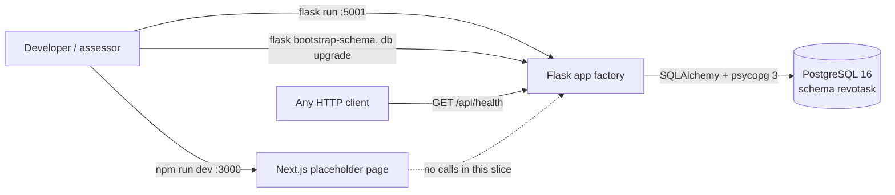

# Design · foundation (T01–T02)

**Status:** Ready for phase review. Nothing is implemented. This design refines root `specs/design.md` D1, D2 (error handling only), D3 and D6 for the foundation slice. It does not change them, except for the approved 405 addition already recorded in `specs/CHANGELOG.md`.
**Requirements:** `requirements.md` in this folder (FND-R1 to FND-R9, assumptions A1–A10).
**Guidelines applied:** BE01, BE02, BE05, BE07, BE08, DB01–DB06, FE-C1, FE-S1, FE-N7, FE-N9, FE-A4.

## 1. Overview



The Next.js app and Flask do not talk to each other in this slice. The dashed line is the T04 integration. Foundation delivers the three pieces each later slice builds on: a validated Flask factory, a migrated schema, and a Next.js shell with styling and test tooling.

## 2. Key design decisions

| # | Decision | Alternatives considered | Consequence |
|---|---|---|---|
| DD1 | One first revision for all nine tables. | One migration per slice: smaller reviews, but T02's "inspect constraints and indexes" check would be incomplete and cross-table constraints (FKs, partial indexes) would be reviewed in pieces. | A large revision. Reviewed table by table in task 2.5. |
| DD2 | Schema creation is a separate Flask CLI command, `bootstrap-schema`. The migration environment checks for the schema and fails with instructions when it is missing. | (a) `CREATE SCHEMA IF NOT EXISTS` inside Alembic `env.py`: fewer steps, but needs schema-creation rights during every migration and hides the Supabase provisioning step that the runbook must document. (b) A raw SQL file: not reusable by tests. | One extra command before the first `upgrade`. Tests and developers use the same code path. Supabase provisioning is a documented release step (FND-AC8.3). |
| DD3 | Bootstrap checks `pg_namespace` first and runs `CREATE SCHEMA` only when the schema is missing. | Run `CREATE SCHEMA IF NOT EXISTS` unconditionally. PostgreSQL may check the caller's database-level privilege even when the schema exists. I have not verified this. | An existing schema is never touched, so a role without database-level CREATE can still run the command against a provisioned schema. |
| DD4 | Tests build the schema through `bootstrap-schema` and `db upgrade`, never `create_all`. Data tests use a SAVEPOINT-per-test transaction. | `create_all` (faster, but does not test the migration). SQLite (cannot express partial indexes, `TIMESTAMPTZ`, `Infinity`/`NaN`). | Tests need local PostgreSQL. A migration test module owns the schema lifecycle (see §8). |
| DD5 | The shared error envelope, request ID and logging belong to foundation. Domain exceptions beyond those here come with T03. | Leave E01 to return an ad hoc 503 body and add the envelope in T03: simpler now, but E01 would need rework and 404/405 would return HTML. | Small, deliberate overlap with T03's "validation/errors" row. Task 2.1 defines `ApiError` and `ServiceUnavailableError`. T03 adds subclasses. |
| DD6 | Database CHECKs cover only the invariants the data model states: finite positive `order`, nonnegative `position_version`, allowed `role` and `kind` values, normalized email. | Mirror every length and trim rule in the database: stricter, but duplicates Marshmallow schemas and makes later length changes need migrations. | Application-level limits (comment length, description 2,000 characters) stay with T05–T10 schemas. |
| DD7 | Partial indexes limited to active rows (`deleted_at IS NULL`). | Full indexes: simpler, but would index soft-deleted rows that every read filters out. | Query filters must include `deleted_at IS NULL` to use these indexes. That is already required by D3. |
| DD8 | Health check opens a connection from the pool and runs `SELECT 1` inside a transaction with a transaction-local statement timeout. Engine options set connection and pool timeouts and `pool_pre_ping`. | A dedicated raw psycopg connection per health call: ignores pool problems, which hides real faults. | `connect_timeout` and `pool_timeout` apply to all connections, not only health. T16 may tune them. |
| DD9 | Frontend test runner is Vitest with jsdom and React Testing Library. Async Server Components and browser flows are Playwright territory and arrive with T15. | Jest: more setup under the App Router. | Vitest cannot render async Server Components, so the placeholder page is synchronous (A5, A9). |
| DD10 | Python runtime is CPython 3.14.5 with a stop-and-report rule. | Pin an older interpreter now: avoids the risk, but overrides the project owner's decision. | Task 1.1 is gated: if any package fails, work stops there and reports it. |
| DD11 | Build the backend as a Docker image from the start (revision 2). One `backend/Dockerfile` runs locally through Compose and on Render. Gunicorn is pinned in T01. | Docker only at T16, with the native Render runtime: less work now, but the first container run would then happen on the release path with no local evidence. A native Render runtime: the image would not be tested locally. | Dockerfile, `.dockerignore` and `compose.yaml` are T01 deliverables. Render is set up in T16 (FND-AC10.6). Local runs use `host.docker.internal` for the host PostgreSQL. |

## 3. Planned repository layout

New files only. Existing files change only where listed in §10.

```text
backend/
  .python-version                 # 3.14.5
  Dockerfile                      # python:3.14.5-slim, non-root, Gunicorn on $PORT (FND-R10)
  .dockerignore                   # excludes .env*, .venv, caches, tests, supabase-ca.crt
  requirements.txt                # runtime pins
  requirements-dev.txt            # -r requirements.txt + pytest, ruff, python-dotenv
  pyproject.toml                  # ruff and pytest configuration
  app/
    __init__.py                   # create_app
    config.py                     # Settings, ConfigError
    extensions.py                 # db (MetaData + naming convention), migrate, jwt
    exceptions.py                 # ApiError, ServiceUnavailableError
    errors.py                     # envelope builder and global handlers
    request_context.py            # request ID, request logging
    cli.py                        # bootstrap-schema
    blueprints/health/{__init__,routes,service}.py
    models/{__init__,base,user,board,board_member,board_column,card,card_comment,notification,board_event,revoked_token}.py
  migrations/                     # flask db init output, then env.py edits
    versions/<rev>_initial_schema.py
  tests/
    conftest.py, db_guard.py
    test_config.py, test_factory.py, test_request_context.py, test_errors.py
    test_health.py, test_db_guard.py, test_bootstrap_schema.py
    test_migration.py, test_schema_inspection.py, test_models_metadata.py, test_db_constraints.py
frontend/
  package.json, package-lock.json, .nvmrc
  tsconfig.json, next.config.ts, postcss.config.mjs, eslint.config.mjs
  vitest.config.mts, vitest.setup.ts
  app/{layout.tsx, page.tsx, page.test.tsx, globals.css}
evidence/foundation-T01-T02.md    # sanitized commands and outcomes
```

`next-env.d.ts` and other generated files follow the scaffold output and are reviewed in the diff.

## 4. Backend design

### 4.1 Configuration (`config.py`, FND-AC1.2)

`Settings.from_env(env=None)` reads (implementation: `env` replaces `os.environ` when given, so tests do not depend on the shell) `APP_ENV`, `DATABASE_URL`, `JWT_SECRET_KEY`, `LOG_LEVEL` (default `INFO`). Validation order is fixed so errors are deterministic. Each failure raises `ConfigError("<VARIABLE>: <reason>")` and the message never includes the value.

| Variable | Rule |
|---|---|
| `APP_ENV` | One of `development`, `test`, `production`. Required. |
| `DATABASE_URL` | Required. Parsed with `sqlalchemy.engine.make_url`. Driver must be `postgresql+psycopg`. |
| `JWT_SECRET_KEY` | Required and non-empty. At least 32 characters when `APP_ENV=production` (A4). |
| `LOG_LEVEL` | One of `DEBUG`, `INFO`, `WARNING`, `ERROR`, `CRITICAL`. |

`TEST_DATABASE_URL` is read only by the test suite (§8), never by the application.

Named constants in `config.py`: `DB_SCHEMA = "revotask"`, `DB_CONNECT_TIMEOUT_SECONDS = 2`, `DB_POOL_TIMEOUT_SECONDS = 2`, `HEALTH_STATEMENT_TIMEOUT_MS = 1000`.

### 4.2 Factory and extensions (`__init__.py`, `extensions.py`, FND-AC1.1, 1.3)

```python
db = SQLAlchemy(metadata=MetaData(schema=DB_SCHEMA, naming_convention=NAMING))
migrate = Migrate()           # version_table_schema set when init_app is called
jwt = JWTManager()

def create_app(env: Mapping[str, str] | None = None) -> Flask:   # implementation parameter name
    settings = Settings.from_env(env)                 # raises ConfigError
    app = Flask(__name__)
    app.config.update(
        SQLALCHEMY_DATABASE_URI=settings.database_url,
        SQLALCHEMY_ENGINE_OPTIONS={
            "pool_pre_ping": True,
            "pool_timeout": DB_POOL_TIMEOUT_SECONDS,
            "connect_args": {"connect_timeout": DB_CONNECT_TIMEOUT_SECONDS},
        },
        JWT_SECRET_KEY=settings.jwt_secret_key,
    )
    db.init_app(app)
    migrate.init_app(app, db, version_table_schema=DB_SCHEMA, include_schemas=True)
    jwt.init_app(app)
    register_request_context(app); register_error_handlers(app)
    app.register_blueprint(health_bp); app.cli.add_command(bootstrap_schema)
    from app import models  # noqa: F401  (registers metadata for migrations)
    return app
```

This is a sketch of intent, not final code. libpq treats `connect_timeout` below 2 as 2, so 2 is the smallest meaningful value. JWT settings beyond the secret (expiry, blocklist loader, error handlers) come with T03.

Naming convention for constraints (fixed so Alembic output is deterministic):

```python
NAMING = {
    "pk": "pk_%(table_name)s",
    "fk": "fk_%(table_name)s_%(column_0_name)s_%(referred_table_name)s",
    "uq": "uq_%(table_name)s_%(column_0_name)s",
    "ck": "ck_%(table_name)s_%(constraint_name)s",
    "ix": "ix_%(table_name)s_%(column_0_name)s",
}
```

Partial and multi-column indexes get explicit names (§5.2).

### 4.3 Request context and logging (`request_context.py`, FND-AC7.7, 7.8)

- `before_request`: read `X-Request-ID`. Reuse it when it matches `^[A-Za-z0-9_-]{1,64}$`, else generate `uuid4().hex`. Store on `flask.g`. Record start time.
- `after_request`: set `X-Request-ID` on the response. Log one line per request.
- Log fields: `request_id`, `method`, `route` (the matched URL rule, or `<unmatched>`), `status`, `error_code` (when an error envelope was produced), `duration_ms`. Raw paths, query strings, headers and bodies are not logged, so tokens and IDs in later routes do not leak.
- The app logger uses `LOG_LEVEL`, a single `key=value` formatter and no duplicate root handler. Status ≥ 500 logs at ERROR, others at INFO.
- Underlying database errors are logged by exception class name only. Driver messages can include host details.

### 4.4 Error envelope and handlers (`exceptions.py`, `errors.py`, FND-AC7.2, 7.4–7.6)

```python
class ApiError(Exception):
    status: int; code: str; message: str
class ServiceUnavailableError(ApiError):   # 503 SERVICE_UNAVAILABLE
```

`error_response(status, code, message, *, fields=None, headers=None)` returns
`{"error": {"code", "message", "request_id", ["fields"]}}` with `Content-Type: application/json`. `fields` is omitted when absent, as in `docs/API.md`.

| Source | Status | Code | Message (fixed) |
|---|---|---|---|
| `ApiError` subclass | its own | its own | its own |
| `NotFound` (unknown path) | 404 | `NOT_FOUND` | Resource not found. |
| `MethodNotAllowed` | 405 | `METHOD_NOT_ALLOWED` | Method not allowed. |
| Any other `HTTPException` with status ≥ 500 | status | `INTERNAL_ERROR` | Something went wrong. |
| Any other `Exception` | 500 | `INTERNAL_ERROR` | Something went wrong. |
| Other `HTTPException` below 500 (redirects, 400, 413, 415) | unchanged | unchanged | Flask default until T03 (open item 4). |

The 405 handler copies the `Allow` header from the exception's response: `headers={"Allow": ", ".join(sorted(exc.valid_methods))}` when `valid_methods` is set. The generic `Exception` handler calls `db.session.rollback()` before building the response, logs the exception class name and request ID, and never returns exception text.

### 4.5 Health route (`blueprints/health`, FND-AC7.1–7.3)

```python
# routes.py (thin, BE02)
@health_bp.get("/api/health")
def get_health():
    check_database(db.engine, statement_timeout_ms=HEALTH_STATEMENT_TIMEOUT_MS)
    return jsonify(data={"status": "ok"})
```

```python
# service.py
def check_database(engine, *, statement_timeout_ms, probe_sql="SELECT 1"):
    try:
        with engine.connect() as conn, conn.begin():
            conn.execute(text("SELECT set_config('statement_timeout', :ms, true)"),
                         {"ms": str(statement_timeout_ms)})
            conn.execute(text(probe_sql))
    except SQLAlchemyError as exc:                  # includes pool TimeoutError
        logger.warning("health_check_failed error_class=%s", type(exc).__name__)
        raise ServiceUnavailableError() from None
```

`set_config(..., true)` is used instead of `SET LOCAL` because it accepts a bound parameter. `probe_sql` exists so tests can run `SELECT pg_sleep(2)` against a 100 ms timeout. The route does not write and returns only the static status.

```mermaid
sequenceDiagram
    participant C as Client
    participant F as Flask
    participant P as PostgreSQL
    C->>F: GET /api/health
    F->>F: request ID set
    F->>P: connect (≤2 s) / pre-ping
    F->>P: set_config statement_timeout=1000; SELECT 1
    alt answered in time
        P-->>F: row
        F-->>C: 200 {"data":{"status":"ok"}}
    else refused, timeout or pool error
        P--xF: error
        F-->>C: 503 SERVICE_UNAVAILABLE envelope + request_id
    end
```

Worst case is about 3 seconds: the connection or pool wait (≤2 s) plus the statement (≤1 s). Pool wait and new-connection time do not add, because a pool wait happens only when no connection needs creating.

### 4.6 Schema bootstrap CLI (`cli.py`, FND-AC5.1, 5.8)

`flask --app app:create_app bootstrap-schema`:

1. Connect with the app engine.
2. `SELECT 1 FROM pg_namespace WHERE nspname = :schema`.
3. If a row exists, print `Schema 'revotask' already exists; nothing to do.` and exit 0.
4. Otherwise run `CREATE SCHEMA revotask` (the identifier is the `DB_SCHEMA` constant, never user input), commit, print `Created schema 'revotask'.`
5. On `OperationalError` or `ProgrammingError`, raise `click.ClickException` with a fixed message (`Cannot reach the database.` or `Not permitted to create schema 'revotask'.`). The connection string is not printed.

It never issues `DROP` or `ALTER`.

### 4.7 Container image and local Compose (revision 2, FND-R10, DD11)

- **Image.** `backend/Dockerfile` starts from `python:3.14.5-slim`, the same version as `.python-version`. Dependencies come from the exact pins in `requirements.txt`. Only `app/` and `migrations/` are copied. The process runs as the system user `revotask` (uid 999 in the built image). Build caching uses a copy of `requirements.txt` before the source, so source edits do not reinstall packages.
- **Command.** `CMD ["sh", "-c", "exec gunicorn --bind 0.0.0.0:${PORT} --workers ${GUNICORN_WORKERS:-2} --error-logfile - 'app:create_app()'"]`. `exec` makes Gunicorn PID 1, so signals reach it. Access logs are off because the app logs each request (4.3). Render sets `PORT`. Compose sets `PORT=5001`.
- **Configuration.** The container gets settings only at runtime. Compose passes `backend/.env` through `env_file`, and it sets `DATABASE_URL` from `DOCKER_DATABASE_URL` (root `.env`, git-ignored). `127.0.0.1` in `backend/.env` is therefore not used inside the container. The image has no secrets.
- **Network.** Compose publishes `127.0.0.1:5001:5001`, so only the Mac can reach the container. `extra_hosts: host.docker.internal:host-gateway` makes the host PostgreSQL reachable on Docker Desktop and on Linux Docker engines. Verified on Docker Desktop 29.9.2 against PostgreSQL 16.14, which listens on `localhost` only.
- **Migrations.** Not part of the container command. `bootstrap-schema` and `db upgrade` are one-off `docker compose run --rm --no-deps backend …` commands. The same pattern applies on Render (`docs/DEPLOYMENT.md`, section 3).
- **Render.** Render builds the same Dockerfile as a Docker Web Service with Root Directory `backend`, Dockerfile Path `./Dockerfile`, and health check `/api/health`. Render's `.dockerignore` handling keeps `supabase-ca.crt` out of the image, and the file is mounted at `/etc/secrets/supabase-ca.crt` at runtime.

## 5. Data design

### 5.1 Model structure (`models/`)

- `base.py`: `UUIDPrimaryKeyMixin` (`id` UUID, `default=uuid.uuid4`), `AuditMixin` (`created_at`, `updated_at` as `TIMESTAMP(timezone=True)`, Python-side UTC default plus `server_default=now()`, `updated_at` with `onupdate`), `SoftDeleteMixin` (`deleted_at`, nullable).
- `models/__init__.py` imports every model so `db.metadata` is complete for Alembic.
- Column `order` is mapped as `db.Float(precision=53)`. SQLAlchemy compiles it to `FLOAT(53)`, and PostgreSQL stores `double precision`. The catalog test in `tests/test_schema_inspection.py` verifies the stored type. The column is named `order` and is quoted by SQLAlchemy.
- Foreign keys use `ondelete="RESTRICT"` and schema-qualified targets come from the shared `MetaData(schema=...)`.

### 5.2 Tables, constraints and indexes (FND-AC4.1–4.4, 5.4, 5.5, 6.1–6.5)

All names below are the database names. "Active" means `deleted_at IS NULL`.

| Table | Columns beyond the data model | Constraints | Indexes |
|---|---|---|---|
| `users` | none | `pk_users`; `uq_users_email`; `ck_users_email_normalized`: `email = lower(btrim(email))` | none beyond the unique index |
| `boards` | none | `pk_boards`; `fk_boards_creator_id_users`; `ck_boards_position_version_nonnegative`: `position_version >= 0`; default 0 | none |
| `board_members` | none | `pk_board_members`; FKs to `boards`, `users`; `uq_board_members_board_id_user_id`; `ck_board_members_role`: `role IN ('admin','member')` | `ix_board_members_user_id_active (user_id) WHERE deleted_at IS NULL` |
| `board_columns` | none | `pk_board_columns`; FK to `boards`; `ck_board_columns_order_finite_positive`: `"order" > 0 AND "order" < 'Infinity'::double precision`; `is_done` default false | `uq_board_columns_board_id_active_done (board_id) UNIQUE WHERE is_done AND deleted_at IS NULL`; `ix_board_columns_board_order_id (board_id, "order", id) WHERE deleted_at IS NULL` |
| `cards` | none | `pk_cards`; FKs to `board_columns`, `users` (nullable `assignee_id`); same order check as columns | `ix_cards_column_order_id (column_id, "order", id) WHERE deleted_at IS NULL`; `ix_cards_assignee_id_active (assignee_id) WHERE deleted_at IS NULL` |
| `card_comments` | none | `pk_card_comments`; FKs to `cards`, `users` | `ix_card_comments_card_created_id (card_id, created_at, id) WHERE deleted_at IS NULL` |
| `notifications` | none | `pk_notifications`; FKs to `users` (recipient, actor), `boards`, `cards` (all NOT NULL); `ck_notifications_kind`: `kind IN ('assigned','commented')` | `ix_notifications_recipient_created_id (recipient_id, created_at, id)`; `ix_notifications_recipient_unread (recipient_id) WHERE read_at IS NULL` |
| `board_events` | none | `pk_board_events`; FKs to `boards`, `users`, `cards` (nullable); `ck_board_events_kind`: `kind IN ('card_created','card_moved','column_reordered','comment_created','entered_done')` | `ix_board_events_board_occurred (board_id, occurred_at)` |
| `revoked_tokens` | none | `pk_revoked_tokens` on `jti` (UUID) | `ix_revoked_tokens_expires_at (expires_at)` |

Column types, lengths and nullability follow `backend/specs/data-model.md` exactly. `NaN` is rejected by the order check because PostgreSQL sorts `NaN` above `Infinity`, so `NaN < 'Infinity'` is false. Task 2.7 proves this on the real database instead of relying on the reasoning.

### 5.3 Relationships (FND-AC4.3, A10)

| Parent side | Child side |
|---|---|
| `User.created_boards` | `Board.creator` |
| `Board.members` | `BoardMember.board` |
| `User.memberships` | `BoardMember.user` |
| `Board.columns` | `BoardColumn.board` |
| `BoardColumn.cards` | `Card.column` |
| `User.assigned_cards` | `Card.assignee` |
| `Card.comments` | `CardComment.card` |
| `User.comments` | `CardComment.author` |
| `User.notifications` | `Notification.recipient` |

Each pair uses `back_populates`. `Board.columns` and `BoardColumn.cards` carry no active-row filter or ordering, because D3 puts active filters in queries, and T07–T09 own the eager-loading shape.

### 5.4 Migration (`migrations/`, FND-AC5.2, 5.3, 5.6, 5.7)

1. Generate the scaffold with `flask --app app:create_app db init`, then edit `env.py`:
   - The version table is `revotask.alembic_version`. Migrations use their own engine with `search_path=public` (implementation). The PostgreSQL role is named `revotask`, so its `"$user"` search path entry resolves to a schema named `revotask`. Without this, Alembic reflects the same tables twice and reports false differences. Every RevoTask object is referenced by its schema-qualified name, so `public` contributes nothing. Replaces the earlier `include_name` filter, which hid real drift and produced phantom table additions (see `specs/CHANGELOG.md`).
   - Before running migrations, check `pg_namespace`. WHEN the schema is missing, raise `CommandError("Schema 'revotask' does not exist. Run: flask --app app:create_app bootstrap-schema")`. The check runs before any DDL, so nothing is created. Connection errors are caught and re-raised without the URL (FND-AC5.8).
2. Generate the revision with `db migrate -m "initial schema"`, then review and hand-edit it: add the check constraints, partial indexes (`postgresql_where`) and explicit index names, confirm every FK has `ondelete="RESTRICT"`, and confirm the `downgrade()` drops indexes and tables in reverse dependency order. Autogenerate is a starting point only (DB06).
3. Drift test: after `upgrade`, run Alembic `compare_metadata`. IF it cannot see check constraints or partial predicates, the inspection test in §8 covers them and the gap goes in the evidence file (FND-AC5.7).

## 6. Frontend design

| Concern | Design |
|---|---|
| Scaffold | `create-next-app` style App Router project in `frontend/`, TypeScript `strict`, root `app/` directory, `@/*` path alias. Exact versions pinned after resolution. |
| Styling | Tailwind CSS v4 through `@tailwindcss/postcss`. `app/globals.css` contains `@import "tailwindcss";` and `@plugin "daisyui";`. If the dev server uses Turbopack, add `"browserslist": "> 1%"` as the daisyUI guide advises. |
| Page | `app/page.tsx` exports `HomePage` (FE-N7) as a synchronous Server Component. It renders a heading, a one-line description and a daisyUI `card`. It has no state, no fetch and no client boundary (FE-C1). `app/layout.tsx` sets `lang`, title metadata and imports `globals.css`. |
| Scripts | `dev`, `build`, `start`, `lint` (`eslint .`), `typecheck` (`tsc --noEmit`), `test` (`vitest run`). |
| Tests | `vitest.config.mts` with jsdom and the React plugin. `vitest.setup.ts` adds jest-dom matchers. `app/page.test.tsx` (FE-N9) renders `HomePage` and asserts the heading text and the daisyUI class on the card. |
| Runtime pin | `.nvmrc` and `engines.node` hold the installed Node version (A7). |
| Environment | `frontend/.env.example` is unchanged. Nothing reads `API_BASE_URL`, `APP_ORIGIN` or `E2E_BASE_URL` yet. The first reader is the T04 server-only client. |

The secret-bundle check (FND-AC3.3) builds with a sentinel value in the environment and searches `.next/`. Because no code reads the variable yet, this check is a regression guard for later slices and cannot prove more than that now. The evidence file says so.

## 7. Local PostgreSQL provisioning (FND-R9, task 2.2)

This is an implementation-time procedure, not application code. It runs `psql` through the local socket as the current account.

1. **Inspect.** Query `pg_roles` for `revotask` and `pg_database` for `revotask_dev` and `revotask_test`. Record what exists. No writes.
2. **Create missing resources only.** Role: `LOGIN`, no `SUPERUSER`, no `CREATEDB`, no `CREATEROLE`. Databases: `OWNER revotask`. SQL is sent on stdin, so the password does not appear in the process list or shell history.
3. **Credentials.** A new role gets a generated random password. It is written, with `DATABASE_URL`, `TEST_DATABASE_URL` and a generated `JWT_SECRET_KEY`, into `backend/.env`, copied from `backend/.env.example`, only if that file does not exist. The file is already ignored by `.gitignore`. Nothing prints the values.
4. **Existing role.** WHEN the role exists and no `.env` holds its password, the procedure stops and reports it. It does not reset the password.
5. **Existing databases owned by someone else.** Check `has_database_privilege('revotask', db, 'CREATE')`. If false, report it and do not grant.
6. **Verify.** Connect with each URL via psycopg and run `SELECT current_user, current_database()`. Record only the names.

`revotask_test` is later protected by the test guard (§8), so a mistaken URL cannot reach `revotask_dev`.

## 8. Test design

**Fixtures (`conftest.py`, task 2.3).**
- Load `backend/.env` with python-dotenv when present.
- `test_db_url`: read `TEST_DATABASE_URL`, call `assert_safe_test_database(test_url, database_url)` (FND-AC8.1). It raises when the URLs are equal, the database name does not end in `_test`, or the host is not in `{localhost, 127.0.0.1, ::1}` or empty (socket). Messages name the rule, not the URL.
- `app`: `create_app({"APP_ENV": "test", "DATABASE_URL": test_db_url, "JWT_SECRET_KEY": "test-only-secret-value-0123456789"})`.
- `schema_at_head` (session scope): bootstrap and `upgrade` to head. If the schema is already at head, it does nothing.
- `db_session`: opens a connection, begins an outer transaction, binds a session with `join_transaction_mode="create_savepoint"`, and rolls back at teardown. Constraint tests use `pytest.raises(IntegrityError)` and keep working because each failing statement is inside a savepoint.

**Migration module.** `test_migration.py` and `test_bootstrap_schema.py` need to drop and rebuild the schema, which would break data tests that share the database. They carry a `migration` marker, drop the schema only on the guarded test database, and restore head in a finalizer. Tests run in file order in one process: neither pytest-xdist nor a random-order plugin is installed.

| Test file | Covers |
|---|---|
| `test_config.py` | FND-AC1.2: each rule fails with the variable name and no value. |
| `test_factory.py` | FND-AC1.1, 1.3: app is created, only the health route is registered, extensions are initialized. |
| `test_request_context.py` | FND-AC7.7, 7.8: reuse of a valid ID, replacement of an invalid one, header on every response, log line fields, no body in logs. |
| `test_errors.py` | FND-AC7.4, 7.6: 404 envelope; test-only route raising an exception gives 500 envelope and rolls back the session. |
| `test_health.py` | FND-AC7.1–7.3, 7.5: 200 body; 503 with an unreachable URL (closed local port) and with `pg_sleep` against a 100 ms timeout; no sensitive text in the 503 body; `POST /api/health` gives 405, code `METHOD_NOT_ALLOWED`, and an `Allow` header containing `GET`. |
| `test_db_guard.py` | FND-AC8.1: equal URLs, wrong database name and remote host are refused; a valid test URL passes. |
| `test_bootstrap_schema.py` | FND-AC5.1, 5.3, 5.8: create on empty, no-op on existing schema with a marker table that survives, `upgrade` fails with the instruction when the schema is missing and creates nothing, unreachable database gives a message without the URL. |
| `test_migration.py` | FND-AC5.2, 5.6, 5.7: upgrade, `current`, second upgrade is a no-op, `downgrade base` leaves schema and empty version table, re-upgrade, no autogenerate drift. |
| `test_schema_inspection.py` | FND-AC5.4, 5.5: column types and nullability, constraints from `pg_constraint`, `ON DELETE RESTRICT`, index definitions from `pg_indexes` including predicates. |
| `test_models_metadata.py` | FND-AC4.1–4.4: tables, schema, `back_populates` pairs, stored `order` type checked in the catalog (`FLOAT(53)` compiled, `double precision` stored). |
| `test_db_constraints.py` | FND-AC6.1–6.5: insert-level rejections and acceptances, including `NaN`, `Infinity`, soft-deleted Done column and physical delete of a referenced row. |

Frontend tests are `app/page.test.tsx` (FND-AC2.3). Build and CSS checks are commands recorded in evidence.

## 9. Traceability

| AC | API / UI / command | Design section | Task | Test or evidence |
|---|---|---|---|---|
| FND-AC1.1 | `flask run`, `create_app()` | §4.2 | 1.2 | `test_factory.py`; run evidence |
| FND-AC1.2 | `Settings.from_env` | §4.1 | 1.2 | `test_config.py` |
| FND-AC1.3 | factory | §4.2 | 1.2 | `test_factory.py` |
| FND-AC1.4 | `.python-version`, venv | DD10 | 1.1 | clean-venv install and import evidence |
| FND-AC1.5 | requirements files | §3 | 1.1 | file review; install evidence |
| FND-AC1.6 | `ruff`, `pytest -v` | §3, §8 | 1.3 | command output |
| FND-AC2.1–2.5 | `/`, npm scripts | §6 | 1.4, 1.5 | `page.test.tsx`; lint, typecheck, build output |
| FND-AC3.1–3.3 | env examples, `.gitignore`, `.next/` | §6 | 1.6 | `git check-ignore`, `git ls-files`, sentinel search |
| FND-AC4.1–4.5 | models | §5.1–5.3 | 2.4 | `test_models_metadata.py` |
| FND-AC5.1, 5.8 | `bootstrap-schema` | §4.6 | 2.5 | `test_bootstrap_schema.py` |
| FND-AC5.3, 5.8 | `db upgrade` without the schema | §5.4 | 2.6 | `test_bootstrap_schema.py` |
| FND-AC5.2, 5.6, 5.7 | `db upgrade/downgrade/current` | §5.4 | 2.6, 2.7 | `test_migration.py` |
| FND-AC5.4, 5.5 | PostgreSQL catalog | §5.2 | 2.6, 2.7 | `test_schema_inspection.py`; `psql` inspection in evidence |
| FND-AC6.1–6.5 | PostgreSQL constraints | §5.2 | 2.8 | `test_db_constraints.py` |
| FND-AC7.1–7.3 | E01 `GET /api/health` | §4.5 | 2.9 | `test_health.py` |
| FND-AC7.4, 7.6 | envelope handlers | §4.4 | 2.1 | `test_errors.py` |
| FND-AC7.5 | `POST /api/health` | §4.4 | 2.9 | `test_health.py` |
| FND-AC7.7, 7.8 | request context | §4.3 | 2.1 | `test_request_context.py` |
| FND-AC8.1, 8.2 | test fixtures | §8 | 2.3 | `test_db_guard.py`; fixture use |
| FND-AC8.3, 8.4 | docs, evidence | §10 | 3.1, 3.2 | diff review |
| FND-AC9.1–9.4 | local PostgreSQL | §7 | 2.2 | provisioning report in evidence |

## 10. Contract and document impact

| Document | Change | When |
|---|---|---|
| `docs/API.md` | 405 added to status conventions. E01 unchanged. | Done during spec phase |
| `backend/specs/api-contract.md` | 405 row added to the error table. Health text unchanged. | Done during spec phase |
| `specs/CHANGELOG.md` | Entry for 405 under `[Unreleased]`. | Done during spec phase. Verification text updated when tests pass. |
| `docs/DEVELOPMENT.md` | `pip install -r requirements-dev.txt`, `bootstrap-schema` before `db upgrade`, verified commands, Python and Node pins. | Task 3.1 |
| `docs/DEPLOYMENT.md` | Schema provisioning under the migration role as a release step. Production install command stays `pip install -r requirements.txt`. | Task 3.1 |
| `docs/DEVELOPMENT.md` (revision 2) | Docker section, `PORT=5001` commands, `DOCKER_DATABASE_URL` and container variables in the environment contract. | Task 3.1 |
| `docs/DEPLOYMENT.md` (revision 2) | Section 3 rewritten for a Render Docker Web Service from `backend/Dockerfile`. Migrations run separately under the migration role. | Task 3.1 |
| `compose.yaml`, root `.env.example`, `backend/Dockerfile`, `backend/.dockerignore` (revision 2) | New local container files. No endpoint or payload change. | Tasks 1.8, 1.9 |
| `README.md`, `CHANGELOG.md`, `backend/CHANGELOG.md`, `frontend/CHANGELOG.md` | Status and `[Unreleased]` notes, including the 405 entry in the root and backend changelogs. Only verified facts. | Task 3.1 |
| `specs/tasks.md` | T01 and T02 rows link to this spec (done during spec phase). Check boxes only when all acceptance checks pass. | Link done. Checkboxes in task 3.2 |
| `specs/traceability.md` | Test status for rows touched by foundation, after verification. | Task 3.2 |
| `evidence/spec-review.md` | Record only the findings and refinements confirmed in review. | Task 3.2 |

No endpoint, payload or error code other than `METHOD_NOT_ALLOWED` changes.

## 11. Security notes

- Health is public and returns a static body. Its 503 body is a fixed message.
- Configuration errors, CLI errors and logs never include variable values or connection strings.
- Local credentials exist only in ignored `.env` files and are never passed through argv.
- The guard on `TEST_DATABASE_URL` prevents the test suite from dropping a non-test schema, because the migration tests drop `revotask`.
- Foundation adds no authentication. Protected-route behavior, token handling and `Cache-Control` for private data begin in T03 and T04.

## 12. Risks

| Risk | Mitigation |
|---|---|
| A pinned dependency does not install or import on CPython 3.14.5. | Task 1.1 stops and reports package, version and error (FND-AC1.4). |
| Alembic autogenerate misses check constraints or partial predicates. | Hand-reviewed revision plus catalog inspection test (FND-AC5.7). |
| `connect_timeout` and `pool_timeout` of 2 seconds are too tight for a remote database. | Named constants. T16 tunes them against Supabase. |
| Tailwind or daisyUI installation steps differ from the guide at implementation time. | Re-read the guide in task 1.4 and record deviations. |
| Local role exists with an unknown password. | Stop and report. Do not reset it (FND-AC9.4). |
