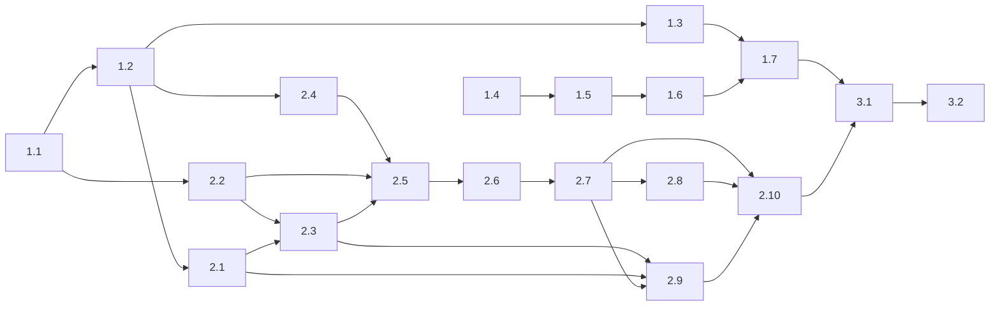

# Tasks · foundation (T01–T02)

**Status:** Ready for phase review. No task is started. Implementation begins only with the implementation prompt.
**Root tasks:** T01 (native 1.1–1.7), T02 (native 2.1–2.10), plus handoff tasks 3.1–3.2 that apply the documentation checkpoint. Existing root IDs are preserved. No new root IDs are proposed.
**Inputs:** `requirements.md` (FND-R1–R9, assumptions A1–A10) and `design.md` (DD1–DD10, §3–§12).

## Rules for this task list

- Do tasks in numeric order unless the **Depends on** line allows otherwise.
- A task is complete only when its **Done when** checks pass with actual output. Partial work and blocked verification stay unchecked.
- Source files named in `design.md` §3 are the plan. If implementation needs a different file or an unplanned dependency, record why in the evidence file and check it in review.
- Backend files follow `guidelines/backend.md` (BE rule IDs) and `guidelines/database.md` (DB rule IDs). Frontend files follow `guidelines/frontend.md` (FE rule IDs).
- Real values for passwords, secrets and connection strings never go into specs, evidence, logs, commits or shell arguments.
- GitHub, deployment, Gunicorn, Render runtime selection and Playwright are out of scope.

## Dependency map

Frontend tasks 1.4–1.6 are independent of the backend and can run in either order relative to 1.1–1.3.

## Tasks

### Group 1 · T01 Local scaffolds and tooling

- [x] **1.1 Pin the backend runtime and verify dependencies on CPython 3.14.5**
  - Root task: T01. Depends on: none.
  - Create `backend/.python-version` (`3.14.5`), `backend/requirements.txt` (Flask, Flask-SQLAlchemy, SQLAlchemy, Flask-Migrate, psycopg, Flask-JWT-Extended) and `backend/requirements-dev.txt` (`-r requirements.txt`, pytest, Ruff, python-dotenv). Use exact `==` pins for direct dependencies (A6).
  - Create `backend/.venv` with the 3.14.5 interpreter and install `requirements-dev.txt`. Import each runtime package.
  - **Stop condition (FND-AC1.4):** IF any package fails to install or import, stop this task, report the package, version and error, and propose nothing else until you decide.
  - Done when: `python --version` in the venv prints 3.14.5; the install exits 0; every package imports; `pip freeze` is saved to the evidence file; `git status` shows `.venv/` ignored.
  - _Requirements: FND-AC1.4, FND-AC1.5. Verification: FND-V2._

- [x] **1.2 Add configuration validation and the application factory**
  - Root task: T01. Depends on: 1.1.
  - Create `app/config.py` (`Settings`, `ConfigError`, named constants), `app/extensions.py` (`db` with schema `revotask` and the naming convention, `migrate`, `jwt`) and `app/__init__.py` (`create_app`). Initialize SQLAlchemy, Flask-Migrate (`version_table_schema="revotask"`) and JWT with the secret only. Engine options per design §4.2.
  - Registration of the request context, error handlers, health blueprint and CLI command is added by tasks 2.1, 2.5 and 2.9. The factory must stay valid at each step.
  - Write `tests/test_config.py` (every rule in FND-AC1.2 fails with the variable name and without the value; valid values pass) and `tests/test_factory.py` (app creation, extensions present, no auth or feature routes).
  - Done when: both test files pass; `python -c "from app import create_app"` succeeds with the env vars set.
  - _Requirements: FND-AC1.1, FND-AC1.2, FND-AC1.3 (health registration completes in 2.9). Guidelines: BE01, BE08. Verification: FND-V1._

- [x] **1.3 Configure Ruff and pytest**
  - Root task: T01. Depends on: 1.2.
  - Create `backend/pyproject.toml` with the Ruff rule set and line length, formatter settings, `testpaths`, and a `migration` marker. Keep the rule set conservative and list it in the file.
  - Done when, from `backend/`: `ruff check .`, `ruff format --check .` and `pytest -v` exit 0, and their output is recorded.
  - _Requirements: FND-AC1.6. Guideline: BE08. Verification: FND-V1._

- [x] **1.4 Scaffold the Next.js app with Tailwind CSS and daisyUI**
  - Root task: T01. Depends on: none.
  - Re-read the daisyUI Next.js install guide, record any difference from `design.md` §6, then create the App Router project in `frontend/` (TypeScript `strict`, `app/` directory, `@/*` alias). Add `postcss.config.mjs`, `app/globals.css` (`@import "tailwindcss"; @plugin "daisyui";`), `app/layout.tsx` and `app/page.tsx` (`HomePage`, synchronous Server Component, daisyUI `card`). Add `.nvmrc` and `engines.node` for the installed Node version. Commit `package-lock.json`.
  - Add `"browserslist": "> 1%"` only if the dev or build server uses Turbopack and the guide still advises it.
  - Do not add Route Handlers, an API client, fetch calls or `NEXT_PUBLIC_` variables.
  - Done when: `npm ci` exits 0; `npm run build` exits 0 and lists only `/`; `npm run dev` serves the page at `http://localhost:3000` (checked with `curl -s -o /dev/null -w "%{http_code}"` returning 200); the built CSS under `.next/static/css/` contains the daisyUI `card` rule.
  - _Requirements: FND-AC2.1, FND-AC2.2, FND-AC2.4, FND-AC2.5. Guidelines: FE-C1, FE-S1, FE-N7. Verification: FND-V3._

- [x] **1.5 Add frontend lint, type check and the Vitest test**
  - Root task: T01. Depends on: 1.4.
  - Add ESLint configuration, `typecheck`, `test` and `lint` scripts, `vitest.config.mts` (jsdom, React plugin), `vitest.setup.ts` (jest-dom) and `app/page.test.tsx`. The test renders `HomePage` with React Testing Library and asserts the heading text and the `card` class, not only that it mounts.
  - Done when: `npm run lint`, `npm run typecheck` and `npm test` exit 0 with at least one passing test; temporarily changing the heading text makes the test fail (checked once, then reverted).
  - _Requirements: FND-AC2.3. Guidelines: FE-A4, FE-N9. Verification: FND-V3._

- [x] **1.6 Check secret hygiene**
  - Root task: T01. Depends on: 1.5 (a build exists).
  - Confirm both `.env.example` files are unchanged in variable names and keep `JWT_SECRET_KEY` blank. Run `git check-ignore -v backend/.env frontend/.env.local` and `git ls-files | grep '\.env'`. Build the frontend with a sentinel `JWT_SECRET_KEY` and `DATABASE_URL` in the environment and search `.next/` for the sentinels.
  - Record in evidence that the build search is a regression guard, because no frontend code reads those variables yet.
  - Done when: both files report ignored; only the two examples are tracked; the sentinel search finds nothing.
  - _Requirements: FND-AC3.1, FND-AC3.2, FND-AC3.3. Root AC13.3 (secrets part). Verification: FND-V4._

- [x] **1.7 Checkpoint: T01 acceptance run**
  - Port: Flask runs on 5001. macOS AirPlay Receiver keeps 5000 and stays enabled. Change recorded in `specs/CHANGELOG.md`.
  - Root task: T01. Depends on: 1.3, 1.6.
  - From a fresh shell, run the backend and frontend commands in `docs/DEVELOPMENT.md` as written, and the T01 completion check from `specs/tasks.md`: "Empty Next build and Flask factory imports pass."
  - Done when: from a fresh shell, the commands in `docs/DEVELOPMENT.md` pass as written with `flask --app app:create_app run --port 5001`; `curl -s http://127.0.0.1:5001/api/health` returns `{"data":{"status":"ok"}}`; the frontend lint, typecheck, test and build pass with `API_BASE_URL=http://127.0.0.1:5001`; the outputs are in the evidence file. Fix any failure in the owning task before continuing.
  - _Requirements: FND-R1, FND-R2, FND-R3. Verification: FND-V2, FND-V3, FND-V4._

- [x] **1.8 Pin Gunicorn and add the backend Docker image**
  - Root task: T01. Depends on: 1.1. Added in revision 2 (`requirements.md` FND-R10, `design.md` §4.7 and DD11).
  - Add `gunicorn==27.0.1` to `backend/requirements.txt`. Create `backend/Dockerfile` from `python:3.14.5-slim`: install the pinned runtime requirements, copy `app/` and `migrations/` only, run as the non-root user `revotask`, and use `CMD` `gunicorn --bind 0.0.0.0:${PORT} 'app:create_app()'`, with `PORT` defaulting to 5001. Create `backend/.dockerignore` so that `.env*`, `.venv`, caches, `tests/` and `supabase-ca.crt` stay out of the build context.
  - Done when: `docker compose build backend` exits 0; `docker run --rm --entrypoint sh revotask-backend:local -c 'python --version; gunicorn --version; id'` shows Python 3.14.5, Gunicorn 27.0.1 and a non-root uid; `/app` contains no `.env` file and no tests; a container started with `-e PORT=8055` logs `Listening at: http://0.0.0.0:8055`.
  - _Requirements: FND-AC1.4, FND-AC10.1, FND-AC10.2. Verification: FND-V11._

- [x] **1.9 Add the local Compose service and root environment example**
  - Root task: T01. Depends on: 1.8.
  - Create `compose.yaml` at the repository root with service `backend`: build from `./backend`, `env_file: ./backend/.env`, `PORT=5001`, `DATABASE_URL` from `${DOCKER_DATABASE_URL:?…}`, `extra_hosts` for `host.docker.internal`, and the published port `127.0.0.1:5001:5001`. Create `.env.example` at the root with the `DOCKER_DATABASE_URL` placeholder. The real `.env` stays git-ignored.
  - Done when: `docker compose config --quiet` exits 0 with a real root `.env` and exits non-zero when `DOCKER_DATABASE_URL` is unset; `docker compose config --services` prints `backend`; `git check-ignore` reports the root `.env` and `backend/.env`, and `.env.example` is tracked.
  - _Requirements: FND-AC10.3, FND-AC10.6. Verification: FND-V11._

- [x] **1.10 Verify the Docker runtime on port 5001**
  - Root task: T01 and T02. Depends on: 1.9, 2.10, 1.7 and 2.9 (native runs stopped first).
  - Stop the native Flask server. Run `docker compose up -d backend`. Confirm the container is up, `GET http://127.0.0.1:5001/api/health` returns `200 {"data":{"status":"ok"}}`, and the container reaches PostgreSQL at `host.docker.internal`. Run the one-off commands `bootstrap-schema`, `db upgrade` and `db current` with `docker compose run --rm --no-deps backend …`. Check Next.js on the host can reach `API_BASE_URL`. Run `docker compose down` and confirm the host database objects and revision are unchanged.
  - Done when: each command passes and its output is in `evidence/foundation-T01-T02.md` (revision 2) with no secret values.
  - _Requirements: FND-AC10.4, FND-AC10.5, FND-AC9.3. Verification: FND-V11, FND-V12._

### Group 2 · T02 Models, migration and API health

- [x] **2.1 Add request context, logging and the shared error envelope**
  - Root task: T02. Depends on: 1.2.
  - Create `app/exceptions.py` (`ApiError`, `ServiceUnavailableError`), `app/errors.py` (envelope builder and handlers for `ApiError`, 404, 405, other ≥500 `HTTPException`, and any `Exception`) and `app/request_context.py` (request ID, response header, one log line per request). Register them in `create_app`. The generic handler rolls back `db.session` and returns only fixed messages. The 405 handler copies the supported methods into `Allow`.
  - Write `tests/test_request_context.py` and `tests/test_errors.py` using test-only routes registered on a test app: valid inbound ID reused, invalid ID replaced, header on every response, log fields present, request body absent from logs; 404 envelope; 405 envelope with `Allow`; unhandled exception gives the 500 envelope without exception text and calls rollback.
  - Done when: both test files pass and `ruff check` stays clean.
  - _Requirements: FND-AC7.4, FND-AC7.5 (handler), FND-AC7.6, FND-AC7.7, FND-AC7.8. Guidelines: BE02, BE05. Verification: FND-V7._

- [x] **2.2 Check and provision the local PostgreSQL role and databases**
  - Root task: T02. Depends on: 1.1.
  - Follow `design.md` §7. Inspect first and record what exists. Create only missing resources: role `revotask` (no superuser, no create-database, no create-role) and databases `revotask_dev` and `revotask_test` owned by it. Send SQL on stdin. If `backend/.env` does not exist, create it from `backend/.env.example` with the two URLs and a generated `JWT_SECRET_KEY`. Do not overwrite an existing `.env`, role, database or password.
  - Stop and report instead of acting when: the account lacks permission; the role exists and its password is unknown; an existing database is owned by another role and `revotask` lacks CREATE on it (FND-AC9.4).
  - Done when: a written report lists, for each resource, "existed" or "created" and any blocked item; a psycopg connection through each URL returns the expected `current_user` and `current_database()`; no secret appears in the report, shell history commands or `git status`.
  - _Requirements: FND-AC9.1–9.4. Verification: FND-V10._

- [x] **2.3 Add the test database guard and shared pytest fixtures**
  - Root task: T02. Depends on: 2.1, 2.2.
  - Create `tests/db_guard.py` (`assert_safe_test_database`) and `tests/conftest.py` (`.env` loading, `test_db_url`, `app`, `schema_at_head`, `db_session` with SAVEPOINT isolation) per `design.md` §8. `schema_at_head` calls the bootstrap and upgrade code created in 2.5–2.7 and is first used in 2.8, so until then it may be defined but unused.
  - Write `tests/test_db_guard.py`: equal URLs, database name not ending in `_test`, remote host, and a valid local test URL.
  - Done when: `pytest tests/test_db_guard.py -v` passes; error messages name the rule and contain no URL.
  - _Requirements: FND-AC8.1, FND-AC8.2 (completes when 2.7 lands). Guideline: BE07. Verification: FND-V8._

- [x] **2.4 Define the SQLAlchemy models**
  - Root task: T02. Depends on: 1.2.
  - [x] 2.4.1 Create `models/base.py` mixins (UUID key, audit timestamps, soft delete) and the nine model files with the columns, types and lengths in `backend/specs/data-model.md`, schema-qualified foreign keys with `ondelete="RESTRICT"`, `Float(precision=53)` for `order`, and the CHECK constraints and partial indexes in `design.md` §5.2.
  - [x] 2.4.2 Declare the relationship pairs in `design.md` §5.3 with `back_populates` on both sides. Import all models in `models/__init__.py`.
  - [x] 2.4.3 Write `tests/test_models_metadata.py` (no database needed): table names and schema, column types and nullability, `order` compiles to `DOUBLE PRECISION` for the PostgreSQL dialect, every FK has `RESTRICT`, each relationship has a reverse `back_populates`.
  - Done when: `test_models_metadata.py` passes and no code path calls `create_all` (`grep -rn create_all app/ tests/` returns nothing).
  - _Requirements: FND-AC4.1–4.5. Guidelines: DB01–DB05. Verification: FND-V5._

- [x] **2.5 Add the `bootstrap-schema` command**
  - Root task: T02. Depends on: 2.2, 2.3, 2.4.
  - Create `app/cli.py` per `design.md` §4.6 and register it in `create_app`. Check `pg_namespace` first, create only when missing, never drop or alter, and use fixed error messages.
  - Write `tests/test_bootstrap_schema.py` (marker `migration`): creates the schema on a database without it; second run exits 0 and a marker table inside the schema survives; unreachable database gives a message without the URL.
  - Done when: the tests pass against `revotask_test`, and running the command against `revotask_dev` twice prints "Created" then "already exists".
  - _Requirements: FND-AC5.1, FND-AC5.8 (bootstrap part). Guidelines: DB06. Verification: FND-V5._

- [x] **2.6 Initialize the Alembic environment**
  - Root task: T02. Depends on: 2.5.
  - Run `flask --app app:create_app db init`. Edit `migrations/env.py` per `design.md` §5.4: `version_table_schema`, `include_schemas`, `include_name`, `compare_type`, schema-exists check before any DDL, and URL-free error messages.
  - Add to `tests/test_bootstrap_schema.py`: `db upgrade` on a database without the `revotask` schema exits non-zero, prints the bootstrap instruction, and creates nothing; `db upgrade` against an unreachable database exits non-zero without the URL.
  - Done when: the added tests pass and the schema is absent after the failing upgrade.
  - _Requirements: FND-AC5.3, FND-AC5.8. Guideline: DB06. Verification: FND-V5._

- [x] **2.7 Author, review and verify the first migration**
  - Root task: T02. Depends on: 2.6.
  - [x] 2.7.1 Generate the revision with `db migrate -m "initial schema"`.
  - [x] 2.7.2 Review and hand-edit it table by table against `backend/specs/data-model.md` and `design.md` §5.2: check constraints, partial indexes with `postgresql_where`, explicit index names, `ondelete="RESTRICT"`, reverse-order `downgrade()`. Record each correction in the evidence file.
  - [x] 2.7.3 Write `tests/test_migration.py` (marker `migration`): bootstrap then upgrade on an empty guarded test database; `db current` equals head; second upgrade is a no-op; `downgrade base` leaves the schema and an empty version table; re-upgrade succeeds; `compare_metadata` reports no differences.
  - [x] 2.7.4 Write `tests/test_schema_inspection.py` using `pg_constraint`, `pg_indexes` and `information_schema`: column types and nullability, primary and unique keys, check expressions, `ON DELETE RESTRICT`, and every index in FND-AC5.5 including its predicate. Document any object type that autogenerate comparison cannot see.
  - [x] 2.7.5 Apply the revision to `revotask_dev` and save a sanitized `psql \d+` style inspection of the nine tables to evidence.
  - Done when: the migration and inspection tests pass, the dev database is at head, and the evidence file lists the review corrections.
  - _Requirements: FND-AC5.2, FND-AC5.4–5.7, FND-AC8.2. Guidelines: DB01–DB06. Verification: FND-V5._

- [x] **2.8 Test database-enforced invariants**
  - Root task: T02. Depends on: 2.7.
  - Write `tests/test_db_constraints.py` with the `db_session` fixture: normalized-email rejections and the accepted normalized case; `order` values `0`, `-1`, `Infinity`, `-Infinity`, `NaN` rejected and `0.5`, `1024` accepted on both tables; second active Done column rejected, accepted on another board and after soft-deleting the first; duplicate membership, bad role, negative `position_version`, bad notification kind, bad event kind and duplicate `jti` rejected; physical delete of a referenced row rejected while setting `deleted_at` succeeds.
  - Done when: the file passes and each rejection test asserts the constraint name in the `IntegrityError`, not only that an error occurred.
  - _Requirements: FND-AC6.1–6.5. Root AC01.2, AC05.1, NFR 4 (DB parts). Guidelines: DB04, DB05. Verification: FND-V6._

- [x] **2.9 Add the health route (E01)**
  - Port: the curl check uses 5001. Tests cover the 5 health cases.
  - Root task: T02. Depends on: 2.1, 2.3, 2.7.
  - Create `app/blueprints/health/{__init__,routes,service}.py` per `design.md` §4.5 and register the blueprint in `create_app`. The route is thin (BE02). The service sets a transaction-local statement timeout with `set_config` and runs the probe.
  - Write `tests/test_health.py`: 200 with `{"data": {"status": "ok"}}` and no auth; 503 envelope for a closed local port, and for `SELECT pg_sleep(2)` under a 100 ms timeout; 503 body contains no URL, host or driver text; the 503 arrives within 3 seconds plus margin; `POST /api/health` returns 405, `METHOD_NOT_ALLOWED` and an `Allow` header containing `GET`; the route writes nothing.
  - Done when: `tests/test_health.py` passes, and `curl -s http://127.0.0.1:5001/api/health` against a running `flask --app app:create_app run --port 5001` returns the 200 body.
  - _Requirements: FND-AC1.3, FND-AC7.1–7.3, FND-AC7.5. API: E01. Guidelines: BE01, BE02, BE05, BE07. Verification: FND-V7._

- [x] **2.10 Checkpoint: T02 acceptance run**
  - Root task: T02. Depends on: 2.7, 2.8, 2.9.
  - From a fresh shell, run `bootstrap-schema`, `db upgrade`, `flask run` and the full `pytest -v`, plus `ruff check .` and `ruff format --check .`. Check the T02 completion check from `specs/tasks.md`: "Apply to clean PostgreSQL and inspect constraints and indexes. Implement bounded DB readiness."
  - Done when: all commands pass, outputs are in the evidence file, and the inspection from 2.7.5 matches the final revision.
  - _Requirements: FND-R4, FND-R5, FND-R6, FND-R7. Verification: FND-V5, FND-V6, FND-V7._

### Group 3 · Handoff and documentation checkpoint

- [x] **3.1 Apply the documentation checkpoint**
  - Root tasks: T01, T02. Depends on: 1.7, 2.10.
  - Review the actual diff against `requirements.md` and `design.md` first.
  - `docs/DEVELOPMENT.md`: local install `pip install -r requirements-dev.txt`, the `bootstrap-schema` step before `db upgrade`, test and lint commands corrected to what ran, Python 3.14.5 and Node pins.
  - `docs/DEPLOYMENT.md`: add schema provisioning under the migration role to the release steps; keep `pip install -r requirements.txt` as the production install; leave runtime selection and Gunicorn for T16.
  - `README.md`: update **Status** and setup facts that were verified. Do not claim live URLs, deployment or later features.
  - `CHANGELOG.md` and `backend/CHANGELOG.md`: add the foundation entry and the `METHOD_NOT_ALLOWED` 405 entry under `[Unreleased]`. `frontend/CHANGELOG.md`: add the scaffold entry.
  - `specs/CHANGELOG.md`: update the 405 entry's **Verification** line with the real test result.
  - Done when: each statement in these files matches a command output in the evidence file, and entries for unverified work say "pending".
  - _Requirements: FND-AC8.3. Verification: FND-V9._

- [x] **3.2 Record evidence and synchronize root task status**
  - Root tasks: T01, T02. Depends on: 3.1.
  - Create `evidence/foundation-T01-T02.md` with the commands, environment (versions only), outputs, the `pip freeze`, review corrections, the build-guard caveat from 1.6, the provisioning report from 2.2, and any open items. Remove secrets, connection strings and account data before saving.
  - Update `specs/traceability.md` status for rows touched by foundation (AC01.2, AC05.1, AC13.3, AC14.1) as partial, with the evidence path.
  - Add to `evidence/spec-review.md` only the findings and refinements you confirmed in the phase reviews, with file and heading references.
  - Check T01 in `specs/tasks.md` only if tasks 1.1–1.7 are done and its completion check passed. Check T02 only if tasks 2.1–2.10 are done and its completion check passed. Otherwise leave it open and list the blocker.
  - Done when: native checkboxes and the root tracker agree, and the final report lists changed files, completed IDs, checks run, open work and documentation updated.
  - _Requirements: FND-AC8.4. Verification: FND-V9._

## Coverage check

| Requirement | Tasks |
|---|---|
| FND-R1 | 1.1, 1.2, 1.3, 1.7, 2.9 (health registration) |
| FND-R2 | 1.4, 1.5, 1.7 |
| FND-R3 | 1.6, 1.7 |
| FND-R4 | 2.4 |
| FND-R5 | 2.5, 2.6, 2.7, 2.10 |
| FND-R6 | 2.8 |
| FND-R7 | 2.1, 2.9 |
| FND-R8 | 2.3, 3.1, 3.2 |
| FND-R9 | 2.2 |

Every acceptance criterion in `requirements.md` appears in at least one task's **Requirements** line.
