# Design Document: kanban (T07–T09)

## Overview

This design implements the ordered column API (E13–E16, root T07), the card API and position service (E17–E20, root T08) and the Kanban UI on `/boards/[id]` (root T09). It follows `requirements.md` (Requirements 1 to 11, decisions K1–K12 approved on 2026-11-13) and the shared design D3 to D5. Python (Flask, SQLAlchemy, Marshmallow, pytest) and TypeScript (Next.js App Router, Tailwind, daisyUI, Vitest) are the languages already in the repository. No table, migration, dependency or E07 shape changes.

### Verified facts about the existing code

| Fact | Where | Consequence |
|---|---|---|
| `authorize_board(board_id, user_id, *, role, lock)` checks membership, takes the board row lock, rechecks membership in a new statement and then checks the role. It returns the board's current `position_version`, read after the lock. | `backend/app/blueprints/boards/service.py` | Columns and cards reuse it. The version it returns after the lock is the value to compare. |
| `NotFoundError` (404 `NOT_FOUND`), `UnauthorizedBoardAccessError` (403), `StateConflictError` (409 `STATE_CONFLICT`) and `RequestValidationError` exist. `POSITION_CONFLICT` does not. | `backend/app/exceptions.py` | Add `PositionConflictError` and `InvalidDestinationError`. |
| `load_json_body(schema)` returns 400 with fixed field messages. Schemas use `unknown = RAISE`. `TrimmedString` exists. | `backend/app/validation.py` | Kanban schemas follow the same pattern. A strict integer field must reject `true` (Python `bool` is an `int`). |
| E07 reads columns and cards in two queries and builds nested dicts. `CardSchema` and `ColumnSchema` already list the public fields. | `boards/service.py` `get_board_detail`, `boards/schema.py` | Move the two queries into one reusable `read_columns(board_id, column_ids=None)`. E07 and E20 share it. |
| `board_columns` and `cards` have `order` as `DOUBLE PRECISION` with the finite-positive check, active-order indexes and the one-active-Done-column partial unique index. `board_events.kind` allows `card_created`, `card_moved`, `column_reordered`, `comment_created`, `entered_done`. | `backend/app/models/` | No migration. The Done index is the backstop for the Done race. |
| `BoardTracker` creates and deletes rows by tracked IDs, and `delete_tracked_rows` removes events, cards and columns of tracked boards. | `backend/tests/boards_helpers.py` | Kanban tests use it. API-created columns and cards belong to tracked boards, so cleanup covers them. |
| The Next side has `handlePrivateWrite`, a fixed `FLASK_PATHS` table with UUID-only path parameters, and an `apiRequest` allowlist of declared method and path pairs. `GET` handlers do not exist for the browser. | `frontend/lib/server/*`, `frontend/lib/apiClient.ts` | Add routes to both tables and a `handlePrivateRead`. |
| `BoardShell` renders `ColumnsPlaceholder` and receives a board summary and members. `MembersPanel` calls `router.refresh()` after E11 and E12. `BoardDetail.columns` is `unknown[]`. | `frontend/components/boards/`, `frontend/lib/types.ts` | Replace the placeholder, type the columns and add a member-removed callback. |
| `FormField` renders a text input only. `ConfirmDialog` and `BaseModal` are ready. | `frontend/components/shared/` | Add `multiline` to `FormField` and one `SelectField` part (two dialogs need a select). |

## Architecture

```mermaid
flowchart TD
    B["Browser: KanbanBoard island"] -->|"POST/PATCH/DELETE, GET board"| H["Next Route Handlers"]
    P["Server page /boards/[id]"] -->|"E07, E10"| F["Flask API"]
    H --> F
    F --> S["columns and cards services"]
    S --> A["authorize_board (check, lock, recheck)"]
    S --> O["app/positions.py: order, version, events"]
    S --> D["PostgreSQL"]
```



The server page still reads E07 and E10 once. After that the island owns the board state and refetches it through `GET /api/boards/[id]`. The island does not depend on `router.refresh()` for the board, so a server render that started before a move cannot overwrite it (K12).

### Key design decisions

| ID | Decision | Reason |
|---|---|---|
| DD1 | Every column and card write follows one sequence in the service: resolve the board ID from the addressed resource without checking access, call `authorize_board(..., lock=True)`, reload the addressed resource under the lock with `populate_existing`, compare the version where one is sent, validate destination and anchor, write, bump the version only if something changed, record events, commit once. | This is K3. A missing resource and a nonmember both end in `NotFoundError` from `authorize_board`, so nothing about other boards leaks. |
| DD2 | A well-formed `column_id` in the E16 body that is missing, soft-deleted or on another board returns the same generic 404 (review L1). A malformed `column_id` is a 400 from the schema, before any query. Invalid anchors and destinations return 400 with "Choose a valid destination." after the version check. | The moved column is the source resource (K3). One 404 for missing, deleted and other-board avoids leaking IDs. Destination and anchor errors stay generic (K2). |
| DD3 | Ordering lives in one module, `backend/app/positions.py`: `allocate_order`, `rebalanced_orders`, `is_unchanged`, `bump_position_version`, `record_event`. Columns and cards call it. | D4 is one algorithm for both lists, so it has one implementation and one test file. |
| DD4 | An unchanged position returns 200 with the authoritative list and writes nothing: no order change, no version bump, no event (K6). | Other clients are not forced into a 409 by a no-op. |
| DD5 | `PositionConflictError` (409 `POSITION_CONFLICT`, "The board changed. Refresh and try again.") and `InvalidDestinationError` (400 `VALIDATION_ERROR`, "Choose a valid destination.", no `fields`) are new typed exceptions mapped by the central handler. | Plain envelope with stable codes (K2). |
| DD6 | Done conflicts, a nonempty delete and a nonempty Done flag change are `StateConflictError` with fixed messages. A duplicate Done column that slips past the check hits `uq_board_columns_board_id_active_done` and is translated to the same 409 (backstop, as in E11). | K2. The board lock already serializes writers, so the index is defense in depth. |
| DD7 | `description` is trimmed. A blank or whitespace-only value, and an explicit `null`, are stored as null. On E18 an omitted `description` keeps its current value (review L6). `assignee_id` is checked inside the transaction after the lock and fails with 400 and `fields.assignee_id`. | One representation of "no description". The membership can change until the lock is held. |
| DD8 | E14 applies every valid submitted field. `is_done` equal to the stored value is ignored (K9). A real `is_done` change on a nonempty column, or to true while another Done column exists, fails the whole request with 409 and writes nothing. | K9. Atomic request. |
| DD9 | One per-board client gate coordinates every Kanban write and every board refetch that can replace the same UI state, including the refresh after a member removal and the Reload board action (review L2). A write holds the gate through its own recovery refetch, so competing actions stay disabled until the board is authoritative again. A response that is older than a later change is ignored. | An edit that finishes during an optimistic move would otherwise be undone by that move's rollback, and a late refetch could overwrite a newer board. |
| DD10 | Drag is native HTML5 drag-and-drop on a desktop pointer. The Move dialog is the keyboard and touch path. Both call `moveCard`. Columns have Move left and Move right only (K4). | FE-C4 and WCAG dragging movements. No drag library is added. |
| DD11 | The refetch endpoint is `GET /api/boards/[id]` on Next (E07). Members use `GET /api/boards/[id]/members` (E10) and `router.refresh()` as today. | The board needs a client read, and the members panel already owns its own refresh. |
| DD12 | `position_version` is a PostgreSQL `INTEGER`. `bump_position_version` updates only `WHERE position_version < 2147483647`. When no row matches, the service raises `StateConflictError("This board has reached its change limit.")`, the transaction rolls back, and nothing is written (L6). Reads, unchanged-position moves, E14 and E18 do not bump the version and still work. v1 has no recovery path, because 2 billion changes is far beyond the 100-card target. | Without the guard the increment would raise a database overflow and return a 500 after partial work. The 409 is explicit and atomic. |
| DD13 | E12 clears `assignee_id` only for active cards (`deleted_at IS NULL`) in active columns (`deleted_at IS NULL`) of the affected board, in the same transaction as the membership soft delete. Soft-deleted cards, cards in soft-deleted columns and other boards keep their data (L7). This is a one-line change to `remove_member` in T05 with a regression test. | The user's decision. Soft-deleted records stay as history. |

## Components and Interfaces

### Backend layout (T07, T08)

```text
backend/app/
  positions.py                 # DD3
  exceptions.py                # + PositionConflictError, InvalidDestinationError
  blueprints/
    boards/service.py          # read_columns(board_id, column_ids=None) extracted from get_board_detail
    columns/{__init__,routes,schema,service}.py   # columns_bp, E13–E16
    cards/{__init__,routes,schema,service}.py     # cards_bp, E17–E20 (E21–E22 land in T11)
  __init__.py                  # register columns_bp and cards_bp
specs/fixtures/kanban-field-cases.json            # column name, card title, description, ids, version
```

Services take plain IDs and return dictionaries. Routes validate and serialize through explicit schemas (BE02, DD9 of boards-membership). Both blueprints import `authorize_board` from the boards service.

### Routes

| Endpoint | Route | Role | Body |
|---|---|---|---|
| E13 | `POST /api/boards/<board_id>/columns` | Admin | `name`, optional `is_done` |
| E14 | `PATCH /api/columns/<column_id>` | Admin | `name` and/or `is_done` (at least one) |
| E15 | `DELETE /api/columns/<column_id>` | Admin | none |
| E16 | `PATCH /api/boards/<board_id>/columns/reorder` | Admin | `column_id`, `before_column_id`, `expected_position_version` |
| E17 | `POST /api/columns/<column_id>/cards` | Participant | `title`, optional `description`, optional `assignee_id` |
| E18 | `PATCH /api/cards/<card_id>` | Participant | any of `title`, `description`, `assignee_id` (at least one) |
| E19 | `DELETE /api/cards/<card_id>` | Participant | none |
| E20 | `PATCH /api/cards/<card_id>/position` | Participant | `column_id`, `before_card_id`, `expected_position_version` |

All routes use `@token_required`. Path IDs go through `parse_uuid` (400 before any query). The reorder route is registered so Flask does not read `reorder` as a column ID.

### Check order (K3)

For every route: authenticate (401), path IDs and body shape (400, no database), then in the service:

1. Resolve the board ID from the addressed resource: `column → board_id`, `card → column → board_id`, or the URL board. A missing, deleted or unknown resource raises `NotFoundError`.
2. `authorize_board(board_id, user_id, role=…, lock=True)`: nonmember 404, lock, recheck membership, then role 403 for a Member on E13–E16.
3. Reload the addressed resource under the lock (`populate_existing`) and check it is still active. For E16 this includes the moved column from the body: a well-formed ID that is missing, soft-deleted or on another board gives the same `NotFoundError` (L1). A failure is `NotFoundError`.
4. E16 and E20: compare `expected_position_version` with `access.position_version` (read after the lock). A difference raises `PositionConflictError`.
5. Validate destination and anchor (400, DD2). Validate `assignee_id` for E17 and E18 (400 with `fields.assignee_id`).
6. Detect an unchanged position (E16, E20) and return without writing.
7. Write, bump the version, record events, `_commit()`.

### Service design (sketch)

```python
# backend/app/positions.py
STEP = 1024.0

def allocate_order(siblings: list[float], index: int) -> float | None:
    """Order for an item inserted at `index` among `siblings` (moving row excluded, sorted by
    (order, id)). None means no strictly ordered midpoint exists, so rebalance (D4)."""
    if not siblings:
        return STEP
    if index >= len(siblings):
        lo, hi = siblings[-1], math.inf
        candidate = lo + STEP
    elif index == 0:
        lo, hi = 0.0, siblings[0]
        candidate = hi / 2
    else:
        lo, hi = siblings[index - 1], siblings[index]
        candidate = (lo + hi) / 2
    ok = math.isfinite(candidate) and candidate > 0 and lo < candidate < hi
    return candidate if ok else None   # ties (lo == hi) and exhausted precision both land here

def rebalanced_orders(count: int) -> list[float]:
    return [STEP * (i + 1) for i in range(count)]      # 1024, 2048, ...

def is_unchanged(current_ids: list[UUID], moved_id: UUID, anchor_id: UUID | None) -> bool:
    """True when the moved row already sits where the request puts it (same list only)."""

def bump_position_version(board_id) -> int:            # UPDATE boards SET position_version = position_version + 1 WHERE id = :id AND position_version < 2147483647 RETURNING position_version; no row -> StateConflictError (DD12)
def record_event(board_id, actor_id, kind, card_id=None) -> None:   # same session, committed by the caller
```

```python
# backend/app/blueprints/cards/service.py (move_card)
card_board = _board_of_card(card_id)                        # NotFoundError if missing
access = authorize_board(card_board, user_id, lock=True)    # 404 / lock / recheck
card = _load_active_card(card_id, card_board)               # populate_existing, NotFoundError
if expected_version != access.position_version:
    raise PositionConflictError()
dest = _active_column(column_id, card_board) or raise InvalidDestinationError()
siblings = _active_cards(dest.id)                           # (id, order), sorted, moved row excluded
if anchor_id is not None and anchor_id not in {s.id for s in siblings}:
    raise InvalidDestinationError()                         # self, deleted, other column, other board
if dest.id == card.column_id and is_unchanged(_ids_including(card, siblings), card.id, anchor_id):
    return _result(card, affected=[dest.id], version=access.position_version)
index = position_of(anchor_id, siblings)
order = allocate_order([s.order for s in siblings], index)
if order is None:                                            # rebalance in this transaction
    write_orders(siblings with the card inserted at index, rebalanced_orders(len(siblings) + 1))
else:
    card.order = order
card.column_id = dest.id
version = bump_position_version(card_board)
record_event(card_board, user_id, "card_moved", card.id)
if dest.is_done and not source_is_done:
    record_event(card_board, user_id, "entered_done", card.id)
_commit()
return _result(card, affected=[source.id, dest.id], version=version)
```

The other services follow the same shape. E13 and E17 append with `allocate_order(siblings, len(siblings))`. E15 and E19 soft-delete (`deleted_at = utcnow()`). `_commit()` is the boards helper with rollback on `SQLAlchemyError`. The Done unique-index `IntegrityError` is mapped to `StateConflictError` in E13 and E14.

Rebalance writes use one bulk update by primary key. A test checks that `updated_at` still refreshes.

### Serialization

`ColumnPlainSchema` (id, board_id, name, is_done, order) for E13, E14 and E16. `CardSchema` and `ColumnSchema` from `boards/schema.py` for E17, E18 and E20. Response bodies are built as follows, with explicit `Meta.fields`:

| Endpoint | `data` |
|---|---|
| E13 | `{column, position_version}` (201) |
| E14 | `column` |
| E15, E19 | `{position_version}` (K1) |
| E16 | `{columns, position_version}` (all active columns, authoritative order) |
| E17 | `{card, position_version}` (201) |
| E18 | `card` |
| E20 | `{card, columns, position_version}` (affected columns only, each with its active cards) |

### Frontend layout (T09)

```text
frontend/
  components/kanban/
    KanbanBoard.tsx          # client island: region, empty state, live region, composes the rest
    KanbanColumn.tsx         # one lane: header, cards, drop zone, add-card form
    ColumnHeader.tsx         # props-only: name, count, Done badge, admin controls slot
    BoardCard.tsx            # props-only: title, assignee, Edit and Move buttons via props
    AddColumnForm.tsx        # admin, name and Done checkbox
    AddCardForm.tsx          # per column
    ColumnEditDialog.tsx     # name and Done toggle (BaseModal)
    CardEditDialog.tsx       # title, description, assignee, Delete (BaseModal and ConfirmDialog)
    MoveCardDialog.tsx       # column select and position select
  components/shared/SelectField.tsx      # new shared part: label, select, error (two dialogs use it)
  components/shared/FormField.tsx        # + multiline for the description
  hooks/useKanbanBoard.ts    # state, gate, Move_Function, refetch (DD9)
  hooks/useDragAndDrop.ts    # desktop drag state and drop targets only
  lib/kanban.ts              # allowlist parsers for columns, cards and responses
  lib/kanbanMove.ts          # pure: applyCardMove, applyColumnMove, mergeAffected, isCardUnchanged, announce text
  lib/kanbanRules.ts         # title, column name, description rules shared with the field-case fixture
  lib/types.ts               # Card, Column, ColumnWithCards, typed BoardDetail
  app/api/boards/[id]/route.ts            # + GET (E07)
  app/api/boards/[id]/members/route.ts    # + GET (E10)
  app/api/boards/[id]/columns/route.ts, columns/reorder/route.ts
  app/api/columns/[id]/route.ts, columns/[id]/cards/route.ts
  app/api/cards/[id]/route.ts, cards/[id]/position/route.ts
```

`ColumnsPlaceholder.tsx` is deleted. `BoardShell` renders `KanbanBoard` in its main column, keeps the members panel in the side column (FE-D4) and passes `onMemberRemoved` to `MembersPanel`. The page now passes the typed columns, the version and the members to the shell. `KanbanBoard`, `KanbanColumn`, the dialogs and the forms are client components. `ColumnHeader` and `BoardCard` are props-only (FE-C2).

### Next handlers and client allowlist

Add to `FLASK_PATHS` and `FlaskParamName` (`columnId`, `cardId`): `boardColumns`, `boardColumnsReorder`, `column`, `columnCards`, `card`, `cardPosition`. Each handler calls `handlePrivateWrite` with the exact `allowedKeys` of its endpoint (the E16 and E20 bodies keep `before_*` explicit, so a missing key is a 400 before the upstream call). `handlePrivateRead` is new: no Origin check (safe method), cookie to bearer, `no-store`, 401 clears the cookie. `apiClient.ts` adds the declared method and path pairs, a `GET` allowlist (`/api/boards/UUID` and `/api/boards/UUID/members`) and `apiGet`. A path outside the table throws before `fetch`.

### Board state and the gate (DD9)

```ts
type KanbanStatus = "idle" | "pending" | "refetching" | "stale";

useKanbanBoard({ boardId, initial: { columns, version } }) => {
  columns, version, status, announcement,
  moveCard(cardId, columnId, beforeCardId),     // the Move_Function
  moveColumn(columnId, beforeColumnId),
  addColumn, editColumn, deleteColumn, addCard, editCard, deleteCard,
  requestRefresh(),                              // used after E12 (K12)
  reload(),                                      // the Reload board action
}
```

- State seeds once from `initial`. Later server renders do not replace it.
- `statusRef` is a synchronous ref, so a double click cannot start two requests. Every write, every board refetch, the refresh after a member removal and the Reload board action run through `run()`. If `status !== "idle"`, `run()` returns without sending anything (K8, L2). A write keeps the gate while it runs its own recovery refetch (restore, then refetch, then release). The queued member-removal refresh waits for the gate and runs after it is released.
- `run()` takes a Snapshot (only for E16 and E20, the optimistic ones), applies the optimistic change, sends the request with the current `version`, then applies the response and sets `version` from it. The other writes are not optimistic: they apply the response.
- `requestRefresh()` while the gate is held sets `refreshQueued`. When the gate is released, the queued refresh runs under the gate. Each state replacement increments an `epoch` counter, and a refetch response is applied only if the epoch is the value it started with. Otherwise it is discarded and, if the gate is free, retried once. An older response never replaces newer state (Requirement 6.8, L2).
- While status is not `idle`, the island sets `aria-busy` on the region, ignores drags and disables the Move buttons, column controls and add, edit and delete controls.

Failure handling for E16 and E20 (optimistic), then for the rest:

| Outcome | Snapshot | Refetch | Feedback |
|---|---|---|---|
| 409 `POSITION_CONFLICT` | restore | yes | toast "The board changed. It has been refreshed." |
| 400 invalid destination (E16, E20) | restore | yes | toast "The card was not moved. The board was refreshed." (columns: "The column was not moved…") |
| 5xx, 503, transport failure | restore | yes | toast "The card was not moved. Try again." |
| 403 | restore | no | toast, then `router.refresh()` as in `BoardShell` |
| 404 for the board (`isBoardAccessError`) | restore | no | access toast, `router.push("/")` |
| 404 for the card or column only | restore | yes | toast |
| 401 `AUTH_REQUIRED` | restore | no | `useErrorHandler` redirect |
| Refetch fails | n/a | n/a | status `stale`: controls stay disabled and the region shows a "Reload board" button that calls `reload()` |

E13 to E15, E17 to E19: a 400 shows field errors in the form and keeps the input (no refetch, no restore). 409 `STATE_CONFLICT` shows the message beside the control, keeps the input and refetches (Requirement 7.7). 403, 404 and 401 follow the table above. 5xx and transport failures show a retry toast and refetch before the next action.

### Drag and the Move dialog

- `useDragAndDrop({ enabled, onDrop })` keeps the dragged card ID in state, sets `effectAllowed = "move"` and `setData("text/plain", id)` (Firefox needs it), and returns prop getters. A card is both a draggable item and a drop target meaning "before this card". Each lane ends with a drop strip meaning "at the end": at least 44 px high at rest, and `min-h-32` (about one card) while a card is dragged, so the target is not narrow. A line marks the target before a drop. Test IDs: `card-<id>`, `dropzone-<columnId>-before-<cardId>`, `dropzone-<columnId>-end`. Drop calls `moveCard(cardId, columnId, beforeCardId)`.
- `MoveCardDialog` opens from the Move button on every card for every participant. It shows a destination column select (default: the current column) and a position select with "At the end of the column" and "Before <card title>" for each other card in that column. For the current column the default is the card's present place, so Confirm is a no-op until the user changes it. Confirm calls the same `moveCard`. `BaseModal` gives Escape, focus trap and focus return.
- `moveCard` returns without a request when `isCardUnchanged` is true (Requirement 9.9). It announces the result in a polite live region, built from the authoritative lists ("Moved Fix login to Done, position 2 of 4.") and from failures ("Fix login was not moved. The board was refreshed.").
- Column reorder: Move left and Move right in the column header. Each calls `moveColumn` with the neighbor as the anchor. The label names the column ("Move In progress left"), and the control is disabled at the first or last column.

### Screens and states

| Area | Behavior |
|---|---|
| Region | `section` with `aria-label="Kanban columns"`, `tabIndex=0`, `overflow-x-auto`, `min-w-0` on every ancestor grid child. Lanes are `w-72 shrink-0` (288 px fits 375 px minus the 16 px gutters). |
| Lane | A `.surface` panel with `p-3 sm:p-4`: header (name, count, Done badge, admin controls), a card list, the add-card form, the end drop strip. |
| Card | A bordered item on `bg-base-200/60`, not a second panel (FE-D3): the title as an "Edit <title>" button, the assignee line (or "Unassigned"), and a Move button. Title and assignee wrap (`break-words`). |
| Empty board | Admin: "Add your first column" with the form. Member: "This board has no columns yet. Ask an admin to add them." (K7). |
| Empty lane | "No cards yet." |
| Dialogs | `BaseModal`, `ConfirmDialog`, `SelectField` and `FormField`, with 16 px text and 44 px controls. |
| Color | Teal marks the main action and the Done badge (`BaseBadge`), red the destructive actions. No new color (FE-D1). |

### Mobile design (Requirements 10, FE-S4 to FE-S6, FE-D9)

Only the region scrolls sideways. The Move button (min 44 by 44 px) is always visible, so no hover or drag is needed. The Move dialog stacks full-width controls below 640 px. At 1024 px the region sits in the wide column and the members panel in the 22 rem side column, so the region scrolls inside a narrower box. `lib/mobileGuard.test.ts` keeps `h-screen`, `100vh` and zoom locks out of the new files. Measured checks are in "Browser checks".

## Data Models

No schema change. Order is `DOUBLE PRECISION`. `position_version` is a nonnegative integer. E16 and E20 accept an integer from 0 to 2147483647 only, so a client cannot send an unbounded value.

### Wire shapes (unchanged from `docs/API.md`)

```text
Column { id, board_id, name, is_done, order }
Card { id, column_id, title, description, assignee_id, assignee_name, order }
E13 { column, position_version }   E15, E19 { position_version }
E16 { columns, position_version }  E17 { card, position_version }
E20 { card, columns: ColumnWithCards[], position_version }
```

### Frontend types

```ts
type Card = { id: string; column_id: string; title: string; description: string | null;
              assignee_id: string | null; assignee_name: string | null; order: number };
type Column = { id: string; board_id: string; name: string; is_done: boolean; order: number };
type ColumnWithCards = Column & { cards: Card[] };
type BoardDetail = BoardSummary & { columns: ColumnWithCards[] };
```

Parsers in `lib/kanban.ts` copy only declared fields and throw `malformedApiError()` for any other shape, as `lib/boards.ts` does.

### Request rules

| Field | Rule |
|---|---|
| Column `name` | Trimmed, 1 to 80 characters. |
| `is_done` | Boolean only. |
| Card `title` | Trimmed, 1 to 160 characters. |
| `description` | Trimmed, at most 2,000 characters, `null` allowed, blank stored as `null`. |
| `assignee_id` | UUID or `null`. |
| `column_id`, `before_*_id` | UUID. `before_*_id` must be present and may be `null`. |
| `expected_position_version` | Integer 0 to 2147483647. `true` and floats are rejected. |
| Unknown fields, empty PATCH body | 400. An empty PATCH returns a body-level message, with no `fields`. |

Messages are fixed strings, `specs/fixtures/kanban-field-cases.json` holds the cases, and both the pytest and Vitest suites read it.

## Error Handling

| Condition | Status and code | Where |
|---|---|---|
| Missing, invalid or expired token | 401 `AUTH_REQUIRED` | `token_required` |
| Bad path UUID, bad body, unknown field, empty PATCH | 400 `VALIDATION_ERROR` | route, before any query |
| Nonmember, removed member, missing or deleted board, column or card, other-board ID, moved column not on the board | 404 `NOT_FOUND` | `authorize_board`, resolve, reload |
| Member on E13 to E16 | 403 `FORBIDDEN` | `authorize_board` role check |
| Stale `expected_position_version` | 409 `POSITION_CONFLICT` | after the lock, before destination checks |
| Done conflict, nonempty column delete, nonempty Done flag change | 409 `STATE_CONFLICT` | services, Done index backstop |
| Assignee not an active participant | 400 `VALIDATION_ERROR`, `fields.assignee_id` | E17, E18 |
| Invalid destination column, anchor, self-anchor | 400 `VALIDATION_ERROR`, "Choose a valid destination." | E16, E20 |
| Version already 2147483647 and the request would change it | 409 `STATE_CONFLICT`, fixed message, nothing written | `bump_position_version` (DD12) |
| Failed commit | rollback, then the central handler's 500 or 503 | `_commit()` |

Every response carries `Cache-Control: private, no-store` (inherited from `response_headers.py`). Frontend outcomes are in "Board state and the gate". Messages never include a submitted value, a title, a name or another board's data.

## Testing Strategy

### Approach

Parameterized pytest and Vitest tests with deterministic fixtures (R8 of boards-membership, Requirement 11.8). No Hypothesis or fast-check. The Playwright journey is delivered in T15. This slice runs a measured mobile check and a manual journey.

### Test data isolation (Requirement 11.7)

Backend tests run on `TEST_DATABASE_URL` through `db_guard` and `BoardTracker`. Boards, columns and cards created through the API are tracked by board ID. `BoardTracker` gets `record_column_from_response` and `record_card_from_response` for direct inserts and reads. Cleanup deletes only tracked rows and their events, comments and notifications, in foreign-key order, even when an assertion fails. No `TRUNCATE`, no name patterns. The existing cleanup test is extended with a card, column and event on an untracked sentinel board that must survive.

### Backend test files (V04)

| File | Covers |
|---|---|
| `test_kanban_schema.py` | Field cases from `kanban-field-cases.json`, `bool` and float versions rejected, unknown fields, empty PATCH, serializer allowlists. |
| `test_positions.py` | `allocate_order`: empty, prepend, midpoint, append, ties, `math.nextafter` neighbors, huge values, nonfinite results, rebalance output, `is_unchanged`. |
| `test_columns_crud.py` | E13 append order and version +1, 201 shape, Done conflict, E14 rename, Done flag rules (K9, nonempty, second Done), E15 empty, nonempty 409, version +1, E15 body `{position_version}`. |
| `test_columns_reorder.py` | E16 both directions, append, E07 order after, `column_reordered` event, unchanged position (200, same version, no event), rebalance, 409, 400 anchor cases, 404 moved column from another board. |
| `test_cards_crud.py` | E17 append order, version +1, `card_created`, `entered_done` on a Done column, blank description to null, invalid assignee 400 with field, E18 partial update and explicit null, version unchanged, E19 soft delete and body. |
| `test_cards_move.py` | E20 within a column (up and down), across columns, to the end, to an empty column, affected lists only, unchanged position, `card_moved` and `entered_done` rules (into Done, within Done, out of Done, Done to Done absent), invalid column, self, deleted and other-column and other-board anchors with no mutation. |
| `test_kanban_access.py` | Matrix for E13–E20: anonymous 401, nonmember 404, removed member 404, deleted board 404, other-board IDs 404, identical 404 envelopes, `no-store` on success and error. |
| `test_kanban_roles.py` | Member 403 on E13–E16 with state unchanged. Admin and Member both succeed on E17–E20. |
| `test_kanban_request_order.py` | 401, then 400, then 404 or 403, then 409 `POSITION_CONFLICT`, then 400 destination, over valid and invalid bodies and each caller. A stale version with a deleted anchor returns 409. |
| `test_kanban_concurrency.py` | Two E20 with one version (one 200, one 409). Two E16. Concurrent Done creation (at most one Done column). E20 racing a member removal (404 after the removal). Version-bumping create racing a move (409 for the stale move). |
| `test_kanban_events.py` | Event rows and kinds per scenario, actor and board, no event for 409, 400, 403, 404 and unchanged positions, same transaction (a failure leaves none). |
| `test_kanban_atomicity.py` | Injected failure after the order write and before commit for E13, E16, E17, E20: order, version and events are as before. |
| `test_kanban_version_ceiling.py` | With `position_version` set to 2147483647 on a test board, each version-changing request (E13, E15, E16 changing, E17, E19, E20 changing) returns 409 `STATE_CONFLICT` and writes nothing: no order change, no event, version unchanged. A stale version, a nonmember, an unchanged position and every read still behave as before. A request with `expected_position_version` 2147483647 passes the version check. 2147483648 and `true` are 400. |
| `test_kanban_assignment_refresh.py` | A card assigned to a member. After E12, E07 shows `assignee_id` and `assignee_name` as null and the version is unchanged. Cards on another board keep their assignee. |
| `test_kanban_properties_*.py` | Parameterized properties 1 to 12 below, one file per group so tasks can run in parallel. |

### Frontend test files (Vitest and React Testing Library)

| File | Covers |
|---|---|
| `lib/kanbanMove.test.ts` | `applyCardMove` and `applyColumnMove` over fixed list tables, `mergeAffected`, `isCardUnchanged`, announcement text. |
| `lib/kanban.test.ts`, `lib/kanbanRules.test.ts` | Parsers reject extra shapes. Rules match the shared fixture. |
| `lib/apiClientProperties.test.ts` (extended) | Declared pairs only, non-UUID segments throw before `fetch`. |
| `hooks/useKanbanBoard.test.tsx` | Optimistic placement, success replaces the lists and version, rollback on 500, 409 restore then refetch, transport failure refetch, refetch failure to `stale` and Reload, the gate ignores a second request, no request for an unchanged place, `requestRefresh` deferred while pending, a stale refetch response discarded, an edit cannot be undone by a rollback. |
| `components/kanban/*.test.tsx` | Rendered columns, order, counts, Done badge, "Unassigned", empty states, role-based controls, disabled edge buttons with labels, Move dialog options and the call it makes, drag drop calls the same `moveCard`, add forms, edit dialog field errors, delete confirmations, busy state, live region text. |
| `components/boards/BoardShell.test.tsx`, `MembersPanel.test.tsx` (extended) | `onMemberRemoved` fires after a successful E12 and triggers the refetch. A pending move finishes first. |
| `app/api/**/route.test.ts` | Each new handler: Origin 403, 401 cookie clear, allowed keys, upstream status pass-through, `GET` handlers return `no-store`. |

### Browser checks (V05, V10, V11)

- `evidence/kanban-mobile-measure.mjs` in the style of `evidence/boards-membership-mobile-measure.mjs`: the board with columns and cards as Admin and as Member, the Move dialog, the column edit dialog, the card edit dialog, both confirm dialogs and the empty board, at 320, 375, 768 and 1280 px. Checks: `scrollWidth <= innerWidth` outside the region, every interactive box at least 44 by 44 with `elementFromPoint` at the center, input and select font size at least 16 px, focus entry, Tab containment, Escape without an API call, focus return, keyboard scroll of the region.
- Screenshots at 375, 768 and 1280 px beside the record (FE-D9). The record says emulator or real device.
- A manual journey at 375 px: add column, add card, edit and assign, drag (desktop), Move dialog, reload, delete, plus a second browser tab to force a 409.
- The V10 Playwright journey (`dragTo()`, reload, assertions) is delivered in T15 and uses the test IDs above.

## Correctness Properties

Each property is a parameterized test over fixed tables, not a generator.

1. **Order allocation:** for every sibling list in a fixed table (empty, one, many, ties, `nextafter` neighbors, huge values) and every index, the result is either a finite positive number strictly between its neighbors or `None`, and rebalance output is strictly increasing from 1024 in steps of 1024.
2. **Request schemas:** each request schema accepts exactly its field set. Unknown fields, missing `before_*_id` and non-integer or boolean versions are rejected.
3. **Position versioning:** for a fixed set of operations, the version rises by exactly 1 for E13, E15, E17, E19 and a changing E16 or E20, and is unchanged for E14, E18, unchanged positions and every failed request.
4. **Authoritative order:** after any successful move, E07 returns the lists the move response returned, each sorted by `(order, id)`.
5. **Same-board moves:** a card never leaves its board. Any destination or anchor outside the board returns 400 with the generic message and writes nothing.
6. **Stale version wins over destination errors:** a stale version with an invalid anchor returns 409.
7. **Inaccessible resources are indistinguishable:** missing, deleted, other-board and nonmember cases give one 404 envelope on E14 to E20.
8. **Role gate:** Members get 403 on E13 to E16 and succeed on E17 to E20.
9. **Done column invariant:** at most one active Done column per board after any sequence of E13, E14 and E15, including concurrent requests, and a Done flag never changes on a nonempty column.
10. **Events:** each successful change writes exactly its documented events in the same transaction, and each failed, conflicting or unchanged request writes none. `entered_done` appears only for creation in a Done column or a move from a non-Done into a Done column.
11. **Response allowlist:** every response body contains only the documented fields.
12. **Failed writes leave no partial state:** an injected failure leaves order, version and events unchanged.
13. **Role-based controls (frontend):** Admin sees column controls, Member sees none, both see card controls and the Move button.
14. **One Move_Function (frontend):** drag and the Move dialog send the same request for the same inputs.
15. **Gate (frontend):** while the status is not idle, no second request is sent and the controls are disabled.
16. **Refresh coordination (frontend):** a refetch queued during a pending write runs after it, and a response older than a later write is never applied.
17. **Browser client sends only declared requests (frontend):** non-UUID segments throw before `fetch`.
18. **Version ceiling:** at 2147483647 every version-changing request returns 409 `STATE_CONFLICT` and leaves order, version and events unchanged.

## Acceptance Criteria Map

| Requirement | API, UI | Work packages | Verification |
|---|---|---|---|
| 1 (columns, AC05.1) | E13, E14, E15 · add form, `ColumnEditDialog`, delete confirm | WP-B2, WP-F3 | V04 `test_columns_crud.py`, properties 2, 9, 11; V05 components |
| 2 (reorder, AC05.2) | E16 · Move left and right | WP-B1, WP-B2, WP-F3 | V04 `test_columns_reorder.py`, `test_positions.py`; V05 |
| 3 (cards, AC06.1) | E17, E18, E19 · `AddCardForm`, `CardEditDialog` | WP-B3, WP-F3 | V04 `test_cards_crud.py`; V05 |
| 4 (move, AC07.1, AC07.2) | E20 · drag, `MoveCardDialog` | WP-B1, WP-B4, WP-F2, WP-F3 | V04 `test_cards_move.py`, concurrency, events; V05 hook tests; V10 in T15 |
| 5 (version, events) | `positions.py`, all writes | WP-B1 to WP-B4 | V04 `test_kanban_events.py`, `test_kanban_concurrency.py`, properties 3, 10 |
| 6 (show board) | page, `KanbanBoard`, `BoardShell` | WP-F1, WP-F3, WP-F4 | V05 components; V11 |
| 7 (column controls) | `ColumnHeader`, `AddColumnForm`, dialogs | WP-F3 | V05; V11 |
| 8 (card controls) | `AddCardForm`, `CardEditDialog` | WP-F3 | V05; V11 |
| 9 (move in the UI) | `useKanbanBoard`, `useDragAndDrop`, `MoveCardDialog`, live region | WP-F2, WP-F3, WP-F4 | V05 hook tests, properties 13 to 16; V10 in T15; manual journey |
| 10 (mobile, AC13.1) | every new control and dialog | WP-F3, WP-V | V11 measured script, screenshots, manual journey |
| 11 (contracts, verification) | handlers, docs | WP-F1, WP-D | V04, V05, V13 (Origin, `no-store`) |

Work packages: **WP-B1** `positions.py`, new exceptions, `read_columns`, tracker helpers. **WP-B2** columns blueprint (T07). **WP-B3** cards create, edit, delete (T08). **WP-B4** card move (T08). **WP-F1** types, parsers, rules, Next handlers, client allowlist. **WP-F2** `useKanbanBoard`, `kanbanMove`. **WP-F3** components, dialogs, `SelectField`. **WP-F4** `BoardShell` and `MembersPanel` wiring, placeholder removal. **WP-V** mobile script and journey. **WP-D** documentation.

### Dependencies and gates

T05 is verified against its own backend acceptance checks (including the L7 regression test) before T07 starts, T07 before T08, and T06 and T08 before T09. WP-B1 comes first. All T09 work (WP-F1 to WP-F4) starts only after T06 and T08 are verified. Root T06 is closed only after the boards-membership task 7.2 (measured mobile check and manual journey) passes, and the kanban slice does not check it. Root T05, T07, T08 and T09 are checked only when their own checks pass. Unverified tasks stay open.

## Contract and Document Impact

No endpoint path, method, request field or response field changes. These clarifications are recorded with this design:

| ID | Change | Where applied |
|---|---|---|
| C6 | E15 and E19 body is `{"position_version": n}` (K1). | `docs/API.md` |
| C7 | `STATE_CONFLICT` for the Done and nonempty-column 409s, 400 with `fields.assignee_id`, 400 "Choose a valid destination." (K2). | `docs/API.md`, `backend/specs/api-contract.md` |
| C8 | Check order: lock, recheck, version 409, then destination 400. E16 returns 404 for a moved column not on the board (K3). | `docs/API.md`, `backend/specs/api-contract.md`, `specs/design.md` D4 |
| C9 | An unchanged position returns 200 with the authoritative list, no version bump and no event. Events only for a real change (K6). | `docs/API.md`, `specs/design.md` D4, `specs/requirements.md` AC07.2 |
| C10 | E14 ignores an unchanged `is_done` and applies other fields (K9). A blank description is stored as null. | `docs/API.md` |
| C11 | Browser GET handlers for E07 and E10 and the Kanban Route Handlers. | `frontend/specs/api-integration.md` |
| C12 | E12 clears assignments only on active cards in active columns of the board (L7). | `docs/API.md`, `specs/requirements.md` AC04.2, `specs/traceability.md`, boards-membership spec |
| C13 | At `position_version` 2147483647 a version-changing request returns 409 `STATE_CONFLICT` and writes nothing (DD12, L6). | `docs/API.md`, `backend/specs/api-contract.md` |

Also updated: `docs/TEST-PLAN.md` (V04, V05), `frontend/specs/pages-and-components.md` (components and the two hooks), `frontend/specs/error-handling.md` (`STATE_CONFLICT`, refetch rules), `specs/CHANGELOG.md` and `evidence/spec-review.md`. `guidelines/frontend.md` gets `SelectField` in the shared parts list when the task plan is finalized. `specs/tasks.md` and `specs/traceability.md` keep their rows: the task mapping did not change and nothing has been verified yet. The native spec link is added to T07, T08 and T09 at finalization.

## Review Items and Decisions

K1 to K12 are resolved as written in `requirements.md` ("Resolved decisions"). The design was approved on 2026-11-13 with review clarifications L1–L7, which are applied above (DD2, DD7, DD9, DD12, DD13). Points that went beyond the written decisions, all approved:

| Item | Resolution in this design |
|---|---|
| E16 moved column not on the board | 404, not 400 (DD2). K3 treats the moved column as the source resource, and one 404 hides whether the ID exists on another board. |
| Gate scope | K8 names create, delete and reorder. The design gates every Kanban write and board refetch (DD9, L2), including the member-removal refresh, and lets a write finish its own recovery refetch while competing actions stay disabled. |
| Rename and Done toggle | They live in one `ColumnEditDialog` instead of two controls on the header. This keeps the header to Edit, Delete and two Move buttons on a 288 px lane. |
| `SelectField` | One new shared part for the two dialogs that need a select. `FormField` gets `multiline` for the description. |
| Hook split | `useKanbanBoard` holds state, snapshots and the gate. `useDragAndDrop` holds only drag state. This differs from the one-hook description in `frontend/specs/pages-and-components.md`, which is updated. |
| Card item and FE-D3 | Lanes are `.surface` panels. Cards are tinted items inside them, not panels, so no panel nests in a panel. |
| Rebalance bulk update | Uses a primary-key bulk update. A test confirms `updated_at` refreshes. |

## Risks

| Risk | Handling |
|---|---|
| Native HTML5 drag-and-drop does not run on touch and is awkward to automate. | The Move dialog is the touch path. Playwright `dragTo()` is used on desktop in T15, with stable test IDs. |
| The region is narrower from 1024 px because the members panel takes 22 rem. | The region scrolls inside its box. Measured at 1280 px. Revisit the layout if the board feels cramped. |
| The server render and the client state can differ after `router.refresh()` (members panel). | The island seeds once and refetches through its own GET. Only the members list uses the refreshed props. |
| Soft-deleted columns: resolved by L7. E12 clears assignments only on active cards in active columns of the board and preserves soft-deleted cards, cards in soft-deleted columns and other boards. | Tracked as a T05 close-out task with a regression test (tasks.md group 1). |
| E11 and E12 member list drift after a long idle session. | Moves return 404 or 409 and the island refetches. |
| Large boards: E07 and refetch return the whole board. | Within the brief's 100-card target. Measured in T15 (V12). |
| T05 and T06 are unchecked while the mobile check is in progress. | The board page this slice builds on has passing automated tests. T09 starts after T06 is verified, as the gate requires. |
