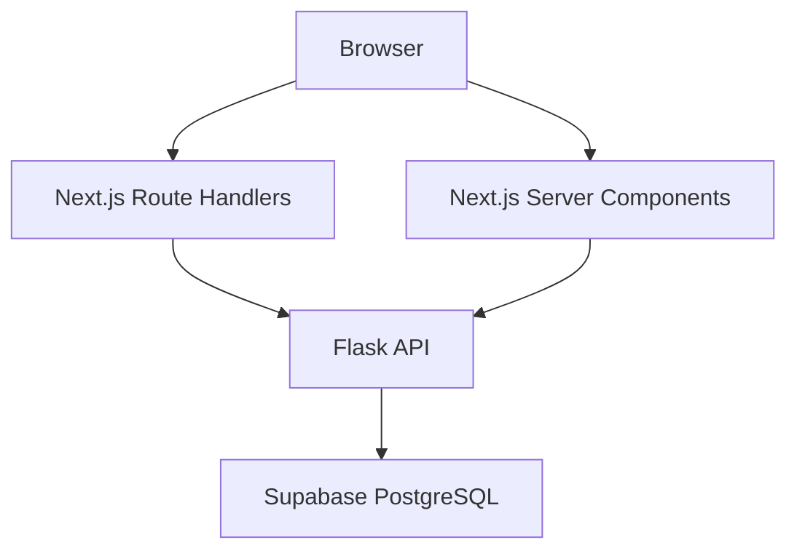

# RevoTask Design · Baseline 0.4.0

## D1. Architecture and deployment

The browser uses same-origin Next.js Route Handlers for interactive requests. Protected Server Components call Flask directly from the server using the same server-side fetch helper. Flask runs from the same `backend/Dockerfile` locally (through Docker Compose) and on Render as a Docker Web Service. Flask on Render owns API authorization and persists data in Supabase PostgreSQL through SQLAlchemy. The browser gets public UI configuration and calls relative `/api/...` paths. Flask API documentation remains independently usable with a bearer token for Postman and tests.

See the [acceptance and endpoint ownership maps](traceability.md) for the links from design to implementation and tests. The repository has one Git history, separate dependency locks, release notes and spec indexes for backend/frontend, and a shared behavioral/API contract. See the [backend API contract](../backend/specs/api-contract.md) and [Blueprint architecture](../backend/specs/architecture.md). See the [deployment runbook](../docs/DEPLOYMENT.md).

## D2. Authentication and authorization

- Flask normalizes email with trim and lowercase, enforces a DB unique constraint, hashes passwords with Argon2id via a maintained library, and issues a 60-minute access JWT with a UUID string subject, `exp` and `jti`. Register validates a password of 8–10 characters with at least one uppercase letter, one lowercase letter and one special character. Login accepts any password of 1–10 characters and applies no composition rule. Return a uniform 401 for invalid credentials. Rate-limit public login/register routes and return 429. Document the limiter storage used and keep a shared store if deploying multiple instances. Local development uses in-memory storage with one Gunicorn worker (Compose), so the counters are exact locally. Shared storage and trusted client address handling are production-release items (T16), and more workers must wait for shared storage.
- On browser login, the Next handler consumes Flask's token response and sets the host-only `revotask_session` cookie with HttpOnly, SameSite=Lax, Path=/, no Domain, and lifetime no longer than the token's expiry. It is Secure on deployed HTTPS. Plain HTTP is allowed only for an explicitly configured loopback development origin. The browser receives the public user only. `AuthContext` holds a safe user DTO for interactive consumers. Load or refresh it using the session/profile endpoint. Public login remains reachable with a stale cookie.
- Next rejects POST/PATCH/DELETE requests when Origin fails exact same-origin validation against the request's trusted deployment origin, and a missing `Origin` is rejected with 403. Validate JSON shape and forward only declared paths/methods to a fixed server-side `API_BASE_URL`. Forward the session bearer and an application request ID. Never forward arbitrary URLs, caller-supplied bearer headers or upstream redirects. Private data uses `Cache-Control: private, no-store` and upstream fetch uses `cache: 'no-store'`. Mutating Next handlers verify Origin before forwarding.
- Flask validates JWT signature/expiry and blocklist status before feature access. Logout writes a revocation record keyed by `jti` and expiry. The Next handler clears the cookie after successful revocation or when the token is already invalid. An upstream failure returns a retryable error so the UI does not report a completed logout. Expired revocation rows can be cleaned periodically. A BFF 401 on an authenticated path clears the cookie. A Server Component receiving a 401 redirects to the login page, which tolerates a stale cookie, since cookie mutation belongs in a Route Handler. Use safe local redirect destinations.
- Board creator has an admin membership. Every board query scopes active records by board membership and follows the parent chain for nested resources. Authenticated nonmembers and removed members get the same 404 as a missing or deleted board on board-scoped routes (contract clarification C1), so board IDs are not disclosed. Missing/deleted resources get 404. E11 with an unregistered email returns 404 `USER_NOT_FOUND`, only after the caller is confirmed as an admin of the board (accepted account-enumeration risk for v1; per-admin E11 rate limit with shared storage in T16). The comment author check applies to edit/delete even for board admins. All board mutations lock the board row, then recheck membership, so removals and concurrent writes serialize. Return 403 for role violations by a current participant.

## D3. Data model

See the [backend data model](../backend/specs/data-model.md) for field types, foreign keys, indexes and migration checks. Use UUID primary keys and UTC `TIMESTAMPTZ` audit timestamps. Mutable domain tables use `created_at`, `updated_at` and nullable `deleted_at` where soft deletion is supported. Session revocations and activity events are operational records with only their relevant timestamps.

| Table | Fields and invariants |
|---|---|
| `users` | `name`, normalized unique `email`, `password_hash`. Public DTO is an allowlist. |
| `boards` | `name`, creator FK, nonnegative integer `position_version` default 0, nullable `sprint_start` and `sprint_end` dates (both null or both set, end on or after start, at most 90 days inclusive; constraint `ck_boards_sprint_range_valid`). |
| `board_members` | `board_id`, `user_id`, `role` = admin/member. Composite unique pair. Re-add reactivates the same membership. No admin removal in v1. |
| `board_columns` | `board_id`, `name`, `is_done`, `order` mapped to double-precision float. Partial unique index on active Done columns per board. |
| `cards` | `column_id`, `title`, nullable `description`, nullable `assignee_id`, `order` as double-precision float. Validate assignee membership inside the transaction. |
| `card_comments` | `card_id`, `author_id`, `content`. |
| `notifications` | `recipient_id`, `actor_id`, `board_id`, `card_id`, `kind`, nullable `read_at`. List and count use the same active board, membership, card and column filters. |
| `board_events` | `board_id`, `actor_id`, nullable `card_id`, `kind`, `occurred_at`. Persist selected create/move/comment events and a dedicated `entered_done` event when a card enters Done, including creation directly in Done. |
| `revoked_tokens` | Unique JWT `jti`, `expires_at`. Never store JWT values. |

Relationships such as `BoardColumn.cards` and `Card.column` use explicit `back_populates`. Use active filters across the resource and ancestors. Soft-delete a board by hiding its entire tree through parent filtering. A column can be deleted or have its Done flag changed only when empty of active cards. Add indexes to membership lookup, active child order, assignee, recipient unread timeline, and board event timestamps. Verify migrations on fresh and prior-schema PostgreSQL. Use an app-private schema and database roles scoped to their responsibilities.

## D4. Ordered Kanban operations

1. The client sends `expected_position_version` and a destination anchor. A card move supplies target `column_id` and nullable `before_card_id`. A column move supplies moved `column_id` and nullable `before_column_id`. Null means append.
2. Begin a transaction, lock the board row, recheck membership, role and the addressed resource under the lock (404 when it is gone), and then compare versions. Return 409 with a stable error code on mismatch, before any destination check. Verify the anchor is active and in the destination, reject self-anchors and reject cross-board moves with a generic 400 and without writing. A position that does not change returns the authoritative list and writes nothing.
3. Exclude the moving row and sort siblings by `(order, id)`. Allocate midpoint for an interior insertion, half the first value when prepending, and last value plus 1024 for append. Use 1024 when empty. If the candidate is nonfinite, nonpositive, or fails strict neighbor ordering due to precision, rebalance destination siblings to 1024, 2048, … inside the same transaction and recalculate. Enforce finite positive order values in DB constraints.
4. Save the authoritative order and destination, and increment `position_version`. Card/column creates and deletes also increment it as part of the same board lock. Create the matching audit event in the transaction, only when the position changed. Return the new version and authoritative ordering for affected lists, including rebalanced siblings.
5. The client snapshots affected state, applies the move optimistically and serializes board position mutations for the active UI. On success it applies the authoritative response. On failure it restores the snapshot and shows feedback. A stale version or uncertain network outcome triggers a canonical board refetch.

## D5. UI and integration

See [pages and components](../frontend/specs/pages-and-components.md), [API integration](../frontend/specs/api-integration.md) and [error handling](../frontend/specs/error-handling.md) for the layer implementation requirements.

| UI | Boundary and behavior |
|---|---|
| `/register`, `/login` | Pages render server-side shells with client form components, inline field errors and a pending state. |
| `/` | Protected Server Component lists boards. A client dialog creates a board. |
| `/boards/[id]` | Protected Server Component fetches initial board data. `KanbanBoard` is a client island for interaction. Use native desktop drag with stable drop zones and a visible Move action for touch and keyboard. Both dispatch one move function. |
| Card detail | Client `CardDetailModal` composes `BaseModal`, the card edit form and a props-driven `CommentList`. It opens from the card title and replaces `CardEditDialog`. The modal owns form and comment state, loads E23 through a same-origin `GET` handler when it opens and uses local pending state, not the board gate. |
| `/my-tasks` | Protected Server Component groups assignment results by board in API order and links the group heading and each row back to board detail (no card deep link). |
| `/profile` | Protected page with a controlled client form seeded by the public profile. A save updates the profile UI and safe user context. |
| Board tools and header | Admin member controls, 300 ms debounced card search with abort or latest-request guard (independent of the Kanban gate, results resolved against the live board state), analytics panel, and notification polling every 30 seconds with cleanup. Marking read immediately refreshes list and count. |

Share `BaseButton`, `BaseBadge` and `BaseModal` using daisyUI class names. Use semantic labels and keyboard focus handling. For component props, code imported into a client graph becomes part of that graph even when the file has no client directive. See [frontend guidelines](../guidelines/frontend.md).

## D6. Reporting, error handling and operations

- Search is board-scoped, case-insensitive, by card title. Escape wildcard literals and cap to 20 results. My Tasks uses active membership, includes Done cards, and is sorted by case-insensitive board name, board ID, column order, card order and card ID, so groups appear in that order. E21 and E22 are read-only (no lock, event or version change) and reject a missing, repeated or unknown query parameter with 400. The shell shows the Boards and My tasks links at every width.
- Notify the assignee for a new assignment by another user, or a new comment from another user on an assigned card. Create notifications in the same DB transaction as the triggering change. Do not generate a notification when re-saving the same assignee.
- Analytics counts current active cards per active column using a left join. Use the board's sprint window (UTC start of `sprint_start` to the UTC start of the day after `sprint_end`) when the board has a sprint, and UTC Monday-to-Monday otherwise. Count distinct card IDs with `entered_done` in the week that are still active cards in an active Done column, so a card moved out of Done or deleted stops counting. For activity, count the board events of the four kinds `card_created`, `card_moved`, `column_reordered` and `comment_created` in the week, grouped by actor and including former board members. `entered_done` is used for the completed count only, so completing a card adds one activity event. Aggregate separately before composing the response to prevent inflated counts.
- Standardize errors via the [API contract](../docs/API.md). Global Flask handlers log request ID, route, error code and safe actor ID where available. The Next client maps typed errors to form feedback, login redirects, conflict refresh, or toast. Use a visible error state if the error affects the whole page.
- Health checks confirm database connectivity with a bounded query. Build isolated fixtures and keep production logs and test artifacts free of secrets.

## D7. Design decisions relative to the handbook

| Topic | Decision |
|---|---|
| Hosting | Render hosts Flask, Supabase hosts PostgreSQL, Vercel hosts Next.js. |
| Token flow | Same-origin Next.js handlers and HttpOnly cookie make the same session available to Server Components. Public user data is sufficient for UI context. Flask keeps bearer-token compatibility. |
| Position input | API accepts stable destination anchors and a version. Flask computes the positive FLOAT order. This changes the handbook's client-supplied order contract while preserving the route and persisted floating-point order. |
| Relationships and password serialization | Explicit SQLAlchemy `back_populates` gives both models a declared relationship. Public DTO allowlists and explicit forbidden-field validation enforce password exclusion. |
| Reviews | Check architectural responsibilities and actual findings. Record actual review counts and rubric differences in evidence. |

References: [Next.js authentication](https://nextjs.org/docs/app/guides/authentication), [Next.js cookies](https://nextjs.org/docs/app/api-reference/functions/cookies), [OWASP CSRF](https://cheatsheetseries.owasp.org/cheatsheets/Cross-Site_Request_Forgery_Prevention_Cheat_Sheet.html), [OWASP password storage](https://cheatsheetseries.owasp.org/cheatsheets/Password_Storage_Cheat_Sheet.html), [WCAG dragging movements](https://www.w3.org/TR/WCAG22/#dragging-movements).
